# picomusic

**Seven instruments on one Raspberry Pi Pico 2 platform: a tonewheel organ, an analog synthesizer, a string machine, a bass synthesizer with step sequencer, a drum machine, a sampled piano and a six-operator FM (DX7) synthesizer.** One repository, one hardware "tower", one `platformio.ini`: you pick the instrument by picking the PlatformIO environment.

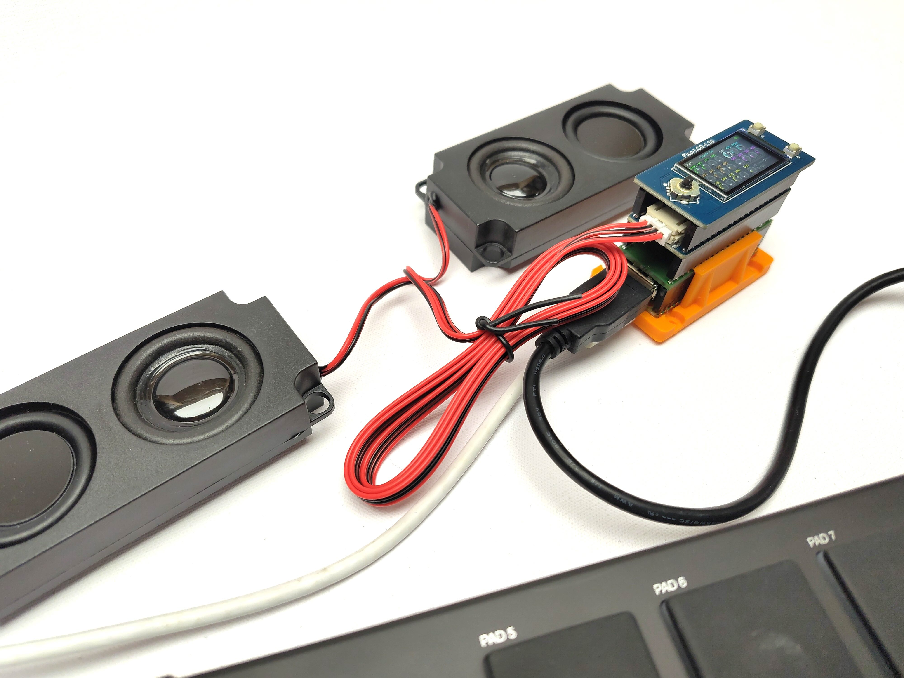

*Every instrument runs on the same tower: Pico 2 at the bottom, the USB shield (the PCB in this repository: MIDI in and USB host), the Waveshare Pico-Audio shield, and the Waveshare Pico-LCD-1.14 on top.*

```bash
pio run -e piano -t upload        # or tonewheel / synth / strings / bass / drums / dx7
```

| Instrument | Environment | What it is | Polyphony | Played with | Flash / RAM used |  Pre-listen |
|---|---|---|---|---|---|---|
| [Tonewheel organ](#5-tonewheel-organ) | `tonewheel` | Hammond-style, nine drawbars, percussion, key click, overdrive, vibrato, chorus, Leslie | 16 notes | its own keyboard unit (UART/J2), or MIDI keyboard | 110 KB / 120 KB RAM | [mp3](audio/demo_tonewheel.mp3) |
| [Analog synthesizer](#6-analog-synthesizer) | `synth` | two wavetable oscillators + noise, 4-pole ladder filter, two ADSR, LFO, glide, overdrive | 12 notes (pool 20) | AKAI MPK mini | 102 KB / 131 KB RAM | [mp3](audio/demo_synth.mp3) |
| [String machine](#7-string-machine) | `strings` | ARP/Solina-style ensemble: five registrations, 3-tap ensemble chorus, pizzicato | 16 notes (pool 24) | AKAI MPK mini | 103 KB / 116 KB RAM | [mp3](audio/demo_strings.mp3) |
| [Bass synthesizer + sequencer](#8-bass-synthesizer-and-sequencer) | `bass` | Moog-style: three oscillators + sub + noise, exact ladder, 303-style step sequencer | mono | AKAI MPK mini | 159 KB / 105 KB RAM | [mp3](audio/demo_bass.mp3) |
| [Drum machine + sequencer](#9-drum-machine-and-sequencer) | `drums` | 808-style voices, grid / pattern / song pages, swing, MIDI clock | — | AKAI MPK mini pads | 154 KB / 123 KB RAM | [mp3](audio/demo_drums.mp3) |
| [Sampled piano](#10-sampled-piano) | `piano` | Salamander grand (and Rhodes, clavinet) as 4-bit ADPCM in flash, wah / tremolo-pan / chorus / reverb | 24 notes (pool 32) | AKAI MPK mini | 2.97 MB (74 %) / 162 KB RAM | [mp3](audio/demo_piano.mp3) |
| [DX7 FM synthesizer](#11-dx7-fm-synthesizer) | `dx7` | six sine operators, the 32 DX7 algorithms, DX7 SysEx banks, the piano's effects | 12 notes (pool 16) | AKAI MPK mini | 113 KB / 211 KB RAM | [mp3](audio/demo_dx7.mp3) |

*Flash and RAM are the figures PlatformIO printed for the shipped build (4 MB Pico 2). Every environment also exists as `<name>_nohost`: the same firmware with the USB host switched off.*

## Where things stand

All seven instruments build and have been **tested and confirmed working on the hardware** (tower: Pico 2, USB shield, audio shield, LCD shield). The tonewheel organ is the only one that has been built with its own keyboard (it also plays from an AKAI MPK mini, see its *AKAI knob map*); the others have been interfaced and tested mostly with an **AKAI MPK mini** on the USB host port. Errors are left that have not been chased yet (see [Known issues](#15-known-issues-and-what-is-next)); most of the numbers in this document (timing, levels, pitch, polyphony, protocol behaviour) were measured on a PC by compiling the real firmware sources against mocks (see [Testing](#12-testing)), **not** on the Pico. The DX7 is new in this repository; it has been played on the tower and works.

## Listen first

Each demo is rendered offline by the *real engine* on a PC (before the DAC, so it is what the firmware computes). They are MP3 copies of the WAV files that used to sit in each project's `docs/`.

| Instrument | File | Length |
|---|---|---|
| Bass synthesizer | [`audio/demo_bass.mp3`](audio/demo_bass.mp3) | 37 s, Moog bass groove, acid line, sub pulse, swung pluck |
| Drum machine | [`audio/demo_drums.mp3`](audio/demo_drums.mp3) | 39 s |
| String machine | [`audio/demo_strings.mp3`](audio/demo_strings.mp3) | 41 s, ensemble chords, violins with pedal, cello + bass, pizzicato |
| Sampled piano | [`audio/demo_piano.mp3`](audio/demo_piano.mp3) | 32 s |
| DX7 FM synthesizer | [`audio/demo_dx7.mp3`](audio/demo_dx7.mp3) | 32 s, electric piano, bass, bells, marimba, brass, strings, saw lead, vibes (`tests/dx7/render.cpp`) |
| Tonewheel organ | [`audio/demo_tonewheel.mp3`](audio/demo_tonewheel.mp3) | 30 s, jazz registration with slow Leslie, fast-Leslie riff with chorus, overdriven lead, flutes (`tests/tonewheel/render.cpp`) |
| Analog synthesizer | [`audio/demo_synth.mp3`](audio/demo_synth.mp3) | 29 s, arpeggio with a filter sweep, pad chords, bass groove, glide lead (`tests/synth/render.cpp`) |

## Contents

1. [The tower: the hardware every instrument runs on](#the-tower)
   - [The stack](#stack) · [The USB shield (the PCB)](#usb-shield) · [Pin map](#pin-map) · [The two Pico-Audio boards](#audio-boards) · [LCD, joystick, buttons](#lcd-shield) · [Power and noise](#power-and-noise) · [What has been built](#what-has-been-built)
2. [Building and flashing](#building)
3. [How the firmware is built (the architecture all instruments share)](#architecture)
4. [Playing any instrument: what they have in common](#common-use)
5. [Tonewheel organ](#5-tonewheel-organ)
6. [Analog synthesizer](#6-analog-synthesizer)
7. [String machine](#7-string-machine)
8. [Bass synthesizer and sequencer](#8-bass-synthesizer-and-sequencer)
9. [Drum machine and sequencer](#9-drum-machine-and-sequencer)
10. [Sampled piano](#10-sampled-piano)
11. [DX7 FM synthesizer](#11-dx7-fm-synthesizer)
12. [Testing](#12-testing)
13. [Tools and hardware files](#13-tools-and-hardware-files)
14. [Repository layout, licences and credits](#repository-layout)
15. [Known issues and what is next](#15-known-issues-and-what-is-next)


---

<a id="the-tower"></a>
## 1. The tower: the hardware every instrument runs on

All seven instruments run on the same hardware. Nothing about the instrument is in the hardware: it is chosen by the firmware you flash.

<a id="stack"></a>
### 1.1 The stack

```
[ Pico-LCD-1.14 ]   <- top      Waveshare, 240x135 ST7789, joystick + buttons A / B
[ Pico-Audio    ]               Waveshare, I2S DAC, 3.5 mm stereo out (two board versions!)
[ USB shield    ]               the PCB in hardware/tower-pcb: MIDI in (3.5 mm TRS) + USB-A host
[ Pico 2        ]   <- bottom   Raspberry Pi Pico 2 (RP2350)
```

| Layer | Part | What it gives the firmware |
|---|---|---|
| bottom | **Raspberry Pi Pico 2** (RP2350, dual Cortex-M33, FPU, three PIO blocks, 520 KB RAM, 4 MB flash) | everything runs here. A Pico 1 (RP2040) cannot be used: the audio driver needs the third PIO block and the audio code the M33 FPU and cycle counter |
| | **USB shield** (this repository, `hardware/tower-pcb/`) | opto-isolated **MIDI in** on a 3.5 mm TRS jack, a **USB-A host socket**, a 3-pin MIDI header; see [1.2](#usb-shield) |
| | **Waveshare Pico-Audio** | I2S DAC and 3.5 mm line / headphone output. **Two board versions exist and the wrong setting is silent**: [1.4](#audio-boards) |
| top | **Waveshare Pico-LCD-1.14** | the 240x135 display, a five-way joystick and two buttons |


*The assembled module in a printed holder (photographed with an earlier hand-wired USB board; the tower now carries the PCB below): LCD board with joystick and two buttons on top, the audio board in the middle, the Pico 2 at the bottom. The speakers connect to the audio board, the USB cables carry the host connection and the Pico's own USB port.*

<a id="usb-shield"></a>
### 1.2 The USB shield (the PCB)

The PCB in [`hardware/tower-pcb/`](hardware/tower-pcb/) (KiCad 9 project, [`schematic.pdf`](hardware/tower-pcb/schematic.pdf), [`pcb.pdf`](hardware/tower-pcb/pcb.pdf)) sits between the Pico 2 and the audio shield and carries the two things every instrument needs besides sound: **MIDI in** and a **USB host port**. It uses exactly three Pico pins and passes the rest of the Pico's pins on to the shields above.

| Function | Pico pin | Circuit |
|---|---|---|
| **MIDI in** (31 250 baud, UART1 RX) | **GP5** | 3.5 mm TRS jack `CN1` (PJ-3220-Y) -> 220 Ω `R1` / `R2` -> dual opto-coupler **HCPL-0631-500E** (`U1`) -> 1 kΩ `R3` -> GP5. The two input LEDs are connected anti-parallel, so the input does not care which way the TRS-MIDI adapter is wired (type A or B). 100 nF on the jack sleeve (`C1`) and on the opto's 3.3 V supply (`C2`) |
| **USB host D+** | **GP6** | `J1` USB-A -> 22 Ω series `R6` -> GP6, 15 kΩ pull-down `R4` to GND |
| **USB host D−** | **GP7** | `J1` USB-A -> 22 Ω series `R7` -> GP7, 15 kΩ pull-down `R5` to GND |
| **VBUS for the host port** | 5 V (VBUS / VSYS) | through the polyfuse `F1` (Yageo SMD1210B075TF, 0.75 A hold) to `J1` pin 1 |
| **3-pin header `J2`** | 3V3 / GP5 (`MIDI_IN`) / GND | a 3.3 V-logic MIDI source (for example the tonewheel organ's keyboard unit) plugs in here and bypasses the opto: pin 1 = 3.3 V, pin 2 = MIDI_IN, pin 3 = GND |

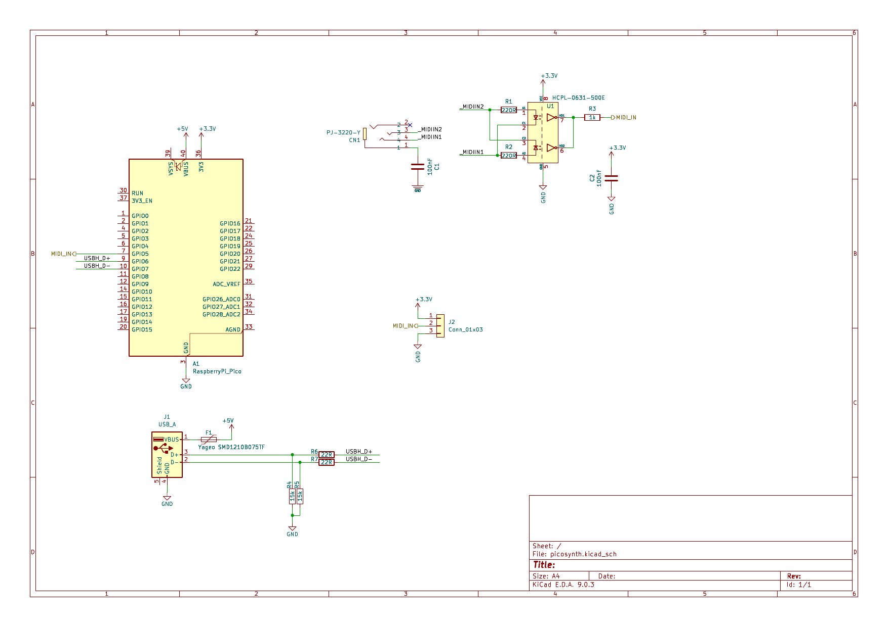

*Schematic (KiCad 9.0.3). The three Pico connections are at the left: `MIDI_IN` = GPIO5, `USBH_D+` = GPIO6, `USBH_D−` = GPIO7.*

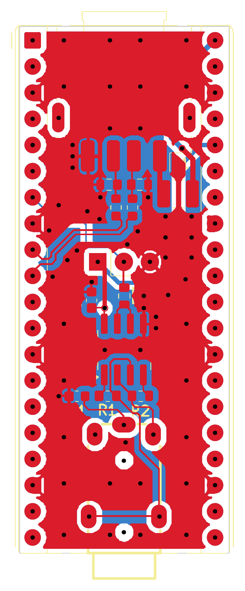

*Board layout (`pcb.pdf`, cropped). The board has the footprint of a Pico.*

Why these parts: the **15 kΩ pull-downs on both data lines** are what the USB specification asks of a host (the pre-PCB builds only had one, on D+); the **22 Ω series resistors** damp the edges of the PIO-generated USB signals; the **polyfuse** protects the Pico's 5 V rail from a shorted or greedy device. The firmware enables the Pico's internal pull-up on GP5, which the opto-coupler's open-collector output needs (check on a new board: GP5 must idle **high** with nothing plugged in).

Using it: **MIDI in** takes a normal MIDI cable through a DIN-5-to-TRS adapter, or any 3.5 mm TRS-MIDI device. The **USB-A socket** takes one class-compliant USB-MIDI keyboard or controller, directly or through a hub (the vendored PIO-USB host does not reliably support *two* devices behind one hub). The **Pico's own micro-USB port** is a USB-MIDI *device* port towards a computer, and is also how you flash and read the serial console. All three MIDI inputs work at once and are merged.

> The component values above are read from the schematic. Not checked on a board: the output of the opto-coupler (`U1` pin 7) feeds GP5 through `R3` with no separate pull-up on the schematic, so it relies on the Pico's internal pull-up; measure GP5 idle-high on your own board before trusting a MIDI cable.

<a id="pin-map"></a>
### 1.3 Pin map

Only **GP5, GP6 and GP7** are wired by the USB shield. Everything else is fixed by the two Waveshare boards, and there is no conflict between them.

| Function | GPIO |
|---|---|
| I2S audio (Pico-Audio, hard-wired) DIN / BCK / LRCK | **Rev 2.1:** GP22 / GP26 / GP27 · **Initial Version:** GP26 / GP27 / GP28 |
| LCD (SPI1): SCK, MOSI, CS, DC, RST, backlight | GP10, GP11, GP9, GP8, GP12, GP13 |
| Joystick UP, DOWN, LEFT, RIGHT, PRESS (active low, internal pull-ups) | GP2, GP18, GP16, GP20, GP3 |
| Buttons A, B (active low) | GP15, GP17 |
| MIDI in (UART1 RX, 31 250 baud) | GP5 |
| USB host D+, D− (PIO-USB) | GP6, GP7 |
| LED | GP25 |

PIO blocks: **PIO2** is the audio (I2S) state machine; **PIO0** carries the USB host's TX and **PIO1** its RX. The Pico's native USB port (TinyUSB device) uses the hardware USB controller.

<a id="audio-boards"></a>
### 1.4 The two Pico-Audio boards

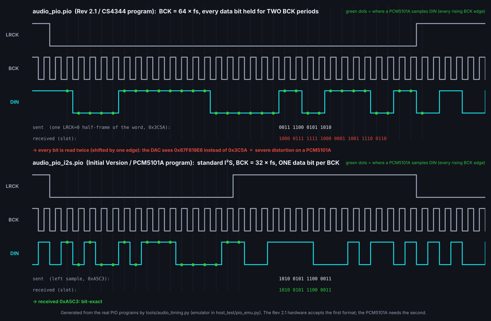

Two different Waveshare Pico-Audio boards exist. They carry different DACs and different pinouts, and software cannot tell them apart: **the wrong setting is silent**. Check the PCB: the later board has "Rev2.1" printed on it.

| | Rev 2.1 | Initial Version |
|---|---|---|
| Marking | "Rev2.1" on the PCB | none |
| DAC | CS4344 | PCM5101A |
| DIN / BCK / LRCK | GP22 / GP26 / GP27 | GP26 / GP27 / GP28 |
| PIO program | `audio_pio.pio`: BCK = 64 × fs, each data bit held for two BCK periods | `audio_pio_i2s.pio`: standard I2S, BCK = 32 × fs, one data bit per BCK |
| `rev2_1` in `platformio.ini` | `1` | `0` (**the default in picomusic**) |

**One switch for all seven instruments:** the `[audio]` section at the top of [`platformio.ini`](platformio.ini):

```ini
[audio]
rev2_1 = 0        ; 0 = "Initial Version" (PCM5101A)   1 = "Rev2.1" printed on the PCB (CS4344)
```

It becomes `-DAUDIO_BOARD_REV2_1=...` for every environment. It selects **both the pins and the PIO program**. (Each instrument's `config.h` still has a fallback default of 1; the `platformio.ini` value always overrides it.) The boot banner on the serial console and the `pio` command name the selected board, its pins and the BCK frequency (2822.4 kHz for the Rev 2.1, 1411.2 kHz for the Initial Version).

**Why two programs.** The Rev 2.1 program changes DIN only every second BCK period, and the Rev 2.1 accepts that. The PCM5101A clocks DIN in on **every** rising BCK edge ("serial data is clocked into the PCM510xA on the rising edge of BCK", TI SLAS859C), so it reads each bit twice and sounds severely distorted (figure above, top). The Initial Version therefore needs standard I2S (16-bit data at BCK = 32 × fs is on the datasheet's list) and it generates its own system clock from BCK, so no MCLK is needed. `firmware/shared/audio_driver.h` swaps the left/right half-words for the I2S program so that left stays left.

Both boards have been confirmed on hardware (the driver is the same in every instrument). On a PC the driver is tested end to end: the real `audio_driver.h` runs against a mocked pico-sdk PIO API, what it programs is replayed through a PIO emulator and decoded by an I2S receiver model (`tests/run_tests.sh <instrument>` includes it).

<a id="lcd-shield"></a>
### 1.5 LCD, joystick and buttons

The Pico-LCD-1.14 shows each instrument's 240×135 panel (rendered by the firmware's own small framebuffer code, one rectangle per loop pass, so the display never disturbs MIDI). Joystick and buttons are shared by every instrument and read with the same debouncer: **LEFT / RIGHT** select a parameter, **UP / DOWN** change it (hold for fast steps), **PRESS** auditions a note or starts/stops something, **A** and **B** do an instrument-specific job (always listed in the instrument's *Controls*). The coloured square at the top right of most panels is the audio core's CPU load: it should stay green.

<a id="power-and-noise"></a>
### 1.6 Power and noise

The tower is powered over the Pico's micro-USB (5 V). A power-hungry controller on the USB host socket can put **audible noise on the audio output** through the shared supply rail (observed with an AKAI MPK mini; a small nanoKEY never caused it). The polyfuse on the USB shield protects against shorts but does not filter: if you still hear it, power the module from a clean 5 V supply rather than a laptop USB port, or power the keyboard separately. *(Author's note, still open: how the module is powered in the finished tonewheel case.)*

<a id="what-has-been-built"></a>
### 1.7 What has been built

- **Every instrument** has been run and confirmed working on the tower (Pico 2, USB shield, Pico-Audio, Pico-LCD-1.14).
- **Only the tonewheel organ has its own keyboard**: a companion keyboard-and-control unit (RP2040 Pico, key matrix, nine drawbars, pots, switches) sends it MIDI over UART (GP5 / header `J2`). See [Keyboard and control unit](#tonewheel-22-keyboard--control-unit-companion-project) and the case files in [`hardware/tonewheel-case/`](hardware/tonewheel-case/).
- **All the others** have been interfaced and tested mostly with an **AKAI MPK mini** on the USB host port, with its factory knob program (K1..K8 = CC1..CC8, see [4](#common-use)); the drum machine also uses its pads and the sequencers its transport.

---

<a id="building"></a>
## 2. Building and flashing

**Toolchain.** VS Code + PlatformIO (or the PlatformIO CLI). The platform is `https://github.com/maxgerhardt/platform-raspberrypi.git` with the Arduino framework and the **earlephilhower** core (board `rpipico2`); libraries (Adafruit TinyUSB, FortySevenEffects MIDI) are fetched automatically; the PIO-based USB host library is **vendored** in `lib/pio_usb/` (Pico-PIO-USB v0.5.3 plus a small compatibility stub). `lib/pio_usb/` must be complete (14 files, including `pio_usb_ll.h`), otherwise TinyUSB's `hcd_pio_usb.c` fails with `pio_usb_ll.h: No such file`.

**Choose the instrument by choosing the environment:**

```bash
pio run -e tonewheel -t upload      # also: synth  strings  bass  drums  piano  dx7
pio device monitor                  # serial console, 115200 baud
```

In VS Code pick the environment in the status bar. The default (plain `pio run`) is `tonewheel`.

How `platformio.ini` is organised (read the file, it is commented):

- `src_dir = firmware`. Every instrument's own sources live in `firmware/<instrument>/`; what several instruments share lives in `firmware/shared/` (the audio driver and its PIO programs, the USB host glue, the wavetable code of the drum machine and string machine, and the effects of the piano and DX7). An environment compiles `firmware/<instrument>/` plus the shared files it names: `build_src_filter = -<*> +<piano/>` (and `+<shared/wavetable.cpp>` where needed). The headers are found through two `-I` paths in the environment's `build_flags` (`firmware/shared` for everyone, `firmware/<instrument>` for its own).
- `[base]` is the platform and libraries, `[flags]` the flags every build gets, `[host]` / `[nohost]` the two clock/USB settings, `[audio]` the one-line audio-shield switch.
- **`<instrument>`** = USB host on, **240 MHz** (this gives exact integer PIO clock divisors for USB full speed; the audio divisor is computed at run time from the real system clock, so pitch is unaffected). **`<instrument>_nohost`** = USB host off, 200 MHz: audio and MIDI from the Pico's own USB port or the TRS input only.
- Flash use: `bass` and `drums` reserve 0.5 MB of flash as a **LittleFS** partition for saved patterns and the kit; the **piano** needs almost the whole 4 MB for its samples (~3.1 MB, no filesystem); the others use roughly 100–160 KB.

**First time:** hold **BOOTSEL** while plugging the Pico 2 into the computer, upload, and from then on the upload works without BOOTSEL.

**First power-on, any instrument** (each instrument's chapter has its own checklist on top of this):

1. The LCD lights. The serial banner (115200 baud) has an `audio shield:` / `Audio:` line: **if it does not name your board, change `rev2_1` in `platformio.ini`** and re-flash. The wrong setting is silent (or badly distorted), not subtly off.
2. Type `help` on the serial console; `on 60` plays a middle C, `off 60` releases it; `stat` or `perf` prints the CPU load; `log notes` prints every MIDI note that arrives.
3. Plug in the USB keyboard: the console prints `MIDI mounted` (host) and the notes you play.
4. The CPU square on the panel stays **green**.

---

<a id="architecture"></a>
## 3. How the firmware is built (the architecture all instruments share)

All seven instruments follow the same design, so a fix in one carries over to the others.

- **Two cores.** *Core 0* runs `loop()`: MIDI (USB device, USB host, UART), the LCD and joystick, the serial console, and all the maths that needs `libm` (pow, exp, tan, sin ...). It never waits (`delay()` is not used). *Core 1* runs `loop1()` and does nothing but audio: it fills a 256-frame buffer, 44.1 kHz stereo, and feeds the I2S PIO FIFO, which also **paces the loop**. `loop1()` lives in SRAM (`__not_in_flash_func`) and every hot function it calls is force-inlined, so no audio sample ever waits for the flash cache.
- **Core 0 prepares, core 1 only adds and multiplies.** A note-on is turned into everything the audio core needs (phase increments, gains, filter coefficients, envelope targets) on core 0, then handed over; core 1 calls no libm and takes no locks.
- **No locks.** Core 0 -> core 1 goes through **single-producer / single-consumer** rings of events and through single words each valid on its own; core 1 -> core 0 through a few counters and bitmasks for the display. Panic and all-notes-off are *counters*, not events, so a full ring can never drop them. This is what the two-thread tests hammer.
- **Control rate.** Envelopes, LFOs and parameter smoothing advance once per 16 samples (2756 Hz, `CONTROL_DIV`) and are interpolated per sample.
- **Voice pool and stealing.** Every polyphonic instrument has a *polyphony limit* (notes that hold, are pedalled or release) and a slightly bigger *pool*; the spare slots let a stolen voice fade out in a few milliseconds instead of being cut (a click). A re-struck key fades its old voice the same way.
- **MIDI input.** One parser (`midi_handler.h`) for the UART and for USB-MIDI packets, so the USB device port, the USB host and the TRS input behave identically: running status, note-on with velocity 0 = note-off, system real-time bytes parsed out of the stream (a clock byte can never corrupt a note), channel filter (`MIDI_CHANNEL`, 0 = omni). The USB host glue (`firmware/shared/usb_host.h`) is a few lines around the same, host-tested parser.
- **Load governor / honest load display.** Each instrument measures the cycles core 1 spends per buffer with the DWT cycle counter and shows it as the CPU square (and in `stat` / `perf`).
- **Per-instrument `config.h`** holds only `#define`s (feature flags, polyphony, the audio-board fallback, voicing constants and the AKAI map).

---

<a id="common-use"></a>
## 4. Playing any instrument: what they have in common

- **MIDI.** Three inputs at once (USB device, USB host, TRS / UART), all channels (omni) unless `MIDI_CHANNEL` is set. Pitch bend ±2 semitones. Program change selects a patch / voice / instrument. CC7 volume, CC64 sustain where it makes sense, CC120 / CC123 panic / all notes off. The control-change maps are listed per instrument.
- **AKAI MPK mini.** With the factory knob program the eight knobs send **CC1..CC8**. Every instrument maps K1..K8 to its eight most useful parameters (the `AKAI_REMAP` switch in `config.h`; each chapter lists its own K1..K8), plus its own full CC map for other controllers.
- **Display.** Joystick LEFT / RIGHT select, UP / DOWN change, PRESS / A / B as listed per instrument; the panel shows the same values the knobs and the serial console change.
- **Serial console (115200).** `help` lists everything; `stat` / `perf` shows CPU; `on <key> [vel]` and `off <key>` play notes without a keyboard; `set <name> <value>` changes a parameter by its short name; `log notes|cc|all|off` prints MIDI events; `panic`; `pio` shows the audio PIO state.
- **Everything is controllable three ways:** MIDI CC, the joystick + LCD, and the serial console.


---

<a id="5-tonewheel-organ"></a>
## 5. Tonewheel organ

**Environment:** `pio run -e tonewheel -t upload` (and `tonewheel_nohost`) &nbsp;·&nbsp; **Sources:** `firmware/tonewheel/` &nbsp;·&nbsp; **Tests:** `tests/run_tests.sh tonewheel`
&nbsp;·&nbsp; **Listen:** [`audio/demo_tonewheel.mp3`](audio/demo_tonewheel.mp3)

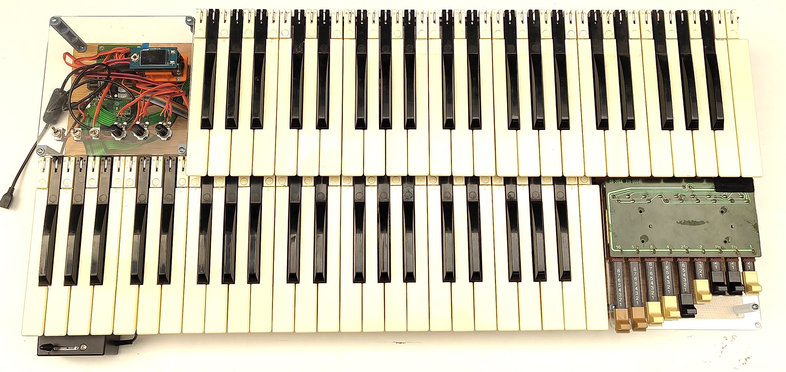

*The instrument, seen from above: two manuals, the nine drawbars (bottom right) and the control panel (top left). The sound is made by the small module shown below.*

A Hammond-style tonewheel organ sound module built on a **Raspberry Pi Pico 2 (RP2350)**: nine-drawbar polyphonic tonewheel synthesis, percussion and key click, and an effects chain with **overdrive, vibrato, chorus and a stereo Leslie rotary-speaker simulation**. It plays from a home-built keyboard unit, from any USB MIDI controller plugged into its USB-A host socket, or from a computer. A small colour LCD shows the drawbars and effect settings.

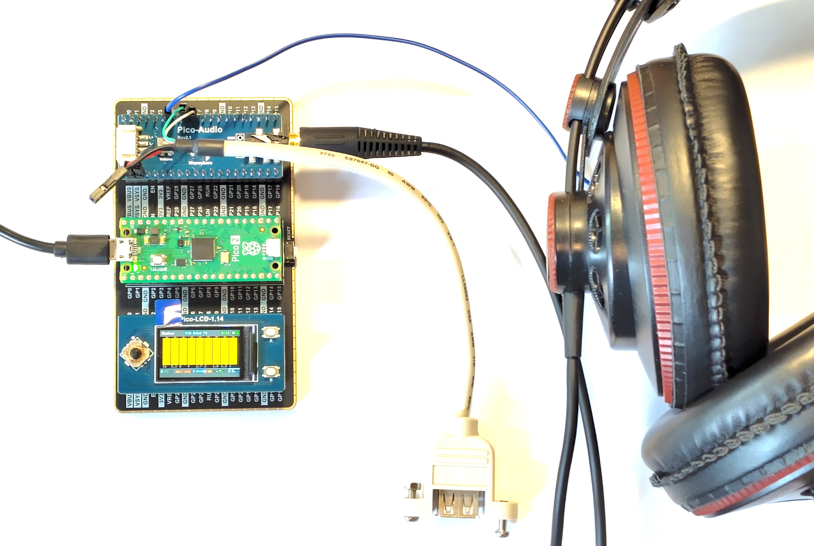

*The tone generator: the Pico 2 between the Pico-Audio (top) and Pico-LCD-1.14 (bottom) boards, the USB-A host socket on a short lead, and headphones in the 3.5 mm output. For now the boards sit side by side on a breadboard-style carrier — see [the pin map](#pin-map).*

**Highlights**

- 16-note polyphony (9 partials per note) with Hammond drawbar footages, first-note-only percussion (2nd/3rd harmonic, fast/slow, soft/normal) and key click
- Overdrive: anti-aliased tube-style clipper with loudness-following makeup
- Vibrato (authentic ±0.25 semitone scanner depth), dual-quadrature chorus
- Leslie simulation: horn + drum rotors, Doppler, two microphones, **slow / stop / fast with realistic run-up and run-down**
- Three MIDI inputs merged: UART (keyboard unit), USB host (controllers), USB device (computer)
- A **load governor** that drops notes gracefully instead of letting the pitch fall or the DAC mute
- Everything controllable three ways: MIDI CC, joystick + LCD, serial console
- Runs from SRAM on core 1; I²S audio through a PIO state machine

> **Status (November 2026):** confirmed working on the hardware. This is the one instrument that has been built with its own keyboard (see *Keyboard and control unit*); it also plays from the AKAI MPK mini. The behaviour described in this chapter was derived and measured on a PC against the real firmware sources (see the Testing part); the CPU figures have not been measured on the Pico, the voicing has not been tuned by ear, and some small errors are still to be chased.

<a id="tonewheel-1-the-big-picture"></a>
### The big picture: keyboard unit and tone generator

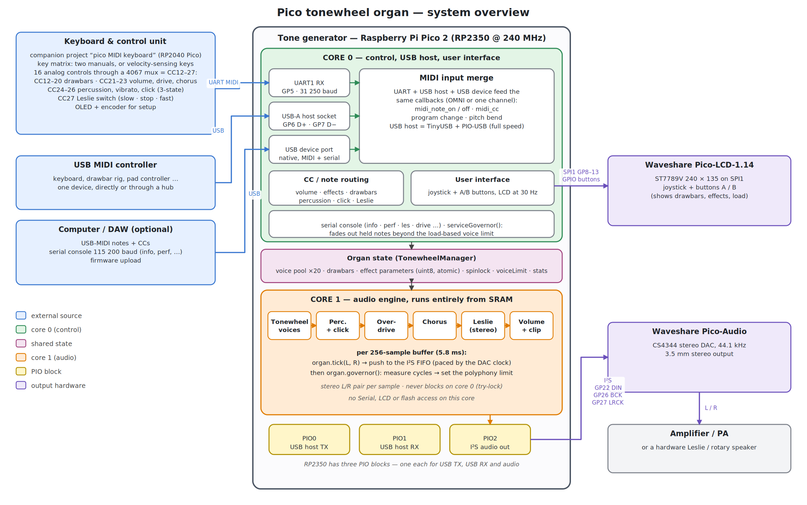

The organ is two cooperating units:

| Unit | What it does | Where |
|------|--------------|-------|
| **Keyboard & control unit** | Scans the keys, reads 16 analog controls (drawbars, pots, switches) and sends them as MIDI | companion project *pico MIDI keyboard* (RP2040 Pico) |
| **Tone generator** | Receives MIDI, synthesises and processes the sound, drives the DAC and the display | **this repository** (Pico 2) |

The tone generator accepts MIDI from **three sources at once** and treats them identically: the UART input (GP5, 31 250 baud — the keyboard unit), the USB-A host socket (one class-compliant USB MIDI device) and its native USB port (computer / DAW). Because everything is just MIDI, the sound module also works with nothing but a USB keyboard plugged in.


<a id="tonewheel-22-keyboard--control-unit-companion-project"></a>
### Keyboard and control unit (companion project)

As built by the author (see the separate *pico MIDI keyboard* repository):

- Raspberry Pi Pico (RP2040), PlatformIO / earlephilhower core
- key matrix: 12 receive lines (GPIO0–11) and 16 send lines through two **74HC238** decoders (GPIO13/14/15 + 16); two selectable layouts — a double-row keyboard (two manuals) or velocity-sensing keys with make/break contacts
- **16 analog controls through a 4067 multiplexer** into ADC0 (GPIO26; mux select GPIO17/18/19/22): nine drawbars, three pots, three three-state switches, one Leslie switch
- MIDI out on UART TX (GPIO12 in the current firmware), 31 250 baud
- OLED + M5Stack encoder on I²C (GPIO20/21) for setup

The unit is the one in the photo at the top of this page; its drawbars and control panel are shown in [Enclosure and panel](#tonewheel-23-enclosure-and-panel).

> **TODO (author):** link the keyboard-unit repository, add its BOM, schematic and photos. Document the drawbar/pot/switch wiring (which mux channel is which CC).

<a id="tonewheel-23-enclosure-and-panel"></a>
### Enclosure and panel

The drawbars and the control panel each sit on a clear acrylic plate, held on standoffs above a wooden base board.

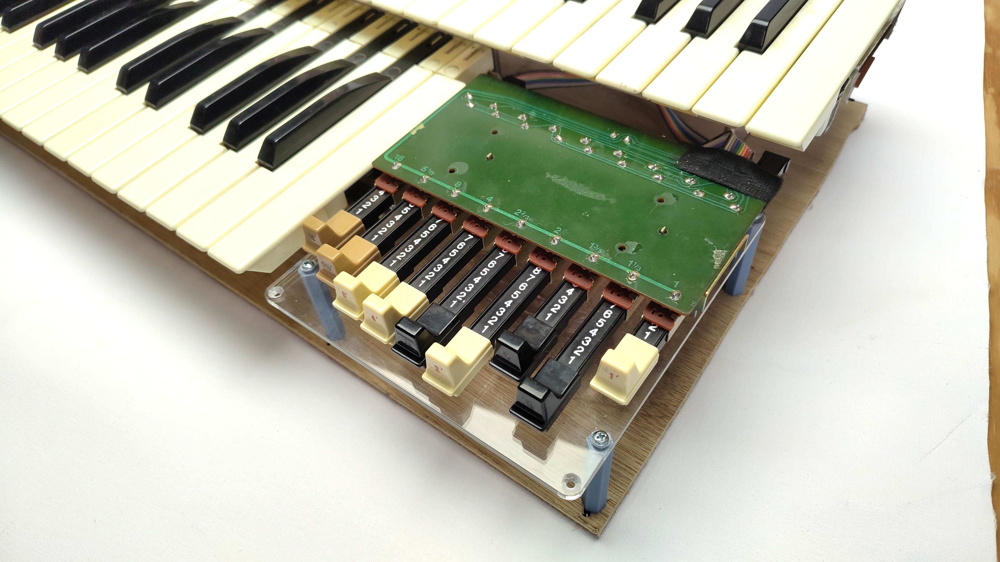

*The nine drawbars (16′ … 1′, footages printed on the circuit board) on their acrylic plate. They are read as CC12–20.*

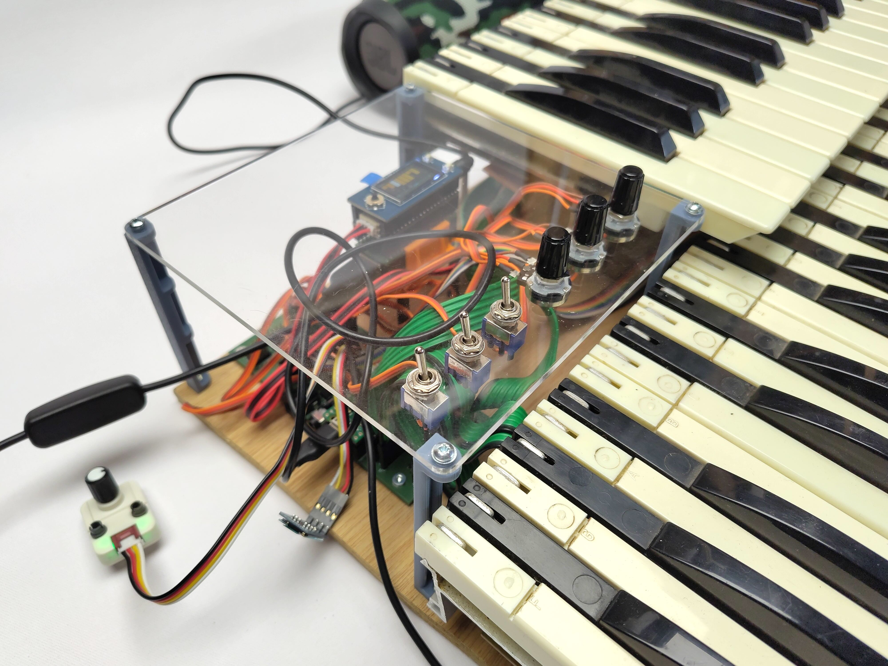

*The control panel: three pots (CC21–23), three toggle switches (the three-state switches, CC24–26) and the setup OLED on an acrylic plate; the M5Stack encoder on its lead (bottom left) is used for setup.*

The case and panel files are in [`hardware/tonewheel-case/`](hardware/tonewheel-case/): the drawbar plate drawing (SVG), the panel beam and the Pico mount (STL) and the standoffs (OpenSCAD + STL).

<a id="tonewheel-32-usb-host-socket-and-uart-link"></a>
### USB host socket and the MIDI link

> **With the picomusic USB shield** ([USB shield](#usb-shield)) the USB-A socket, the pull-downs, the polyfuse and the MIDI input are on the PCB, and the keyboard unit's TX goes to its 3-pin header **J2** (3.3 V / MIDI_IN / GND). The notes below describe the hand-wired build that came before the PCB.

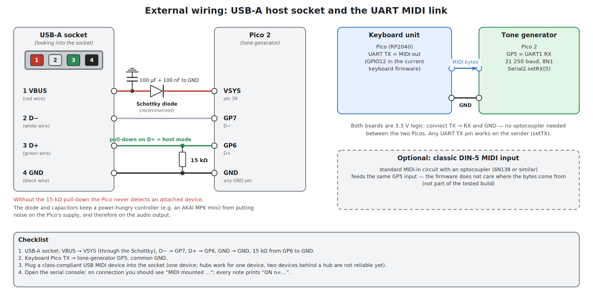

1. **USB-A socket:** D+ → GP6, D− → GP7, GND → GND, VBUS → VSYS (pin 39) — preferably through the Schottky diode with the 100 µF + 100 nF capacitors on the socket side. **Fit the 15 kΩ resistor from GP6 to GND.** Without it the Pico never sees a device attach.
2. **MIDI link from the keyboard unit:** its UART TX → GP5, plus a common ground. Both boards are 3.3 V logic, so no optocoupler is needed between them.
3. Optional DIN-5 input: any standard MIDI-in optocoupler circuit can feed GP5.

> Pin order of the USB-A socket, looking into the socket: 1 VBUS (red), 2 D− (white), 3 D+ (green), 4 GND (black).

<a id="tonewheel-34-power-and-noise"></a>
### Power and noise

A power-hungry controller on the USB host socket (the author observed it with an AKAI MPK mini; a small nanoKEY never caused it) can put **audible noise on the audio output** through the shared supply rail. The diode + capacitors in 3.2 prevent it. If you still hear noise, power the Pico from a clean 5 V supply rather than a laptop USB port.

> **TODO (author):** state how the module is powered in the finished case.

<a id="tonewheel-35-more-photos-to-add"></a>
### Photos

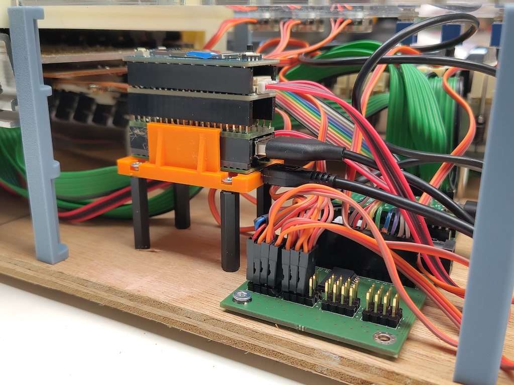

*The tone generator mounted inside the instrument: the stacked boards in an orange 3D-printed holder on standoffs, USB cables leaving at the right, the keyboard unit's wiring behind.*

> **TODO (author):** a close-up of the USB-A socket wiring (the 15 kΩ resistor, diode and capacitors); the MIDI link between the keyboard unit and the tone generator; the underside of the keyboard unit with its cabling; the whole instrument with the tone generator in place.


<a id="tonewheel-43-first-power-on-checklist"></a>
### First power-on checklist

1. The LCD lights and shows the drawbars. A green square appears at the top right (audio load).
2. In the serial monitor: `help` lists the commands; `info` prints the organ state. The boot banner has an `Audio:` line naming the Pico-Audio version — if it is not your board, switch `rev2_1` in the `[audio]` section of `platformio.ini` (see [the two Pico-Audio boards](#audio-boards)); the wrong setting is silent.
3. Plug in a USB MIDI keyboard — you should see `MIDI mounted idx=0 addr=1`, then `ON n=…` for each key.
4. Type `db 888000000` and play a note: a full gospel organ sound from both channels of the 3.5 mm output.
5. Type `perf` while holding a chord: the load split and polyphony limit appear.


<a id="tonewheel-5-playing-it-controls"></a>
### Controls

<a id="tonewheel-51-the-control-panel-and-the-midi-cc-map"></a>
#### The control panel and the MIDI CC map

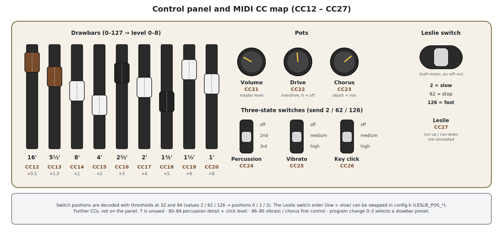

*The drawing is schematic; the real drawbars and control panel are shown in [Enclosure and panel](#tonewheel-23-enclosure-and-panel).*

| CC | Control | Range / behaviour |
|----|---------|-------------------|
| 12 – 20 | Drawbars 1–9 (16′ … 1′) | 0–127 → level 0–8 |
| 21 | Master volume | 0–127 |
| 22 | Overdrive | 0 = off, 1–127 = more |
| 23 | Chorus | one pot sets depth **and** mix together |
| 24 | Percussion switch | 2 = off · 62 = on, 2nd harmonic · 126 = on, 3rd harmonic |
| 25 | Vibrato switch | 2 = off · 62 = medium · 126 = high |
| 26 | Key-click switch | 2 = off · 62 = medium · 126 = high |
| 27 | **Leslie** switch | 2 = slow · 62 = stop · 126 = fast |
| 80 – 83 | Percussion detail | on/off · harmonic · decay (fast/slow) · level (soft/norm), each ≥ 64 = second option |
| 84 | Key-click level | 0–127 |
| 86 – 90 | Fine control | vibrato depth / rate · chorus depth / rate / mix |
| PC 0 – 3 | Program change | Full organ · Jazz · Flute · all off |

Three-state switches decode with thresholds at 32 and 94, so the values 2 / 62 / 126 (or anything near) work. The Leslie switch order can be swapped in `config.h` (`LESLIE_POS_*`). **Every received CC is printed on the serial console** — the quickest way to check what your own controller sends. By default all MIDI channels are accepted (`MIDI_CHANNEL 0` = OMNI).

<a id="tonewheel-52-display-and-joystick"></a>
#### Display and joystick

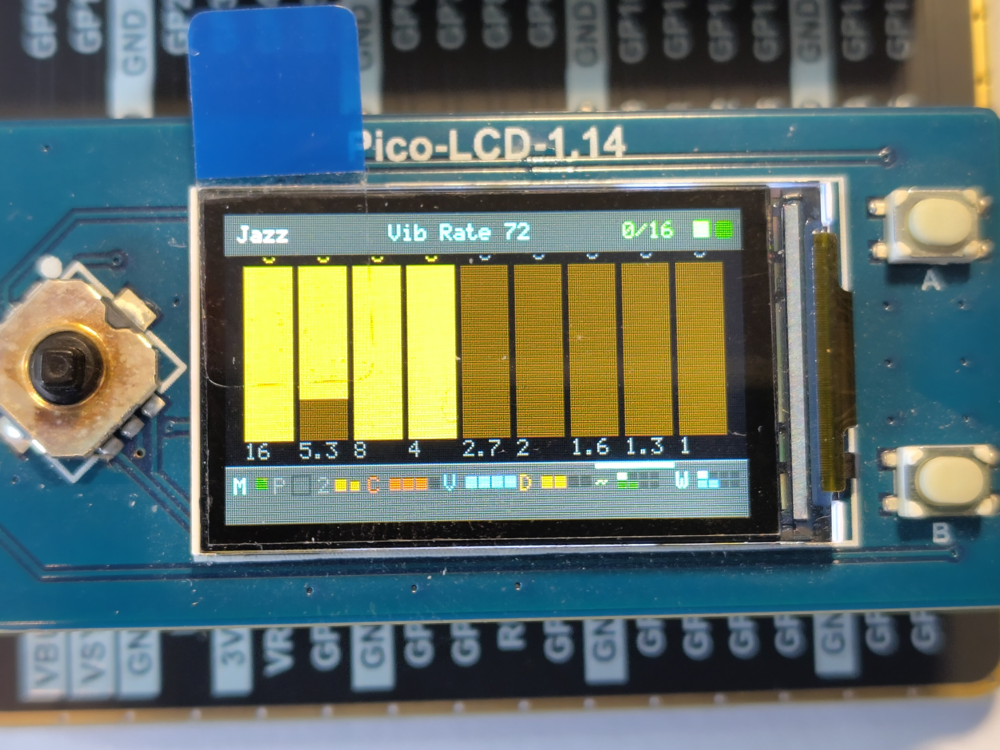

*The display in use: preset "Jazz", the drawbar bars, and the status line at the bottom. "Vib Rate 72" is selected, shown by the cyan bar above the vibrato block; 0/16 means no notes held, 16 allowed.*

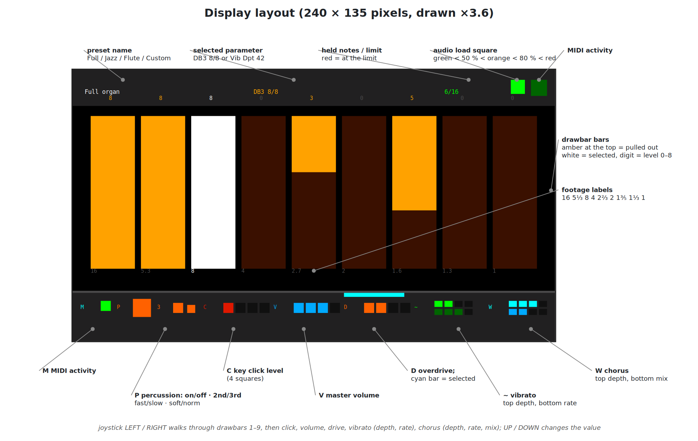

| Input | Action |
|-------|--------|
| Joystick LEFT / RIGHT | walk through: drawbars 1–9, click, volume, drive, vibrato depth / rate, chorus depth / rate / mix |
| Joystick UP / DOWN | change the selected value (drawbars ±1 level, others ±8). **Down pulls a drawbar down**, like a real one |
| Joystick PRESS | cycle presets: Full → Jazz → Flute |
| Button A | cycle the percussion settings |
| Button B | toggle key click |

Top bar: preset · selected parameter · **held notes / voice limit** (red when the governor is holding you back) · load square (green < 50 %, orange < 80 %, red) · MIDI dot.

<a id="tonewheel-53-serial-commands"></a>
#### Serial commands

115 200 baud, line-terminated.

| Command | Effect |
|---------|--------|
| `help`, `info`, `all` | command list · organ state · all notes off |
| `db 888000000` | set the nine drawbars (digits 0–8) |
| `pre full\|jazz\|flute\|off` | load a preset |
| `perc on\|off\|2\|3\|fast\|slow\|soft\|norm` | percussion |
| `click <0-127>`, `vol <0-127>` | key-click level, master volume |
| `drive <0-127>` | overdrive (0 = off) |
| `vib d <0-127>`, `vib r <0-127>` | vibrato depth, rate |
| `cho d\|r\|m\|a <0-127>` | chorus depth, rate, mix, **amount** (depth + mix together, like the pot) |
| `les stop\|slow\|fast` | Leslie speed |
| `perf` | audio load breakdown, polyphony limit, measured cost per oscillator |
| `pio` | audio PIO state |


<a id="tonewheel-6-how-it-works"></a>
### How it works

<a id="tonewheel-61-two-cores"></a>
#### Two cores

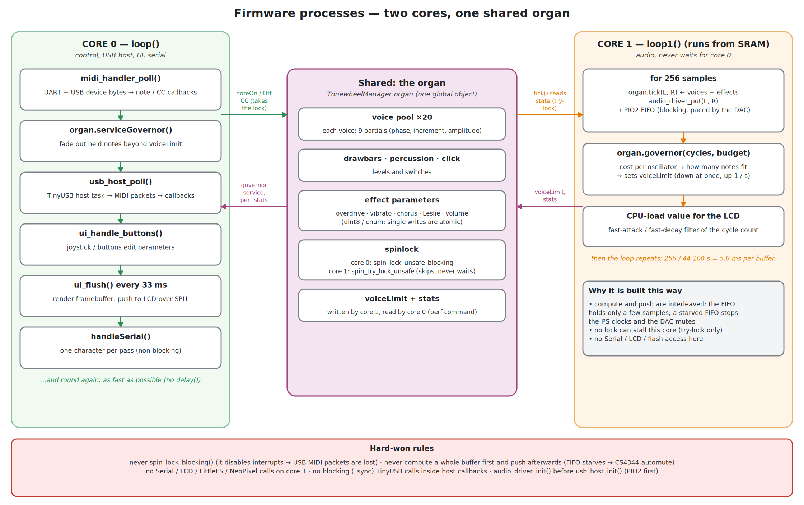

**Core 0** runs `loop()`: it polls the MIDI sources and the USB host, routes notes and CCs into the organ, handles the joystick, renders the LCD at 30 Hz and reads the serial console. **Core 1** runs only the audio loop, from SRAM: for each 256-sample buffer it computes one sample, pushes it into the PIO FIFO (paced by the DAC clock), and then lets the governor look at how long it all took.

The two cores share one global object, the organ. Core 0 takes its spinlock with `spin_lock_unsafe_blocking()`; core 1 only ever *tries* the lock, so it can never wait for core 0. Parameters are single bytes, so core 0 can write them without a lock.

Three rules came out of painful debugging and should not be broken (details in `context.md`):

1. **Never `spin_lock_blocking()`** — it disables interrupts, so USB MIDI packets get lost under chord bursts.
2. **Never compute a whole buffer and push it afterwards.** The PIO FIFO holds only a few samples; if it runs dry the I²S clocks stop and the DAC mutes (the CS4344 does; the PCM5101A likewise powers down when its clocks stop).
3. **Audio code must run from SRAM and never block.** Everything on core 1 is force-inlined into `loop1()`, because code executed from flash competes with core 0 for the small XIP cache.

<a id="tonewheel-62-pio-allocation"></a>
#### PIO allocation

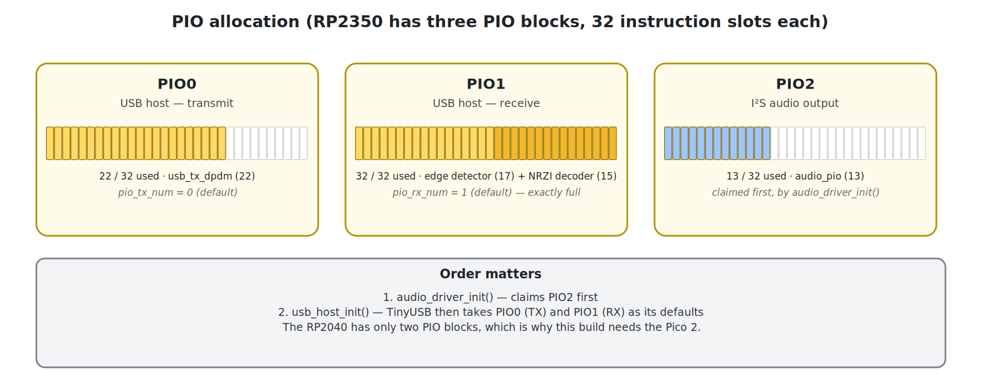

*The figure shows the Rev 2.1 audio program (`audio_pio`). With the Initial Version the same PIO2 state machine runs `audio_pio_i2s` instead (8 instructions, standard I²S); the order rule below is the same.*

`audio_driver_init()` must run before `usb_host_init()` so the audio state machine claims PIO2 first and TinyUSB takes PIO0/PIO1.

<a id="tonewheel-63-the-tonewheel-engine"></a>
#### The tonewheel engine

Each note is one **voice** with nine **partials**, one per drawbar:

| Drawbar | 1 | 2 | 3 | 4 | 5 | 6 | 7 | 8 | 9 |
|---------|---|---|---|---|---|---|---|---|---|
| Footage | 16′ | 5⅓′ | 8′ | 4′ | 2⅔′ | 2′ | 1⅗′ | 1⅓′ | 1′ |
| Frequency × note | 0.5 | 1.5 | 1 | 2 | 3 | 4 | 5 | 6 | 8 |

A partial is a 32-bit phase accumulator reading a 4096-point sine table; its amplitude is `drawbar level / 8`. Only partials that actually sound (level > 0, below 22 kHz) are iterated, and the sum is scaled **once** for all voices. The inner loop is about 15 integer instructions per sounding partial.

- **Percussion** fires only on the first note of a new chord (authentic Hammond behaviour), at the 2nd or 3rd harmonic, fast or slow decay, soft or normal; while it is on, the 8′ drawbar is reduced by 25 % as on the original.
- **Key click** is a short noise burst on key press and release.
- **Vibrato** modulates the partials' phase increments with a sine LFO (0.5–9 Hz, depth up to ±0.25 semitone). The multiplier is applied once per 16 samples, in integer arithmetic, so there is no `powf()` and no per-oscillator float work in the audio path.

<a id="tonewheel-64-the-effects-chain"></a>
#### The effects chain

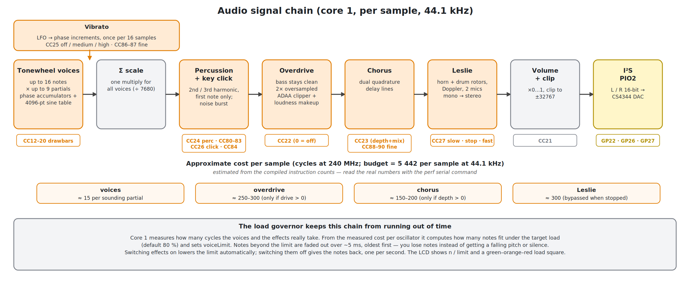

Order: voices → percussion + click → **overdrive → chorus → Leslie** → master volume → clip → I²S. Each effect costs almost nothing when it is off (Leslie and overdrive bypass completely).

<a id="tonewheel-overdrive"></a>
##### Overdrive

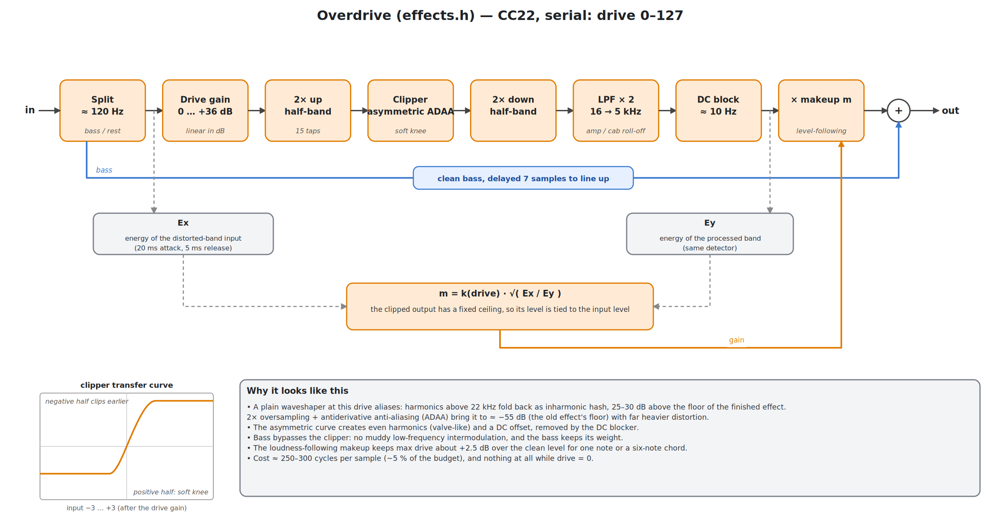

An asymmetric soft clipper (even + odd harmonics, valve-like) with gain from 0 to +36 dB. It had to be built carefully, because **a plain waveshaper at this drive aliases badly**: harmonics above 22 kHz fold back as inharmonic hash that sounds like noise. The shipped design uses 2× oversampling and antiderivative anti-aliasing, a gentle roll-off (16 kHz at low drive → 5 kHz at max) and a DC blocker, and keeps the **bass out of the clipper** so low notes stay clean. A loudness-following makeup keeps the level about **+2.5 dB over the clean signal at maximum drive** (set by `OD_LEVEL_DB`) for one note or a six-note chord alike.

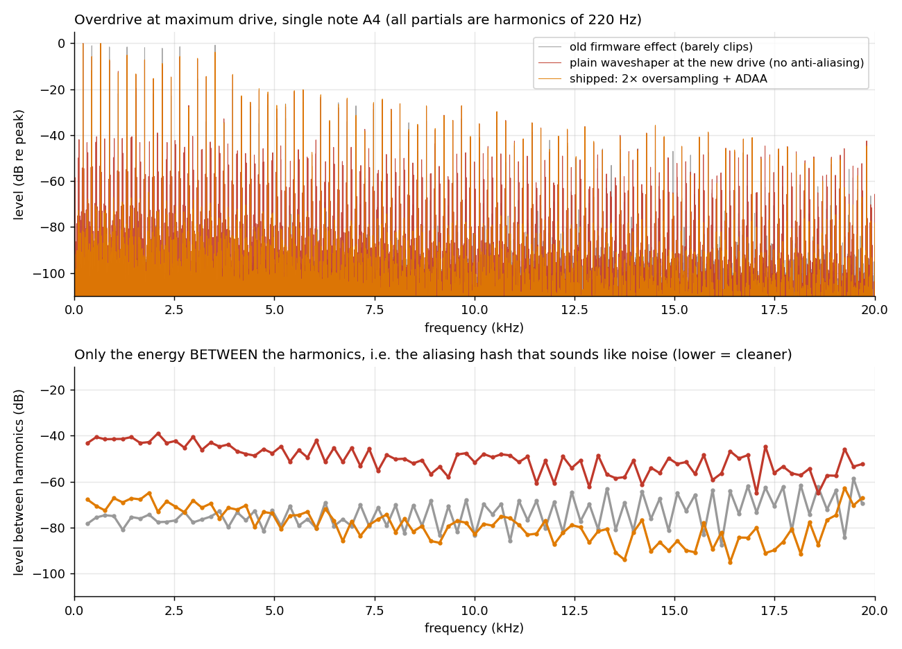

*Single note A4, maximum drive. Lower panel: only the energy between the harmonics (the aliasing hash). The shipped effect (orange) sits 25–30 dB below the plain waveshaper (red) and on the floor of the old, much milder effect (grey).*

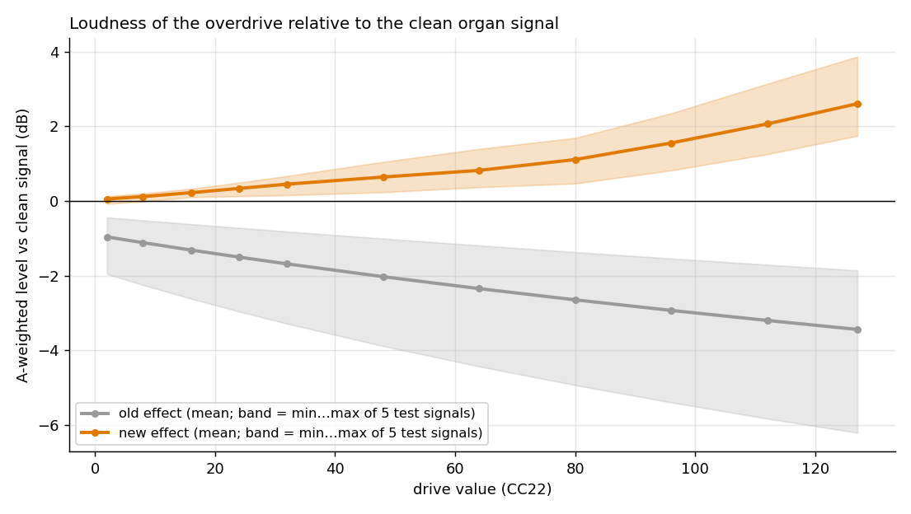

*Loudness relative to the clean organ signal across five test signals (one quiet note to a six-note full-drawbar chord). The old effect got quieter as drive increased; the new one rises smoothly and stays within about 2 dB across very different playing.*

Cost: roughly 250–300 cycles per sample (~5 % of the audio budget), paid only while drive > 0.

<a id="tonewheel-chorus"></a>
##### Chorus

Two delay lines (20 ms centre, up to ±2 ms swing, 0.2–3 Hz) driven by LFOs a quarter cycle apart — the Boss CE-2 arrangement. When one LFO reverses direction (the moment a single delay line clicks), the other is moving at its steadiest, so the artefact cancels. Depth and mix are independent; the panel pot sets both.

<a id="tonewheel-leslie"></a>
##### Leslie

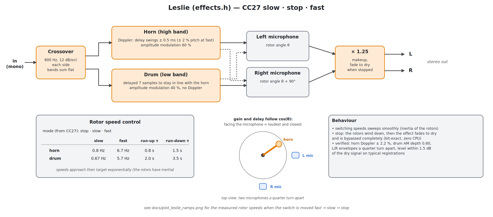

A crossover at 800 Hz splits the signal: the **horn** (highs) gets a modulated delay — the Doppler pitch shift, ±0.5 ms, about ±2 % pitch at full speed — plus 60 % amplitude modulation; the **drum** (lows) gets 40 % amplitude modulation. Two virtual microphones a quarter turn apart give a **stereo** output. Switching speeds does not jump: the rotors accelerate and decelerate exponentially with different inertia for horn and drum, exactly the "wind-up" you hear on a real cabinet. On "stop" the rotors wind down and the effect then fades to the dry signal and switches itself off completely.

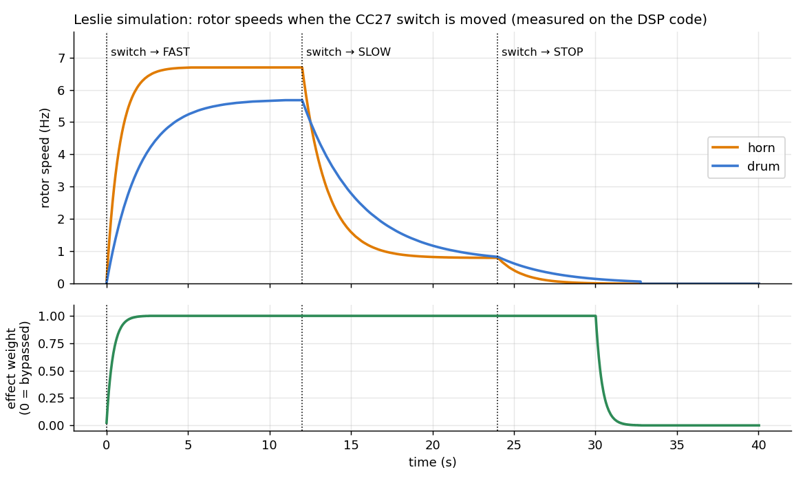

*Rotor speeds measured from the DSP code while the switch is moved fast → slow → stop.*

<a id="tonewheel-65-the-load-governor"></a>
#### The load governor

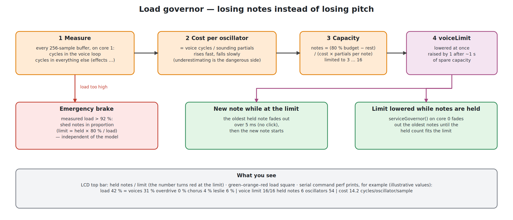

On a heavy chord with every effect on, the audio core can run out of time. Without protection the I²S clock stretches (the pitch falls) and finally the DAC loses lock and mutes. The governor prevents that: every buffer it measures what each oscillator really costs on this chip, works out how many notes fit under 80 % load, and lowers `voiceLimit` accordingly. Surplus notes **fade out over 5 ms, oldest first** — you lose notes, never pitch or sound. Switching effects on lowers the limit; switching them off gives the notes back, one per second. Run `perf` to see the numbers.

<a id="tonewheel-66-midi-input-and-the-usb-host"></a>
#### MIDI input and the USB host

All three sources call the same `midi_note_on / off / cc / program_change / pitch_bend` functions. The USB host (TinyUSB + PIO-USB, full speed) mounts **one** USB MIDI device; the callbacks must never block (no `_sync` TinyUSB calls), otherwise enumeration of other devices stalls. On disconnect all notes are released.


<a id="tonewheel-7-tuning-guide"></a>
### Tuning guide

Everything user-facing lives in `firmware/tonewheel/config.h`.

| Setting | Default | Effect |
|---------|---------|--------|
| `MAX_ACTIVE_VOICES` | 16 | hard polyphony ceiling (the governor lowers it further when needed) |
| `GOV_TARGET_LOAD_PCT` | 80 | audio load the governor aims to stay under |
| `GOV_MIN_VOICES` | 3 | the governor never limits below this |
| `VOICE_FADE_SAMPLES` | 220 | fade-out length of a stolen note (~5 ms) |
| `VIBRATO_MAX_SEMITONES` | 0.25 | vibrato depth at maximum (0.25 = scanner vibrato; 0.5 = obvious) |
| `VIBRATO_SWITCH_MEDIUM / HIGH` | 64 / 127 | depth for the vibrato switch positions |
| `CLICK_LEVEL_MEDIUM / HIGH` | 40 / 110 | click levels for the click switch |
| `OD_MAX_GAIN_DB` | 36 | drive gain at maximum; higher adds little clipping but more aliasing |
| `OD_LEVEL_DB` | 2.5 | overdrive loudness at maximum relative to clean |
| `OD_GAIN_CURVE` | 1.0 | 1.0 = gain in dB linear with the pot; > 1 back-loads the effect |
| `OD_LPF_HIGH_HZ / LOW_HZ` | 16 k / 5 k | post-clipper roll-off at low / max drive |
| `LESLIE_*_HZ` | 0.8 / 6.7 · 0.67 / 5.7 | horn / drum speeds, slow / fast |
| `LESLIE_*_ACCEL_S / DECEL_S` | 0.8 / 1.5 · 2.0 / 3.5 | rotor run-up / run-down time constants |
| `LESLIE_HORN_DEPTH / DRUM_DEPTH` | 0.6 / 0.4 | amplitude-modulation depth |
| `LESLIE_STEREO` | 1 | 0 = both outputs identical (mono amp) |
| `LESLIE_POS_LOW / MID / HIGH` | slow / stop / fast | what each position of the CC27 switch selects |
| `CHORUS_MIX_DEFAULT` | 64 | default wet level |
| `MIDI_CHANNEL` | 0 | 0 = all channels, 1–16 = one channel |
| `AUDIO_BOARD_REV2_1` | 1 | 1 = Pico-Audio Rev 2.1 (CS4344), 0 = Initial Version (PCM5101A); selects the audio pins **and** the PIO program; can also be set with `-DAUDIO_BOARD_REV2_1=0` |
| `ENABLE_LCD / SERIAL / USB_HOST / PERF` | 1 | feature switches |

If you change the overdrive clipper, filters or `OD_GAIN_CURVE`, the makeup calibration in `Overdrive::Overdrive()` has to be re-measured (the comment there explains how).


<a id="tonewheel-8-testing-and-verification-status"></a>
### Testing and verification status

Being clear about what is verified how:

**Confirmed by the author on the hardware:** audio and MIDI from all three inputs; drawbars, percussion, click; vibrato, chorus, Leslie and overdrive sound and behave as intended; the load governor stops the pitch falling and the freezes at 6–7 notes.

**Verified on a PC against the real source (host test harness; see `context.md`):**

- CC mapping and switch decoding for the 2 / 62 / 126 values
- the voice engine against the previous one: identical within ±3 LSB (−74 dB); vibrato noise floor below −93 dB
- Leslie: bit-exact bypass when stopped, Doppler ±2.2 %, modulation depths, stereo phase, level within ~1.5 dB of dry
- overdrive: aliasing, loudness across five signals, click-free switching, pot sweeps, silence and extreme inputs
- governor: convergence and stability against synthetic cost models, graceful note fading
- audio driver, both Pico-Audio versions: the real `audio_driver.h` runs against a mocked pico-sdk PIO API; what it programs (program, clock divider, pins, every sample pushed) is replayed through a PIO emulator and decoded with an I²S receiver model. Rev 2.1: program byte-identical to the previous one, 44100 Hz. Initial Version: bit-exact left and right. Both boards are also confirmed on hardware in the analog-synth project (identical driver)

**Compiled for the Cortex-M33 and inspected:** the whole audio path is one call-free function; instruction counts per stage.

**Not yet measured on hardware:** the exact cycle costs. The numbers in this document are estimates from compiled instruction counts; the `perf` command gives the real ones.

> **TODO (author):** paste a few real `perf` outputs here (idle, 6 notes, 16 notes with all effects on) once measured.


<a id="tonewheel-9-troubleshooting"></a>
### Troubleshooting

| Symptom | Likely cause and fix |
|---------|----------------------|
| Pitch falls, or sound stops, with chords | The audio core is overloaded. Run `perf`; reduce effects or `MAX_ACTIVE_VOICES`; make sure you built the current firmware (governor) |
| No sound at all | Check the Pico-Audio is seated; the boot banner's `Audio:` line must name **your** board (`AUDIO_BOARD_REV2_1` 1 = Rev 2.1, 0 = Initial Version — the wrong setting is silent); run `pio` and confirm *SM enabled*; the DAC mutes if the clocks stop |
| USB keyboard not detected | 15 kΩ pull-down missing or on the wrong pin; **some controllers (AKAI MPK mini) only enumerate if plugged in before the Pico is powered** — power-cycle with the device attached |
| Noise on the output with a USB controller | Add the diode + capacitors from 3.2 |
| Two USB devices behind a hub: only one works | Known limitation of the vendored pio-usb v0.5.3 (see roadmap); use one device on the host socket and the keyboard unit on the UART |
| Only some drawbars respond | Your controller sends other CC numbers; watch the serial console (every CC is printed) and adjust `MIDI_CC_DRAWBAR_*` in `config.h` |
| Leslie "slow" and "fast" are swapped | swap `LESLIE_POS_LOW` and `LESLIE_POS_HIGH` |
| Compile error: conflicting declaration of `tuh_midi_*_cb` | TinyUSB callback signatures differ between versions; this code targets TinyUSB 3.7.x (`idx`-based callbacks) |
| Compile error: `pio_usb_host_endpoint_close` undefined | Keep the compatibility stub in `lib/pio_usb/` (declaration in `pio_usb.h`, body at the end of `pio_usb_host.c`) |
| Nothing in the serial monitor | `ENABLE_SERIAL` is 0, or the monitor is not at 115 200 baud |
| Serial output floods when a pot moves | Expected — each CC is printed |


<a id="tonewheel-10-limitations-and-roadmap"></a>
### Limitations and roadmap

- **One USB MIDI device on the host socket.** A hub works for one device; two devices behind a hub enumerate but only the first gets its MIDI interface. A newer Pico-PIO-USB (the one bundled with TinyUSB) is the likely fix.
- **No Pico 1 build.** The audio loop reads the Cortex-M33 cycle counter and the audio driver needs PIO2: both exist only on the RP2350 (Pico 2). The old Pico 1 environment was dropped in picomusic.
- **Velocity is ignored** (as on a Hammond).
- **Leslie is a model, not a measurement** of a particular cabinet; the speeds, depths and inertia are parameters you can tune. A hardware Leslie can still be fed from the audio output (set the switch to *stop* for a dry signal).
- Planned: a combined MIDI-in + USB-host board; further modules on the same platform (analog synth, FM synth, electric piano, drum machine — see `context.md`).


<a id="tonewheel-akai-knob-map"></a>
### AKAI knob map

With `AKAI_REMAP 1` in `firmware/tonewheel/config.h` (the default) the eight knobs of an AKAI MPK mini (factory program, CC1..CC8) play the organ. The remap happens in `midi_cc()` in `main.cpp` and turns the knobs into the organ's own CCs, so the organ's keyboard unit (CC12..27) is not affected.

| Knob | CC | Function |
|---|---|---|
| K1 | 1 | master volume |
| K2 | 2 | overdrive (drive) |
| K3 | 3 | chorus amount (depth and mix together) |
| K4 | 4 | Leslie: lower third = slow, middle third = stop, upper third = fast |
| K5 | 5 | drawbars 16' and 5-1/3' (the bass pair) |
| K6 | 6 | drawbars 8' and 4' |
| K7 | 7 | drawbars 2-2/3' and 2' |
| K8 | 8 | drawbars 1-3/5', 1-1/3' and 1' (the brilliance group) |

Each drawbar group moves its drawbars together from 0 to 8. Program change 0..3 still selects the full-organ, jazz, flute and off registrations. Not built-in yet: percussion, vibrato and click on the pads or knobs. *New in this version: it compiles, but has not been tried on the hardware yet.*

<a id="tonewheel-source-files"></a>
### Source files (`firmware/tonewheel/`)

| file | what it is |
|---|---|
| `click.h` | Key click  (Pico 2 version) |
| `config.h` | Pico 2 (RP2350) optimised build |
| `drawbars.h` | –  9-drawbar state |
| `effects.h` | Post-processing effects chain |
| `lcd.cpp` | LCD driver  (Pico 2 optimised) |
| `lcd.h` | –  Public interface for LCD display + buttons |
| `lcd_buttons.h` | –  Joystick + buttons on Pico-LCD-1.14 |
| `lcd_driver.h` | –  Waveshare Pico-LCD-1.14 low-level driver |
| `lcd_ui.h` |  |
| `main.cpp` | Tonewheel organ  (v10 clean) |
| `mclk.h` | –  Master clock (MCLK) generator for CS4344 |
| `midi_handler.h` | –  MIDI input: USB-MIDI + UART MIDI |
| `oscillator.h` | –  Phase-accumulator oscillator |
| `percussion.h` | Hammond-style percussion  (Pico 2 version) |
| `perf.h` | Cycle counter (DWT CYCCNT) for load measurement |
| `tonewheel_manager.h` | Pico 2 optimised |
| `tonewheel_voice.h` | –  One organ key = 9 tonewheel partials |
| `usb_host.h` | USB MIDI host via Pico-PIO-USB |
| `voice.h` | –  Single monophonic voice (one note at a time) |
| `voice_manager.h` | –  Polyphonic organ voice manager |
| `wavetable.h` | –  Sine look-up table (LUT) |


---

<a id="6-analog-synthesizer"></a>
## 6. Analog synthesizer

**Environment:** `pio run -e synth -t upload` (and `synth_nohost`) &nbsp;·&nbsp; **Sources:** `firmware/synth/` &nbsp;·&nbsp; **Tests:** `tests/run_tests.sh synth`
&nbsp;·&nbsp; **Listen:** [`audio/demo_synth.mp3`](audio/demo_synth.mp3)

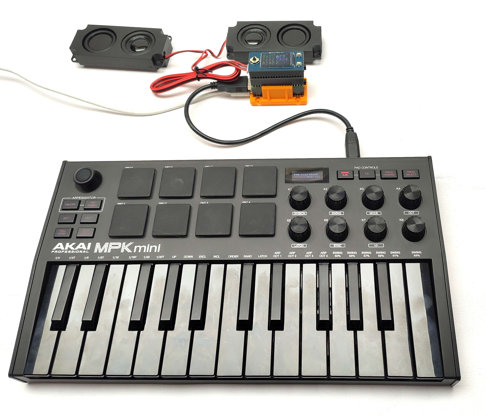

*The complete setup: an AKAI MPK mini on the USB host socket, the synth module (Pico-LCD-1.14, Pico-Audio and Pico 2 in a 3D-printed holder) and two speakers.*

A polyphonic subtractive synthesizer for the Raspberry Pi Pico 2 (RP2350), using either version of the Waveshare Pico-Audio DAC shield (Rev 2.1 or Initial Version, see [Audio shield versions](#audio-boards)) and a Waveshare Pico-LCD-1.14 display. It shares its platform layer (I²S audio, USB host, MIDI input, display driver) with the Pico Tonewheel Organ and receives MIDI from three simultaneous sources:

- **USB device** (Pico's native USB port) — PC, DAW, or USB MIDI controller
- **USB host** (GP6/GP7 socket) — one USB MIDI keyboard or controller (developed with an AKAI MPK mini)
- **UART** (GP5) — DIN-5 MIDI in, or a keyboard-scanner Pico

Per voice: two wavetable oscillators (+ noise) → 4-pole resonant ladder filter → amplifier, with two ADSR envelopes, an LFO for vibrato, pitch bend and optional mono glide. Master section: asymmetric tube overdrive → volume. **12 notes** sound at once (pool of 20 voices), and the **newest note always wins** when the limit is reached.

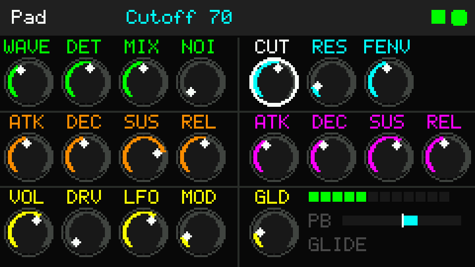

*The 240×135 control panel: 20 round knobs, a top bar with the selected parameter, and a status block. Rendered from the real firmware code through an ST7789 emulator.*

> **Status (November 2026):** confirmed working on the hardware. Tested mostly with an AKAI MPK mini on the USB host port. The behaviour described in this chapter was derived and measured on a PC against the real firmware sources (see the Testing part); the CPU figures have not been measured on the Pico, the voicing has not been tuned by ear, and some small errors are still to be chased.

<a id="synth-configuration-configh"></a>
### Configuration (`config.h`)

`config.h` contains **only `#define`s** — no includes, no code. All user-facing values live here.

<a id="synth-feature-flags"></a>
#### Feature flags

```cpp
#define ENABLE_LCD        1
#define ENABLE_SERIAL     1
// ENABLE_USB_HOST defaults to 1; the synth_nohost env passes -DENABLE_USB_HOST=0
```

<a id="synth-audio-shield"></a>
#### Audio shield

```cpp
#define AUDIO_BOARD_REV2_1  1   // 1 = Rev 2.1 (CS4344)   0 = Initial Version (PCM5101A)
```

Defaults to 1; override with `-DAUDIO_BOARD_REV2_1=0` in `build_flags`. It selects pins **and** PIO program (see [Audio shield versions](#audio-boards)).

<a id="synth-polyphony"></a>
#### Polyphony

```cpp
#define MAX_ACTIVE_VOICES  12   // notes that may sound at once (held keys + release tails)
#define SYNTH_POOL         20   // physical voice slots; the spare 8 let a stolen voice fade out
#define STEAL_RELEASE_MS    4   // fade time of a stolen voice
```

`SYNTH_POOL` must exceed `MAX_ACTIVE_VOICES` (compile-time check) and may not exceed 32. CPU worst case is `SYNTH_POOL` voices, but only for the few milliseconds of a steal. If the CPU square (see [Display](#synth-display)) goes orange or red, lower `MAX_ACTIVE_VOICES` first.

<a id="synth-sound"></a>
#### Sound

```cpp
#define CONTROL_DIV        16       // control-rate block, in samples (2.76 kHz)
#define VOICE_SCALE        4800     // per-voice peak (of 32767) at master volume 127
#define MOD_MAX_SEMITONES  2.0f     // vibrato depth at mod = 127
#define FILTER_MAX_HZ      12000.0f // nominal cutoff ceiling (stability limit, see below)
#define FILTER_CHEAP_SAT   0        // 1 = division-free filter saturator (unmeasured on the Pico)
```

<a id="synth-midi"></a>
#### MIDI

```cpp
#define MIDI_CHANNEL             0   // 0 = OMNI
#define AKAI_REMAP               1   // CC1..CC8 = the eight knobs of an AKAI MPK mini
#define MIDI_PROGCHANGE_PATCHES  1   // program change selects a patch
```


<a id="synth-sound-engine"></a>
### Sound engine

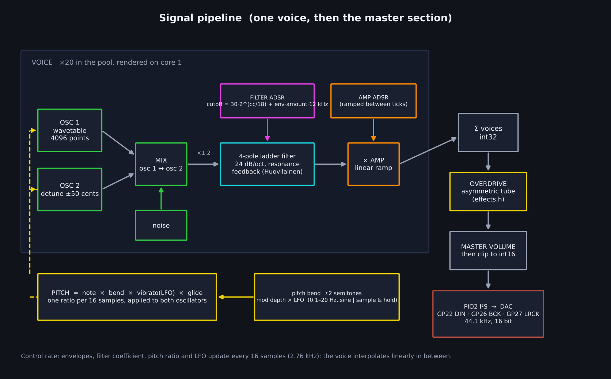

<a id="synth-oscillators"></a>
#### Oscillators
Two phase-accumulator oscillators read a 4096-point single-cycle wavetable (sine, triangle, saw, square — one waveform for both). Oscillator 2 is detuned by up to ±50 cents and blended with **MIX**. White noise can be added (**NOI**, up to 40 %). The waveform is looked up once per control block, so turning **WAVE** changes held notes immediately. Waveforms are *not* band-limited (see [Known limitations](#synth-known-limitations-and-next-steps)).

<a id="synth-filter"></a>
#### Filter
A 4-pole, 24 dB/oct Moog-style ladder (Huovilainen topology: each stage `s += g·(sat(in) − sat(s))`, resonance fed back from stage 4). The cutoff is

```
nominal cutoff = 30 Hz · 2^(CUT/18)  +  FENV/127 · filter-envelope · 12 kHz        (limited to 12 kHz)
```

**Nominal is not the −3 dB point.** The one-pole stages use `g = tan(π f/fs)` as an Euler coefficient, which puts the real −3 dB point at roughly a quarter of the nominal value (measured on the firmware's own filter, resonance 0):

| nominal | 200 | 500 | 1000 | 2000 | 4000 | 8000 | ≥ 12000 |
|---|---|---|---|---|---|---|---|
| −3 dB at | 44 Hz | 111 Hz | 226 Hz | 473 Hz | 1050 Hz | 3326 Hz | fully open |

So the filter is deliberately dark and leans on its envelope for brightness. This is the sound the instrument was voiced with; changing the mapping changes every patch.

**Stability:** above ≈ 14 kHz nominal the coefficient is unstable (measured gain 2.8× at 16 kHz, 11.6× at 20 kHz). The ceiling `FILTER_MAX_HZ = 12000` removes that region; the filter is already fully open at that point, so nothing audible is lost. Each voice also checks its filter states once per control block and restarts the ladder if they ever run away (NaN or |s| ≥ 16).

<a id="synth-envelopes"></a>
#### Envelopes
Two linear ADSRs per voice (amplitude and filter). Times are exponential in the CC value:

| value | 0 | 32 | 64 | 96 | 127 |
|---|---|---|---|---|---|
| time | 3 ms | 17 ms | 98 ms | 556 ms | 3 s |

Attack/decay/sustain are captured when a note starts. **Release is read when the key is lifted**, so you can turn the release knob while holding a chord and the next key-up uses the new time.

<a id="synth-pitch-vibrato-glide"></a>
#### Pitch, vibrato, glide
- **Pitch bend** ±2 semitones.
- **Vibrato:** one LFO (0.1–20 Hz, sine or sample & hold) × **MOD** depth (0 … ±2 semitones).
- **Glide** (button B / CC65): mono legato. While a key is held, a new key re-pitches the same voice (no retrigger) with an exponential glide of **GLD** time (5 ms … 3 s). After a gap the next note glides from the last pitch.

Bend, vibrato and detune are combined into one frequency ratio per 16 samples.

<a id="synth-overdrive-and-level"></a>
#### Overdrive and level
The summed voices pass through the organ's asymmetric tube waveshaper (`effects.h`, shared file): positive and negative halves clip differently, giving even harmonics. **DRV** 0 = bypass, 1…127 = input gain ×1…×5 with output compensation. **VOL** is applied *after* the overdrive, so the drive character does not change with volume. At the default VOL 80 one voice peaks at about 3000 of 32767.


<a id="synth-polyphony-and-voice-stealing"></a>
### Polyphony and voice stealing

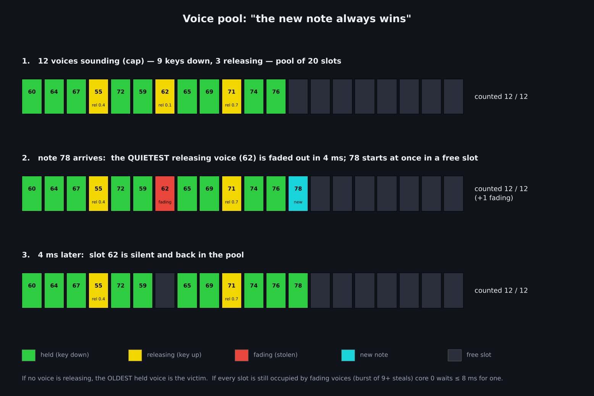

Up to `MAX_ACTIVE_VOICES` voices *count* (held keys plus release tails). When another note arrives at the limit:

1. the **quietest voice whose key is already up** is the victim — otherwise the **oldest held** voice;
2. the victim gets a short **fast release** (`STEAL_RELEASE_MS`) and stops counting immediately;
3. the new note starts **at once in a free slot** — the pool has 8 spare slots exactly for this.

Nothing is ever overwritten while it sounds, so there are no clicks and no races. If a burst of 9+ simultaneous steals fills every slot with fading voices, core 0 waits at most 8 ms for one to finish; the note is never dropped. A note-off for a stolen note is ignored.

<a id="synth-why-there-are-no-locks"></a>
#### Why there are no locks

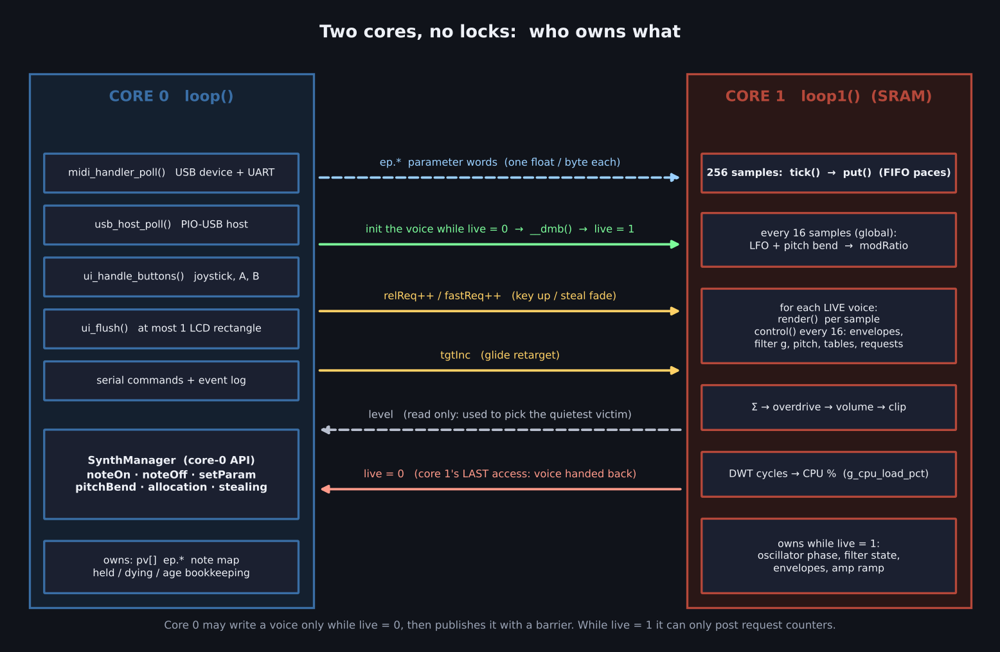

Core 0 (MIDI, USB host, display, serial) only writes a voice while core 1 has handed it back (`live = 0`) and then publishes it behind a memory barrier. While a voice is live, core 0 can only increment request counters (release / fast release) and write a glide target. Core 1 owns the envelopes, filter and oscillators of a live voice outright. Every cross-core field is a single aligned word written by one side, so **neither core can ever wait for the other** — the audio loop cannot stall on a MIDI burst, and a key press cannot corrupt a sounding voice. (`spin_lock_blocking` is deliberately absent: it disables interrupts and loses USB-MIDI packets.)


<a id="synth-midi"></a>
### MIDI

```cpp
#define MIDI_CHANNEL             0   // 0 = OMNI
#define AKAI_REMAP               1   // CC1..CC8 = the eight knobs of an AKAI MPK mini
#define MIDI_PROGCHANGE_PATCHES  1   // program change selects a patch
```


<a id="synth-patches"></a>
### Patches

Joystick **PRESS** cycles through three complete patches (each sets *every* parameter, so nothing leaks between patches); MIDI program change selects them too. Editing any parameter renames the patch to *Custom*.

| Parameter | Init | Pad | Bass |
|---|---|---|---|
| Waveform | saw | tri | sqr |
| Detune | 64 | 70 | 66 |
| Osc Mix | 0 | 64 | 0 |
| Noise | 0 | 0 | 0 |
| Cutoff | 60 | 70 | 50 |
| Resonance | 38 | 15 | 40 |
| Flt Env Amt | 90 | 60 | 100 |
| Amp Attack | 5 | 60 | 2 |
| Amp Decay | 50 | 60 | 40 |
| Amp Sustain | 80 | 100 | 100 |
| Amp Release | 30 | 70 | 20 |
| Flt Attack | 3 | 50 | 2 |
| Flt Decay | 60 | 50 | 30 |
| Flt Sustain | 25 | 80 | 40 |
| Flt Release | 40 | 60 | 20 |
| Volume | 80 | 80 | 80 |
| Drive | 0 | 0 | 0 |
| LFO Rate | 94 | 80 | 94 |
| Mod Depth | 0 | 15 | 0 |
| Glide Time | 20 | 20 | 20 |
| LFO Wave | 0 | 0 | 0 |


<a id="synth-display"></a>
### Display

The panel is shown near the top of this document; the figure with CC labels is in [MIDI](#synth-midi). While playing it looks like this:

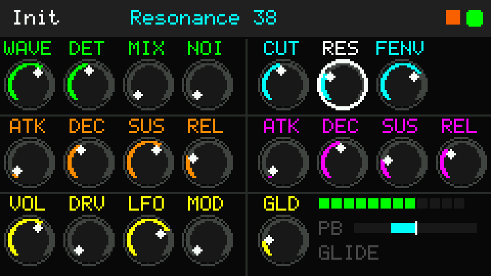

*An unedited Init patch with an 8-note chord held: eight voice pips (green; they turn red at the 12-voice cap), the pitch-bend bar left of centre, the CPU square orange (50–79 %), the MIDI dot lit, and the resonance knob selected (white ring, its value in the top bar).*

<a id="synth-top-bar-y--017"></a>
#### Top bar (y = 0..17)

```
[patch]   [selected parameter  value]                           [CPU] [MIDI]
```

- **Patch** — Init / Pad / Bass / Custom
- **Centre** — name and value of the selected knob, in that knob's group colour
- **CPU square** — green < 50 %, orange 50–79 %, red ≥ 80 % (measured on core 1 with the DWT cycle counter)
- **MIDI dot** — lights for 120 ms on note and CC messages

<a id="synth-knob-grid-y--19131"></a>
#### Knob grid (y = 19..131)

Three rows × eight columns, colour-coded: **green** oscillators, **cyan** filter, **orange** amp envelope, **magenta** filter envelope, **yellow** master / FX / modulation. The selected knob has a white ring and label. Each knob shows its value as an arc from bottom-left to bottom-right with a white pointer.

<a id="synth-status-block-bottom-right"></a>
#### Status block (bottom right)

- **Voice pips** — one per counted voice (red when at the cap)
- **PB** — pitch-bend position, centred
- **GLIDE** — lit when glide is on

<a id="synth-joystick-and-buttons"></a>
#### Joystick and buttons

| Input | Action |
|-------|--------|
| LEFT / RIGHT | Select previous / next knob (wraps) |
| UP / DOWN | Increase / decrease: 2 per press; hold for repeat (after 350 ms, every 70 ms), step 8 after 700 ms. WAVE changes one waveform per press |
| PRESS | Next patch |
| Button A | **Panic** — silence everything |
| Button B | Glide on/off |

<a id="synth-why-the-display-does-not-disturb-midi"></a>
#### Why the display does not disturb MIDI

Each widget redraws only when its own value changes, and only that rectangle goes to the panel as one bulk SPI transfer (a knob is ≈ 2 KB, the largest rectangle 8.6 KB ≈ 1.2 ms). At most **one** rectangle is sent per `loop()` pass, so USB and MIDI polling continue between rectangles; an idle panel sends nothing. The first full paint is 22 SPI calls.


<a id="synth-serial-commands"></a>
### Serial commands

Connect at 115200 baud.

| Command | Effect |
|---------|--------|
| `help` | List all commands |
| `stat` | CPU load, voice counts, audio PIO state |
| `voices` | Every sounding voice: slot, note, envelope stage and level, held / released / fading |
| `params` | All parameter values with their CC numbers |
| `set <name> <0-127>` | Set a parameter by serial name, e.g. `set cut 70` |
| `cc <n> <0-127>` | Send a MIDI CC to the synth |
| `on <note>` / `off <note>` | Play / release a note |
| `patch <0-2>` | Load a patch |
| `glide on\|off` | Mono legato glide |
| `all` | Release all notes |
| `panic` | Silence everything now |
| `log notes\|cc\|all\|off` | Which incoming MIDI events are printed (default: notes) |
| `pio` | Audio PIO debug |

MIDI events are queued by the callbacks and printed from `loop()`, so a slow terminal can never delay the next MIDI message.


<a id="synth-usb-host"></a>
### USB host

One USB MIDI device on the host socket (direct or through a hub). Two devices simultaneously through a hub are not reliably supported with the vendored `pio_usb` v0.5.3. Practical workflow: keyboard on the USB host socket, a PC on the Pico's own USB port, optional hardware MIDI on GP5.


<a id="synth-testing"></a>
### Testing

The engine, filter and display are tested on a PC with the **real source files** and mocked Arduino/Pico headers (`tests/synth/`, built with g++ and AddressSanitizer + UBSan including float-cast-overflow).

```bash
tests/run_tests.sh synth          # full suite: filter, display and engine (includes the torture and two-thread tests)
tests/run_tests.sh synth quick    # fast pass
```

`run_tests.sh` stages the real sources (`stage.sh` swaps in mocks for just `audio_driver.h`, `midi_handler.h` and `usb_host.h`), builds with AddressSanitizer + UBSan and runs all four suites.

| Suite | What it checks |
|---|---|
| `test_filter` | New filter matches the previous one within 1 % at every cutoff; `tan` approximation error 0.036 %; bounded output at *any* requested cutoff (peak ≤ 1.16); NaN / runaway detection |
| `test_engine` | Parameter table; attack/sustain/release; polyphony cap and newest-note-wins; releasing voices stolen before held ones; pool exhaustion; same-note retrigger, duplicates and stale note-offs; glide and vibrato maths; every parameter swept at extremes; **250 000-event random torture** with invariants checked after every event; **two real threads** (audio flat out and real-time paced) with ≈ 1.3 million control events against 13 million samples |
| `test_audio` | **Audio driver, both boards.** The real `audio_driver.h` runs against a mocked pico-sdk that records everything it programs (program, clock divider, pins, every sample pushed); that is replayed through a PIO emulator and decoded with an I²S receiver model (rising-edge sampling). Rev 2.1: program byte-identical to the organ's, 44100 Hz, recovered by the half-rate receiver it needs. Initial Version: bit-exact left and right over 2 896 samples, left on LRCK = 0. |
| `test_lcd` | Emulates the ST7789 (decodes the real command/window stream): panel always equals the framebuffer, single-knob update = 6 SPI calls / 2 KB, idle = zero traffic, MIDI dot dims by itself, joystick repeat, patch cycling, debounce |


<a id="synth-known-limitations-and-next-steps"></a>
### Known limitations and next steps

- **Other DAC boards** — only the two Waveshare Pico-Audio versions are supported (`AUDIO_BOARD_REV2_1`). A board that wants a different bit format or clock needs its own PIO program; do not assume a program is portable between DACs.
- **Chorus** — `effects.h` already contains the organ's dual-quadrature chorus; it only needs knobs and CCs.
- **Velocity** is ignored; **CC 64 is the amp sustain level** (no sustain pedal).
- **Aliasing** — the saw and square wavetables are not band-limited; high notes alias. The filter hides most of it.
- **Filter scale** — the nominal cutoff is about 4× above the real −3 dB point (see [Filter](#synth-filter)).
- **`FILTER_CHEAP_SAT`** — removes five float divides per voice-sample; expected to help on the RP2350, not yet measured.
- **USB hub** with multiple devices — see [USB host](#synth-usb-host).
- **No Pico 1 build:** the audio driver needs PIO2, which only the RP2350 has.

<a id="synth-source-files"></a>
### Source files (`firmware/synth/`)

| file | what it is |
|---|---|
| `adsr.h` | –  ADSR Envelope Generator |
| `analog_manager.h` | –  Polyphonic voice manager |
| `analog_voice.h` | –  One polyphonic voice |
| `config.h` | Analog Synth, Pico 2 (RP2350) |
| `effects.h` | Post-processing effects chain |
| `lcd.cpp` | single-page knob panel, Waveshare Pico-LCD-1.14 (ST7789, 240x135) |
| `lcd.h` | public interface of the LCD panel + joystick/buttons |
| `lfo.h` | –  Low Frequency Oscillator |
| `main.cpp` | Analog Synth  (restored on the tonewheel V1.0 architecture) |
| `midi_handler.h` | –  MIDI input: USB-MIDI + UART MIDI |
| `synth_env.h` | linear ADSR, advanced at control rate |
| `synth_filter.h` | Moog-style 4-pole ladder (Huovilainen topology) |
| `synth_manager.h` | polyphony, parameters and the audio tick |
| `synth_osc.h` | phase-accumulator oscillator (one wavetable read per sample) |
| `synth_params.h` | every user-facing parameter, in one table |
| `synth_voice.h` | one polyphonic voice |
| `usb_host.h` | USB MIDI host via Pico-PIO-USB |
| `vcf.h` | –  Moog Transistor Ladder Filter |
| `vco.h` | –  Phase-accumulator VCO |
| `wavetable.cpp` | storage + generation of the waveform tables |
| `wavetable.h` | Four single-cycle waveforms, 4096 points, int16 |


---

<a id="7-string-machine"></a>
## 7. String machine

**Environment:** `pio run -e strings -t upload` (and `strings_nohost`) &nbsp;·&nbsp; **Sources:** `firmware/strings/` &nbsp;·&nbsp; **Tests:** `tests/run_tests.sh strings`
&nbsp;·&nbsp; **Listen:** [`audio/demo_strings.mp3`](audio/demo_strings.mp3)

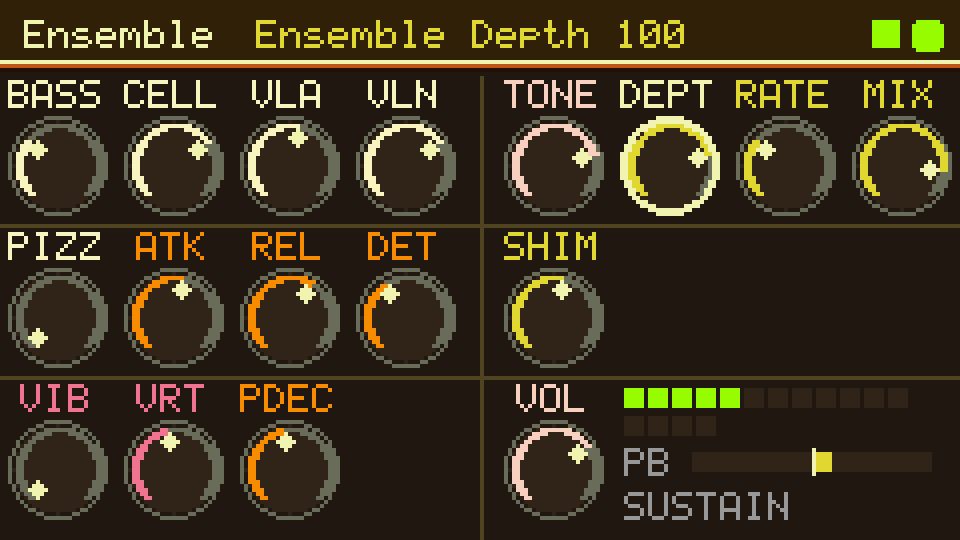

*The 240×135 control panel: five registrations, envelope, vibrato, tone, the ensemble section and a status block. Rendered from the real firmware code through an ST7789 emulator.*

A polyphonic **string machine** (in the tradition of the ARP/Solina String Ensemble) for the Raspberry Pi Pico 2 (RP2350), with a Waveshare Pico-Audio DAC shield (either version, see [Audio shield versions](#audio-boards)) and a Waveshare Pico-LCD-1.14 display. It is built on the same platform layer, threading model and tooling as the analog synth and the tonewheel organ, and receives MIDI from three sources at once:

- **USB device** (Pico's native USB port) — PC, DAW, or USB MIDI controller
- **USB host** (GP6/GP7 socket) — one USB MIDI keyboard or controller (developed against an AKAI MPK mini)
- **UART** (GP5) — DIN-5 MIDI in, or a keyboard-scanner Pico

Every key is a voice: three phase-locked saw octaves (16′, 8′, 4′) with a slow attack/release envelope. All voices are summed onto shared buses, run through five fixed **registration filters** (bass, cello, viola, violin, pizzicato), a tone control, and the **3-tap ensemble chorus** that gives a string machine its sound. Stereo out, **sustain pedal**, vibrato, pitch bend, four patches.

> **Status (November 2026):** confirmed working on the hardware. Tested mostly with an AKAI MPK mini on the USB host port. The behaviour described in this chapter was derived and measured on a PC against the real firmware sources (see the Testing part); the CPU figures have not been measured on the Pico, the voicing has not been tuned by ear, and some small errors are still to be chased.

**Listen first:** [`audio/demo_strings.mp3`](audio/demo_strings.mp3) (41 s, stereo) is rendered by the real engine on a PC — Ensemble chords, Violins with pedal, Cello + bass, a pizzicato arpeggio, and a big slow chord. It is what the firmware *computes*, before the DAC.

<a id="strings-first-power-on-checklist"></a>
### First power-on checklist

1. The LCD shows the panel; a green CPU square appears at the top right.
2. Serial monitor (115200): the banner names your audio shield. If it is not your board, switch `rev2_1` in the `[audio]` section of `platformio.ini`.
3. Type `on 60`: you should hear a note with a slow attack. `off 60` releases it. `stat` prints the CPU load.
4. Plug in a USB MIDI keyboard; each key prints `ON n=…`. Hold a chord of 6–8 notes: **the CPU square should stay green**. If it goes orange, lower `MAX_ACTIVE_VOICES` (see [Configuration](#strings-configuration)).
5. Try the sustain pedal (CC 64) or press button B (latching sustain); the SUSTAIN lamp lights.


<a id="strings-configuration"></a>
### Configuration

`config.h` contains **only `#define`s**.

```cpp
#define MAX_ACTIVE_VOICES  16   // notes that may sound at once (held + sustained + release tails)
#define STRINGS_POOL       24   // physical voice slots; the spare ones let a stolen voice fade out
#define STEAL_RELEASE_MS    6   // fade time of a stolen voice
#define AUDIO_BOARD_REV2_1  1   // 1 = Rev 2.1 (CS4344), 0 = Initial Version (PCM5101A)
#define AKAI_REMAP          1   // CC1..CC8 = the eight knobs of an AKAI MPK mini
```

`MAX_ACTIVE_VOICES` defaults to a **conservative 16**: the CPU cost has only been compared on a PC (see [Testing](#strings-testing)). Raise it (up to 24, the number of voice pips on the panel) once the CPU square stays green with your registrations. The pool must exceed the cap (compile-time check) and may not exceed 32.

The voicing constants (`FILT_*`, `TRIM_*`, `OUT_GAIN`, `ENS_*`, `VIB_MAX_SEMITONES`) are described in the [Tuning guide](#strings-tuning-guide).


<a id="strings-sound-engine"></a>
### Sound engine

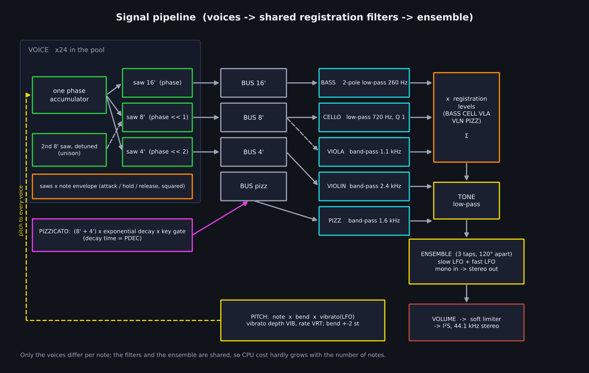

<a id="strings-how-a-string-machine-works"></a>
#### How a string machine works
A real string machine has one oscillator bank (top-octave generator + dividers) that is *always running*; each key only opens a gate with a slow envelope. The notes of each footage are summed onto a bus, the buses go through **fixed filters** ("registrations": cello, viola, violin…), and the sum goes through the **ensemble** — a chorus made of three modulated delays. This firmware copies that structure, which is why it is cheap: the filters and the ensemble are shared, so only the saws and the envelope cost anything per note.

<a id="strings-voice"></a>
#### Voice
One 32-bit phase accumulator runs at the 16′ pitch; the 8′ and 4′ saws are `phase << 1` and `phase << 2`, so the octaves are phase-locked exactly like a divider chain. The saws are **PolyBLEP**-corrected (≈ 16 dB less alias energy than a naive saw at every pitch from C4 to C8). With **DET** above 0 a second 8′ saw, detuned by up to 18 cents, joins the 8′ bus. A footage whose frequency would exceed 0.45 × the sample rate is silently skipped. A voice only computes the footages the registrations actually use (an unused bus costs nothing).

<a id="strings-registrations"></a>
#### Registrations

| Knob | Source | Filter (2-pole state-variable, fixed) |
|---|---|---|
| BASS | 16′ bus | low-pass 260 Hz, Q 0.71 |
| CELL | 8′ bus | low-pass 720 Hz, Q 1.0 |
| VLA | 8′ bus | band-pass 1.1 kHz, Q 0.9 |
| VLN | 4′ bus | band-pass 2.4 kHz, Q 0.7 |
| PIZZ | pizzicato bus (8′ + 4′) | band-pass 1.6 kHz, Q 0.7 |

Each knob is a level (squared law). The five paths are trimmed to equal loudness at middle C (within 0.15 dB, measured). The responses are shown at the end of this section.

<a id="strings-envelope"></a>
#### Envelope
Linear attack and release, **held at full level while the key is down** (no decay, no sustain level), applied squared so the release sounds closer to an exponential. **ATK** 4 ms … 2.4 s, **REL** 20 ms … 6 s. Release time is read at the moment of key-up, so turning REL while holding a chord changes the next release.

<a id="strings-pizzicato"></a>
#### Pizzicato
`(8′ + 4′) × exponential decay × key gate`: a plucked note whose decay time constant is **PDEC** (50 ms … 1 s) and whose gate releases with the REL time. It has its own bus and filter, so it can be mixed with the sustained registrations.

<a id="strings-tone"></a>
#### Tone
A one-pole low-pass on the sum, 600 Hz … 19 kHz.

<a id="strings-ensemble"></a>
#### Ensemble
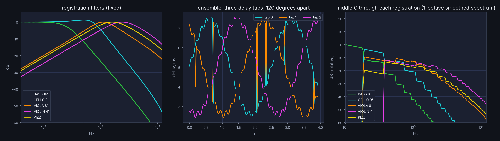

Three delay taps (centre 5 ms) swept by a **slow** sine LFO (**RATE**, 0.15 … 1.2 Hz, ±2.4 ms at full **DEPT**) plus a **fast** one (6.2 Hz, ±0.45 ms × **SHIM**). The three taps' LFO phases are 120° apart, so their delay offsets always sum to zero: the sound moves without drifting in pitch. Tap 0 goes left, tap 2 right, tap 1 to both; **MIX** goes from dry to wet at roughly constant level (within 0.4 dB, measured).

<a id="strings-vibrato-pitch-bend-output"></a>
#### Vibrato, pitch bend, output
**VIB** / **VRT** set a vibrato LFO (depth up to ±0.35 semitone, 0.5 … 8 Hz); pitch bend is ±2 semitones; both act on all voices through one frequency ratio per 16 samples. The output goes through **VOL** (squared law) and a gentle tanh-like soft limiter (linear for small signals), so a dense chord compresses instead of clipping.


<a id="strings-polyphony-stealing-and-the-sustain-pedal"></a>
### Polyphony, stealing and the sustain pedal

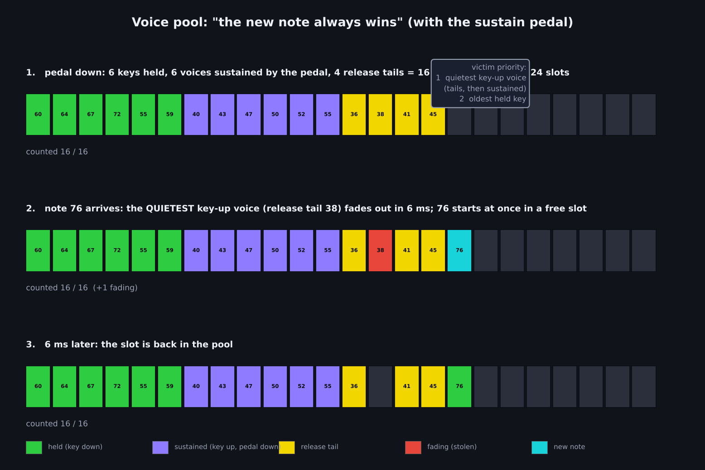

Up to `MAX_ACTIVE_VOICES` voices *count* (held keys, voices held by the pedal, release tails). When another note arrives at the limit:

1. the **quietest voice whose key is already up** (a release tail, then a pedal-sustained voice) is the victim — otherwise the **oldest held** voice;
2. the victim gets a short fast release (`STEAL_RELEASE_MS`) and stops counting at once;
3. the new note starts **at once in a free slot** — the pool has spare slots exactly for this.

Nothing is overwritten while it sounds, so there are no clicks and no races. If a burst of more steals than spare slots fills the pool with fading voices, core 0 waits at most 10 ms for one to finish; the note is never dropped.

**Sustain pedal** (MIDI CC 64, serial `sustain on|off`, button B as a latch): while down, releasing a key does not release the voice; when the pedal goes up every sustained voice is released. A pedal pressed *after* the key still catches the release.

<a id="strings-why-there-are-no-locks"></a>
#### Why there are no locks

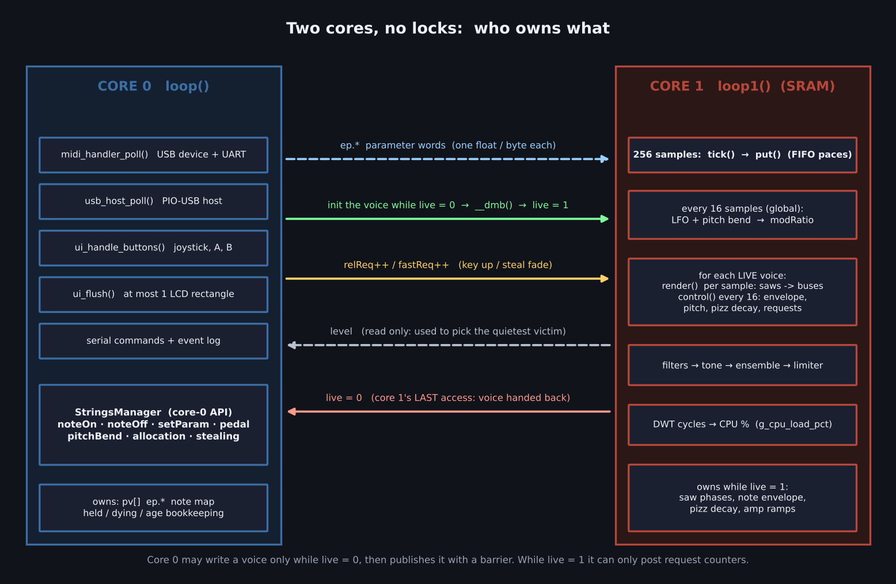

Same model as the analog synth. Core 0 (MIDI, USB host, display, serial) writes a voice only while core 1 has handed it back (`live = 0`) and then publishes it behind a memory barrier; while a voice is live, core 0 can only post release-request counters. Core 1 owns the envelope, phases and pizzicato state of a live voice outright. Every cross-core field is a single aligned word written by one side, so **neither core can ever wait for the other**.


<a id="strings-midi"></a>
### MIDI

All parameters go through one table (`strings_params.h`); the panel, MIDI, serial and patches all use it.

<a id="strings-control-change-map"></a>
#### Control change map

| Parameter | Serial name | Knob | **MIDI CC** | Range / meaning |
|---|---|---|---|---|
| **Registrations** | | | | |
| Bass 16' | `bass` | BASS | 20 | 16' saws → 2-pole low-pass, 260 Hz |
| Cello 8' | `cello` | CELL | 21 | 8' saws → 2-pole low-pass, 720 Hz, Q 1 |
| Viola 8' | `viola` | VLA | 22 | 8' saws → band-pass, 1.1 kHz |
| Violin 4' | `violin` | VLN | 23 | 4' saws → band-pass, 2.4 kHz |
| Pizzicato | `pizz` | PIZZ | 24 | 8' + 4' with its own decay → band-pass, 1.6 kHz |
| **Envelope** | | | | |
| Attack | `atk` | ATK | 73 | 4 ms … 2.4 s (exponential) |
| Release | `rel` | REL | 72 | 20 ms … 6 s (exponential) |
| Unison Detune | `det` | DET | 26 | second 8' saw per note, detuned 0 … 18 cents (0 = off) |
| Pizz Decay | `pdec` | PDEC | 75 | pizzicato decay time constant 50 ms … 1 s |
| **Vibrato** | | | | |
| Vibrato Depth | `vib` | VIB | 77 | vibrato depth 0 … ±0.35 semitone |
| Vibrato Rate | `vrate` | VRT | 76 | 0.5 … 8 Hz |
| **Ensemble** | | | | |
| Ensemble Depth | `edepth` | DEPT | 94 | sweep of the three delay taps (0 = static) |
| Ensemble Rate | `erate` | RATE | 27 | slow LFO 0.15 … 1.2 Hz |
| Ensemble Mix | `emix` | MIX | 93 | dry … wet |
| Ensemble Shimmer | `eshim` | SHIM | 28 | amount of the fast (6.2 Hz) LFO |
| **Tone / output** | | | | |
| Tone | `tone` | TONE | 74 | low-pass on the sum, 600 Hz … 19 kHz |
| Volume | `vol` | VOL | 7 | master volume (squared law) |

Other messages:

| Message | Function |
|---|---|
| CC 11 | Expression — alias of the master volume |
| CC 64 | **Sustain pedal** (≥ 64 = down) |
| CC 120 | All sound off (panic: everything fades in 6 ms) |
| CC 123 | All notes off (normal release, also releases pedal-held voices) |
| Pitch bend | ±2 semitones |
| Program change | selects patch `n mod 4` |
| Velocity | ignored (as on the original machines) |

CC 93 and CC 94 follow the General MIDI meanings (chorus send, celeste depth), so DAW presets and controllers that send them drive the ensemble.

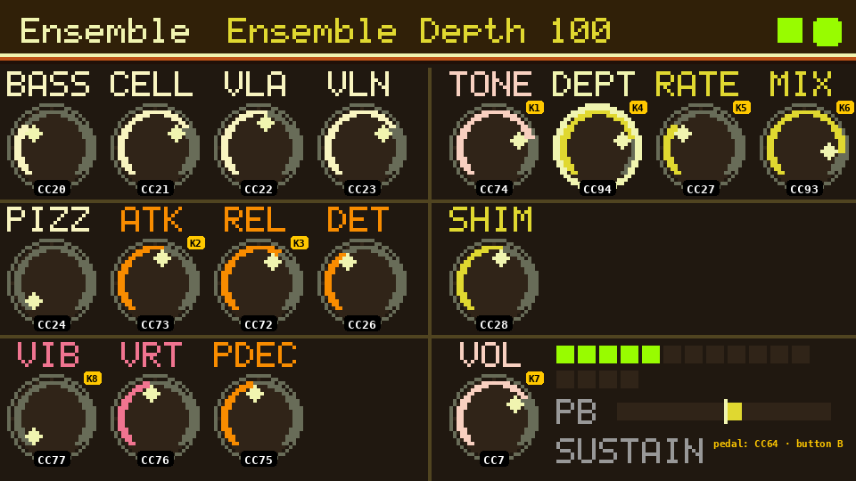

*Every knob with its primary CC. Orange badges mark the AKAI MPK mini knob (K1…K8) that also reaches it.*

<a id="strings-akai-mpk-mini-knobs"></a>
#### AKAI MPK mini knobs

With `AKAI_REMAP 1`, CC1…CC8 always mean the eight knobs of an MPK mini in its factory program:

| Knob | CC | Controls |
|---|---|---|
| K1 | 1 | Tone |
| K2 | 2 | Attack |
| K3 | 3 | Release |
| K4 | 4 | Ensemble Depth |
| K5 | 5 | Ensemble Rate |
| K6 | 6 | Ensemble Mix |
| K7 | 7 | Volume |
| K8 | 8 | Vibrato Depth |


<a id="strings-patches"></a>
### Patches

Joystick **PRESS** cycles through four complete patches (each sets *every* parameter); MIDI program change selects them too. Editing a parameter renames the patch to *Custom*. The patch volumes are equalized so the level does not jump when switching.

| Parameter | Ensemble | Cello | Violins | Pizz |
|---|---|---|---|---|
| Bass 16' | 40 | 110 | 0 | 0 |
| Cello 8' | 90 | 120 | 0 | 0 |
| Viola 8' | 70 | 40 | 70 | 30 |
| Violin 4' | 90 | 0 | 120 | 20 |
| Pizzicato | 0 | 0 | 0 | 120 |
| Attack | 70 | 60 | 90 | 0 |
| Release | 80 | 70 | 95 | 40 |
| Unison Detune | 50 | 30 | 60 | 20 |
| Vibrato Depth | 0 | 0 | 25 | 0 |
| Vibrato Rate | 60 | 60 | 70 | 60 |
| Pizz Decay | 60 | 60 | 60 | 55 |
| Tone | 100 | 80 | 110 | 105 |
| Ensemble Depth | 100 | 80 | 110 | 70 |
| Ensemble Rate | 40 | 30 | 50 | 40 |
| Ensemble Mix | 110 | 90 | 110 | 85 |
| Ensemble Shimmer | 70 | 50 | 80 | 50 |
| Volume | 90 | 85 | 72 | 112 |


<a id="strings-display"></a>
### Display

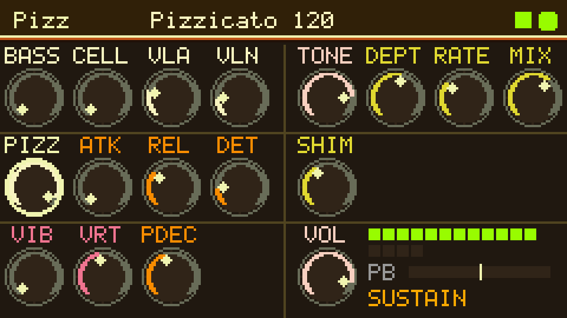

*Pizz patch with a 12-note chord and the pedal down: twelve voice pips, SUSTAIN lit, the pizzicato knob selected (white ring, value in the top bar).*

**Top bar:** patch name · selected parameter with its value (attack/release in ms or s, rates in Hz, detune in cents) · CPU square (green < 50 %, orange 50–79 %, red ≥ 80 %) · MIDI dot (lights 120 ms on note and CC messages).
**Knob grid:** green registrations, orange envelope, magenta vibrato, cyan ensemble, yellow tone/volume. The selected knob has a white ring.
**Status block (bottom right):** voice pips (two rows of 12; they turn red at the cap) · pitch-bend bar · SUSTAIN lamp.

| Input | Action |
|-------|--------|
| LEFT / RIGHT | Select previous / next knob (wraps) |
| UP / DOWN | Change by 2 per press; hold for repeat (after 350 ms, every 70 ms), step 8 after 700 ms |
| PRESS | Next patch |
| Button A | **Panic** — silence everything |
| Button B | Latching sustain on/off |

Each widget redraws only when its own value changes, and only that rectangle goes to the panel as one bulk SPI transfer (a knob is ≈ 2 KB, the largest rectangle 8.6 KB ≈ 1.2 ms), at most one per `loop()` pass, so USB and MIDI polling continue between rectangles.


<a id="strings-serial-commands"></a>
### Serial commands

Connect at 115200 baud.

| Command | Effect |
|---------|--------|
| `help` | List all commands |
| `stat` | CPU load, voice counts, audio PIO state |
| `voices` | Every sounding voice: slot, note, envelope stage and level, held / sustained / released / fading |
| `params` | All parameter values with their CC numbers |
| `set <name> <0-127>` | Set a parameter by serial name, e.g. `set atk 90` |
| `cc <n> <0-127>` | Send a MIDI CC |
| `on <note>` / `off <note>` | Play / release a note |
| `patch <0-3>` | 0 Ensemble · 1 Cello · 2 Violins · 3 Pizz |
| `sustain on\|off` | Latching sustain pedal |
| `all` / `panic` | Release all notes / silence everything now |
| `log notes\|cc\|all\|off` | Which incoming MIDI events are printed |
| `pio` | Audio PIO debug |


<a id="strings-tuning-guide"></a>
### Tuning guide

Everything is in `config.h` unless noted. The filter frequencies and ensemble depths are a **starting point chosen from how string machines are described, not from a reference unit**: expect to adjust them by ear.

| Constant | Default | Effect |
|---|---|---|
| `FILT_BASS_HZ` / `_Q` | 260 / 0.71 | low-pass of the 16′ bus |
| `FILT_CELLO_HZ` / `_Q` | 720 / 1.0 | low-pass of the 8′ bus (cello) |
| `FILT_VIOLA_HZ` / `_Q` | 1100 / 0.9 | band-pass of the 8′ bus (viola) |
| `FILT_VIOLIN_HZ` / `_Q` | 2400 / 0.7 | band-pass of the 4′ bus (violin) |
| `FILT_PIZZ_HZ` / `_Q` | 1600 / 0.7 | band-pass of the pizzicato bus |
| `TRIM_*` | calibrated | per-registration loudness; re-derive after changing a filter: `python3 tests/.build/strings/host_test/calibrate_trims.py` |
| `OUT_GAIN` | 0.15 | overall level; a 6-note chord peaks around 0.25–0.4 of full scale at the patch volumes |
| `ENS_D0_MS` | 5.0 | centre delay of the ensemble taps |
| `ENS_SLOW_DEPTH_MS` / `ENS_FAST_DEPTH_MS` | 2.4 / 0.45 | sweep at full DEPT (and SHIM) |
| `ENS_FAST_HZ` | 6.2 | fast LFO rate |
| `VIB_MAX_SEMITONES` | 0.35 | vibrato depth at VIB = 127 |
| `PZ_ATTACK_MS` | 2.0 | pizzicato strike attack |

The time/rate mappings (ATK, REL, PDEC, tone, ensemble and vibrato rates, detune) are the `*Seconds()` / `*Hz()` helpers at the top of `strings_params.h`. After changing patches or voicing, `python3 tests/.build/strings/host_test/calibrate_patches.py` suggests per-patch volumes that give every patch the same RMS.

If the CPU square goes orange: lower `MAX_ACTIVE_VOICES`; set **DET** to 0 (removes one saw per note); drop registrations you do not use (an unused footage bus costs nothing).

<a id="strings-troubleshooting"></a>
### Troubleshooting

| Symptom | Likely cause and fix |
|---|---|
| No sound at all | The banner's `audio shield:` line must name **your** board (`AUDIO_BOARD_REV2_1`; the wrong setting is silent); check the Pico-Audio is seated; run `pio` and confirm *SM enabled* |
| Pitch falls, clicks, or sound mutes with big chords | The audio core is overloaded: lower `MAX_ACTIVE_VOICES`, set DET to 0 |
| Notes do not sound / very quiet | Registration knobs at 0, or VOL low; try patch 0 (`patch 0`) |
| USB keyboard not detected | 15 kΩ pull-down on GP6 missing; some controllers (AKAI MPK mini) only enumerate if plugged in before the Pico is powered |
| Sound too dark / too thin | TONE, or the `FILT_*` voicing constants |
| Ensemble too subtle / too seasick | DEPT, SHIM and RATE, or the `ENS_*` constants |


<a id="strings-testing"></a>
### Testing

The engine, display and audio driver are tested on a PC with the **real source files** and mocked Arduino/Pico headers (`tests/strings/`, g++ with AddressSanitizer + UBSan including float-cast-overflow):

```bash
tests/run_tests.sh strings          # full suite (includes the torture and two-thread tests)
tests/run_tests.sh strings quick    # fast pass
```

| Suite | What it checks | Result |
|---|---|---|
| `test_dsp.py` | Drives the real engine through `probe.cpp` and measures: PolyBLEP vs naive saw alias energy at C4…C8 (≥ 15 dB better at every pitch); registration filter shapes at their design frequencies; **loudness balance** of the five registrations (within 1 dB; calibrated to 0.15 dB); ensemble (left = right at mix 0, decorrelated at full mix, level within 2 dB, tap delays sweep ±2.4 ms with offsets summing to zero); envelope timing (attack, release and pizzicato decay within 15 % of the set times); headroom of 6- and 10-note chords; everything-at-maximum stress | pass |
| `test_engine` | parameter table; one note's life; cap and newest-wins stealing; key-up voices stolen before held ones; pool exhaustion; **sustain pedal** (held after key-up, released on pedal-up, pedal after the key, retrigger under the pedal, stealing prefers sustained voices); same-key retriggers; bend and vibrato maths; every parameter at its extremes with 24 notes; **250 000-event random torture** with the bookkeeping invariants checked after every event (29 410 steals, max 21 live of 24 slots); **two real threads** (audio flat out and real-time paced; 772 000 control events against 3.5 million samples) | pass, no stuck voices, no sanitizer findings |
| `test_lcd` | emulates the ST7789: panel always equals the framebuffer; a knob update is 6 SPI calls / 2 KB; idle = zero traffic; value formats; two-row voice pips; SUSTAIN lamp; joystick repeat, patch cycling, debounce | pass |
| `test_audio.py` | the real `audio_driver.h` against a mocked pico-sdk, replayed through a PIO emulator and an I²S receiver model, for both audio shields (Rev 2.1 program byte-identical to the organ's; Initial Version bit-exact) | pass |

**CPU, on a PC (relative only — not Pico numbers):** the shared chain alone costs 51 ns per sample, 6 notes 98 ns, 16 notes (the default cap) 175 ns, and 16 notes with every registration and unison on 347 ns; for comparison the analog synth's 12 voices cost 122 ns on the same machine. A voice costs about the same as a synth voice; the shared chain costs about six voices. **The real load on the Pico is not measured yet** — the CPU square and `stat` will tell.

**Not verified:** the CPU figures and the analogue chain on the real hardware (it has been flashed and played, but not measured), the analogue chain, and how the voicing *sounds*. ThreadSanitizer was run on the analog synth, whose cross-core protocol this project reuses unchanged; it has not been re-run on this tree.


<a id="strings-known-limitations-and-next-steps"></a>
### Known limitations and next steps

- **Confirmed working on the tower; not yet tuned by ear.** Tune the voicing by ear (the constants above).
- **CPU unmeasured on the Pico**; the default cap of 16 is deliberately conservative.
- **Velocity and aftertouch are ignored** (a swell from channel aftertouch would be a natural addition).
- **One envelope for all registrations**; real machines have separate attack/release per section.
- **No solo/brass registrations and no split**; the registration table is easy to extend (add a bus + filter).
- The 5×7 display font draws a lowercase g like a 9, so no patch name contains one.
- USB hub with two devices is limited by the vendored `pio_usb` v0.5.3 (as in the other projects).

<a id="strings-source-files"></a>
### Source files (`firmware/strings/`)

| file | what it is |
|---|---|
| `config.h` | Pico String Machine, Pico 2 (RP2350) |
| `lcd.cpp` | single-page knob panel, Waveshare Pico-LCD-1.14 (ST7789, 240x135) |
| `lcd.h` | public interface of the LCD panel + joystick/buttons |
| `main.cpp` | String Machine  (same architecture as the analog synth and the tonewheel organ) |
| `midi_handler.h` | –  MIDI input: USB-MIDI + UART MIDI |
| `strings_dsp.h` | shared (all-voices) signal processing |
| `strings_manager.h` | polyphony, parameters, sustain pedal and the audio tick |
| `strings_params.h` | every user-facing parameter, in one table |
| `strings_voice.h` | one note of the string machine |
| `usb_host.h` | USB MIDI host via Pico-PIO-USB |


---

<a id="8-bass-synthesizer-and-sequencer"></a>
## 8. Bass synthesizer and sequencer

**Environment:** `pio run -e bass -t upload` (and `bass_nohost`) &nbsp;·&nbsp; **Sources:** `firmware/bass/` &nbsp;·&nbsp; **Tests:** `tests/run_tests.sh bass`
&nbsp;·&nbsp; **Listen:** [`audio/demo_bass.mp3`](audio/demo_bass.mp3)

Three oscillators + sub + noise into a **4-pole ladder filter with exact coefficients** (it self-oscillates *in tune* and tracks the keyboard), two ADSR envelopes, legato-only glide, accent, and a 303-style sample-exact step sequencer with slide and accent. Same platform, architecture and test tooling as `picosynth`, the tonewheel organ, `picostrings` and `picodrums`.

> **Status (November 2026):** confirmed working on the hardware. Tested mostly with an AKAI MPK mini on the USB host port. The behaviour described in this chapter was derived and measured on a PC against the real firmware sources (see the Testing part); the CPU figures have not been measured on the Pico, the voicing has not been tuned by ear, and some small errors are still to be chased.

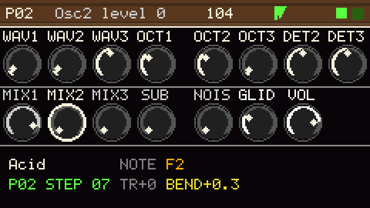

Listen to what the engine renders: [`audio/demo_bass.mp3`](audio/demo_bass.mp3) (37 s, mono: Moog Bass groove, an acid line with the cutoff sweeping, a sub pulse, a swung pluck; 108 BPM; peak -0.7 dBFS, no clipped samples).

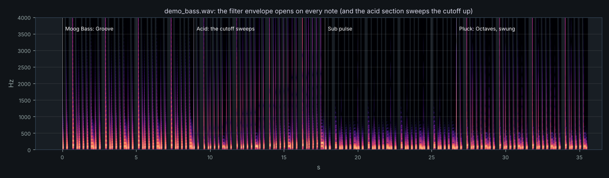

<a id="bass-1-what-was-found-while-building-it-the-filters-cutoff-scale"></a>
### What was found while building it: the filter's cutoff scale

The ladder from `picosynth` computes its pole coefficient as `g = tan(pi f / fs)`. Working out the loop exactly shows that puts the real pole at **about half the nominal frequency (0.50 at low cutoffs, drifting to 0.46 at 5 kHz)**. For a general synth that is only a different scale on the knob. For a bass synth it is wrong: the resonance should self-oscillate *at* the cutoff and the cutoff should track the keyboard exactly.

Each stage is `s += g*(sat(u) - sat(s))`, computed from the previous sample's state, so each stage is `g/(z-1+g)` and the loop is `L(z) = k * H(z)^4`. It oscillates where `arg(z-1+g) = pi/4`, which has a closed form: **`g = 1 - cos w + sin w`, `k_crit = 4 sin^4 w / g^4`** (w = 2 pi f / fs). `bass_tables.cpp` tabulates both (1/16-octave steps, linear interpolation) at boot. Resonance is then expressed *relative to critical*, so the RES knob means the same at every cutoff.

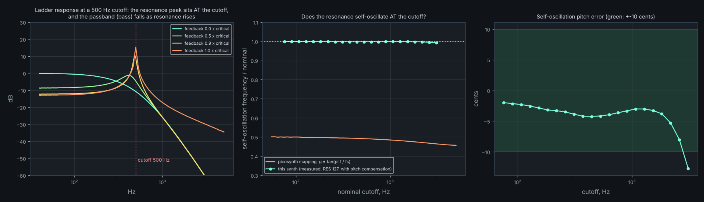

Measured on the real filter code: at exactly critical feedback it self-oscillates **within 0.4 cents of the target from 55 Hz to 3.5 kHz**. Above critical the `tanh`-style saturation pulls it flat (20-35 cents at 5-10 % over), exactly as on a real Moog; a measured compensation keeps it on pitch (**within 8 cents up to 2.6 kHz, 13 cents at 3 kHz**). The same exact mapping would fix picosynth's "true-Hz filter" open item.

<a id="bass-3-building-and-the-first-power-on-checklist"></a>
### First power-on checklist

1. **Banner.** Serial monitor at 115200: check `audio shield:` names your board and `ladder cutoff 20 Hz .. 5.5k Hz`.
2. **Sound.** `on 36` (a C2), then `off 36`. Try `patch 2` (Acid) and `set res 127`: the filter should whistle at the cutoff; `set cut 60` moves the pitch of the whistle.
3. **Keys.** Play the MPK. `log notes` shows each key and flags accents (velocity >= 112).
4. **Sequencer.** `play`: the Moog Bass groove loops. Press A on the board to stop.
5. **CPU square** (top right): should stay green. The PC worst case is 21 ns/sample; the real Pico figure is the first number to record.
6. **MIDI clock.** Setup page -> SYNC -> MIDI CLOCK, start your DAW.

<a id="bass-4-controls"></a>
### Controls

**A** tap = play / stop. **A held 0.6 s** = step-write on / off. **B** = next page (OSC -> FILT -> SEQ -> SETUP).

| Page | Joystick |
|---|---|
| OSC, FILT | LEFT/RIGHT select a knob, UP/DOWN change it (hold = fast), PRESS = audition a C2 (350 ms) |
| SEQ | LEFT/RIGHT move the cursor, UP/DOWN change the note (hold = octaves), PRESS cycles note -> accent -> slide -> slide+accent -> rest |
| SETUP | UP/DOWN choose a row, LEFT/RIGHT change it, PRESS = action (CLEAR needs a second press within 2 s; SAVE refuses while playing) |

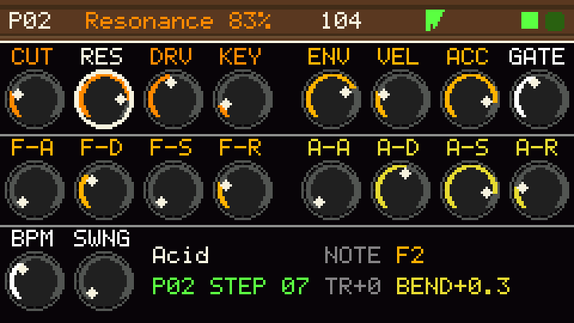

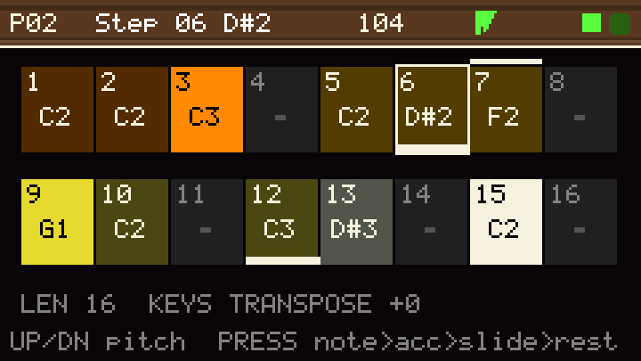

On the SEQ page accents are bright, a slide is a white bar bridging into the next step, rests are dark, the white bar above a step is the playhead and the frame is the cursor. The top bar shows the pattern, the selected value, tempo, the sounding note (green), play/stop, `EXT` (external clock) and a red `W` while step-write is on.

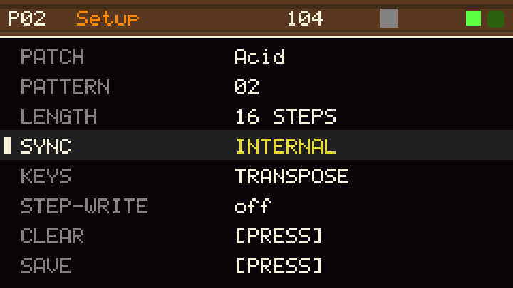

<a id="bass-5-the-sound"></a>
### The sound

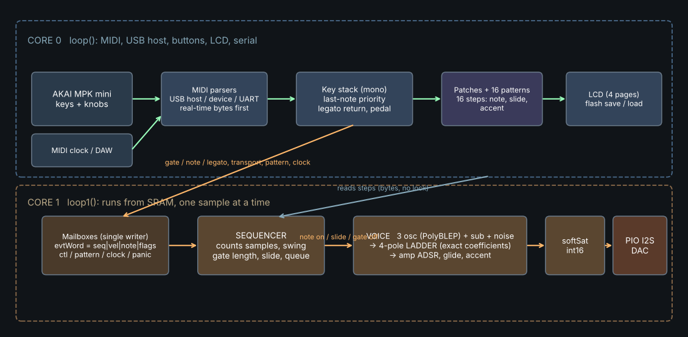

**Voice** (one, mono): oscillators 1-3 (saw, square or triangle each; PolyBLEP anti-aliased saw and square), octave -1..+2 each, osc 2 and 3 detuned +-50 cents; a **sub oscillator** (square, one octave below osc 1) and **noise**; mixed, `x INPUT_SCALE x DRIVE`, into the **ladder**, then amplitude, then a soft limiter.

| Knob (page) | Range | Notes |
|---|---|---|
| WAV1-3, OCT1-3, DET2-3 (OSC) | saw / square / triangle; -1..+2 octaves; +-50 cents | |
| MIX1-3, SUB, NOIS (OSC) | square law, 0..1 | |
| GLID (OSC) | off, 10 ms .. 3 s (time to 99 %) | **only while notes overlap** (legato / slide) |
| CUT (FILT) | 20 Hz .. 5.5 kHz, exponential | the frequency of the resonance peak |
| RES (FILT) | 0 .. 108 % of critical | **127 self-oscillates, in tune**; passband falls with resonance, as on a Moog |
| DRV (FILT) | x1 .. x6 into the ladder | saturation |
| KEY (FILT) | 0 .. 100 % | cutoff follows the keyboard in octaves per octave; C2 is the reference |
| ENV, VEL, ACC (FILT) | 0..6 octaves; 0..100 %; 0..100 % | filter envelope depth; velocity sensitivity; accent amount |
| GATE (FILT) | 10 .. 95 % of a step | sequencer note length |
| F-A F-D F-S F-R / A-A A-D A-S A-R | attack 1 ms .. 2 s; decay / release 5 ms .. 3 s (time to within 1 %); sustain 0..100 % | linear attack, exponential decay and release |
| BPM, SWNG | 60..187 (serial `bpm`: 30..300); 50..75 % | |

* **Cutoff in octaves.** Internally `cutoff = CUT + KEY * (pitch - C2)/12 + ENV * envelope`, all in octaves, clamped to 0..8.1 octaves above 20 Hz (the coefficient `g` reaches 1.0 at 5.5 kHz; above it the stage is unstable). No libm on the audio core.
* **Saturation is real and audible.** At full input level the ladder flattens the wave (a triangle's 3rd harmonic is about 3.4 dB lower than ideal); that is the Moog character, measured and asserted in the tests.
* **Accent** (a step with the accent flag, or a key with velocity >= 112): filter envelope depth x(1 + 1.5 x ACC) and +50 % x ACC level. **VEL** scales amplitude and envelope depth by velocity.
* **Mono keyboard**: last-note priority; releasing the top key returns to the previous held key **legato** (glide, no envelope retrigger); a detached key retriggers. Sustain pedal (CC64) holds. Pitch bend +-2 semitones.
* **Oscillator frequency** is capped at ~17 kHz (note 127 plus two octaves would be 50 kHz).

<a id="bass-patches-program-change-0-3-or-setup---patch-a-patch-never-changes-tempo-or-swing"></a>
#### Patches (program change 0-3, or SETUP -> PATCH; a patch never changes tempo or swing)

| # | Name | Character |
|---|---|---|
| 0 | Moog Bass | saw + detuned saw + square an octave down, medium resonance, snappy filter envelope |
| 1 | Sub | triangle + sub oscillator, filter nearly shut: a deep sine-like bass |
| 2 | Acid | one saw, resonance 108, big envelope, accent 110, glide: the TB-303 formula |
| 3 | Pluck | square + saw + sub, short filter decay, no sustain |

Volumes were **calibrated from measurement** (`tests/bass/calibrate_patches.py`): the same 4-bar groove through each patch reaches -19.5 dBFS RMS (Pluck -19.9, its VOL is maxed), peaks 0.38-0.77.

<a id="bass-6-the-sequencer"></a>
### The sequencer

Runs on **core 1 and counts samples**: step times are exact to 1 sample whatever core 0 (USB, LCD) is doing (measured over 33 steps at 120 BPM).

* **16 patterns x 16 steps**, per-pattern length 1-16. Each step: a note (C0..C7 range 12-96), **gate**, **slide**, **accent**. Four demo patterns (Groove, Acid, Sub pulse, Octaves) ship in the box.
* **Gate length** = GATE % of the step (it scales with a swung step's own length).
* **Slide** (303 style): the gate is held through the end of the step and the *next* note is played legato, no retrigger, gliding by the GLID time. A slide into a rest just ends the note.
* **Swing** 50-75 %, **tempo** changes apply from the next step.
* **Pattern change** while playing waits for the bar line (to the sample); stopped it is immediate.
* **Keys while playing**: by default (SETUP -> KEYS = TRANSPOSE) a key **transposes** the running sequence (C2 = no change; the transposition stays until the next key); the other mode plays the key over the sequence.
* **Step-write** (A held, or SETUP): the keyboard enters notes at the cursor and advances (velocity >= 112 = accent); the **sustain pedal enters a rest**.
* **MIDI clock** (SETUP -> SYNC): 24 ppqn, one step per 6 ticks; the first tick after Start fires step 1; Start restarts, Stop halts, Continue resumes. Gate length follows the *measured* tick interval. Start/Stop also work on internal sync. Swing is not applied under external clock.
* STOP releases a held note, so nothing hangs.

<a id="bass-7-midi"></a>
### MIDI

| Message | Does |
|---|---|
| notes, velocity | mono keyboard (>= 112 = accent) |
| pitch bend | +-2 semitones |
| CC 1-8 (AKAI K1-K8) | K1 CUT, K2 RES, K3 ENV, K4 F-D, K5 GLIDE, K6 DRIVE, K7 VOLUME, K8 ACCENT |
| CC 74 / 71 / 7 / 5 | cutoff / resonance / volume / glide (the standard numbers) |
| CC 14-33, 52-58, 72-75 | every other parameter, see `PARAM_INFO` in `bass_params.h` |
| CC 64 / 120 / 123 | sustain pedal / all sound off (fast release) / all notes off |
| program change 0-3 | patch |
| clock F8, start FA, continue FB, stop FC | transport |

`midi_handler.h` has the real-time byte fix from the drum machine: a clock byte may sit between the data bytes of another message and must neither corrupt it nor be dropped by the channel filter. `usb_host.h` calls the shared, tested parser.

<a id="bass-8-serial-console"></a>
### Serial console

`help` lists everything. Useful: `log notes`, `grid`, `params`, `set cut 70`, `patch 2`, `step 3 D#2sa` (step 3 = D#2, slide, accent; `step 4 .` = rest), `write on`, `bpm 97.5`, `save`, `load`, `demo`, `stat`.

<a id="bass-9-testing"></a>
### Testing

`tests/bass/run_tests.sh` builds and runs every suite against the real sources, with AddressSanitizer + UBSan (+ float-cast-overflow):

| Suite | Checks | Covers |
|---|---|---|
| `test_dsp.py` | 57 | pitch within 1 cent E1..C6, bend, octave, detune, sub; raw saw / square / triangle harmonic series exact; PolyBLEP beats naive by >= 15 dB; ladder -3 dB point, slope, resonance behaviour; **self-oscillation in tune**; KEY 0 / 64 / 127; envelope ENV / accent / velocity / drive; attack, decay, release timing; glide, legato, retrigger; mono priority; pedal; stability; patch loudness |
| `test_seq.py` | 39 | sample-exact timing, gate length, swing, tempo change, slide, accent, rests, STOP, START / CONTINUE, pattern queue, length, transpose, step-write, MIDI clock, CCs, panic |
| `test_engine.cpp` | 117 | parameters, **40,000 random key operations against a reference model**, patterns, save image + corruption, 250,000-event torture, two-thread race, 2000 note on/off pairs = 4000 voice events, extremes |
| `test_storage.cpp` | 14 | LittleFS wrapper: save / load, refusal while playing, power cut, bit-rot |
| `test_lcd.cpp` | 68 check lines | ST7789 emulator: every page painted completely, gestures, 1500-step fuzz (panel == framebuffer), largest transfer **8651 bytes = 1.15 ms** |
| `test_midi.cpp` | 16 + 19 | the real `midi_handler.h`, omni and `MIDI_CHANNEL 10` |
| `test_audio.py` | | the real audio driver for both shields through a PIO emulator |

Bugs the tests found *in this project*: the first ladder derivation had an extra delay in the loop (the measurement against the real filter exposed it); oscillator frequency overflowing `uint32` for a high key plus +2 octaves; `loadPatch` rounding a fractional BPM; the SEQ cursor frame drawn one pixel outside its widget (never sent to the panel); the first external-clock step computing its gate from time zero.

**Performance** (`tests/bass/bench.cpp`, x86 -O2, *relative*): idle 1.9 ns/sample; one held note 17.6 ns; **worst case (3 oscillators + sub + noise, resonance and drive maxed) 21 ns**; the demo pattern playing 11 ns. For comparison the drum machine's worst case is 69 ns and the string machine's 349 ns on the same machine. No CPU governor is needed.

<a id="bass-10-known-limitations--not-yet-verified"></a>
### Known limitations

* **Confirmed working on the tower; voicing not yet tuned by ear, CPU not measured.** The first thing to record is the CPU square. All voicing (patches, envelope ranges, drive curve, accent amount) is derived from known behaviour, not tuned by ear.
* The ladder runs at 44.1 kHz without oversampling: with high resonance on high notes some aliasing is possible (not measured; the cutoff is capped at 5.5 kHz). Self-oscillation drifts flat above ~2.6 kHz (-13 cents at 3 kHz).
* The ladder's -3 dB point is 0.435 x cutoff at low frequencies but drifts up (0.47 at 400 Hz, 0.56 at 1.6 kHz), and its slope is 24 dB/octave only well above the cutoff: it is a discrete filter, not an analog one.
* `usb_host.h` cannot be compiled on a PC; it is a few lines around the shared, tested parser. Flash saving is tested against an in-memory LittleFS mock. Both are untested on hardware.
* One voice only (a bass); no LFO, no filter FM, no portamento outside legato; no song chaining; no per-step velocity or ties beyond slide.
* External clock jitter goes straight into the step timing (core 0 polls USB); swing is not applied under external clock. A USB hub is not supported by this pio_usb version.

<a id="bass-source-files"></a>
### Source files (`firmware/bass/`)

| file | what it is |
|---|---|
| `bass_dsp.h` | oscillators (PolyBLEP), ladder filter, envelope, limiter. Core 1, force-inlined, no libm |
| `bass_manager.h` | the bass synth: mono key handling, patches, 16 x 16-step sequencer, transport |
| `bass_params.h` | parameters, value mappings, patches, demo patterns |
| `bass_storage.h` | save / load the sound + patterns to flash (LittleFS) |
| `bass_tables.cpp` |  |
| `bass_tables.h` | tables built ONCE at boot (core 0, libm allowed), read-only afterwards (core 1) |
| `bass_voice.h` | the one voice: 3 oscillators + sub + noise -> ladder -> amp.   Mono, Moog-style |
| `config.h` | Pico Bass Synth (Moog-style mono bass + step sequencer), Pico 2 (RP2350) |
| `lcd.cpp` | 4-page bass synth panel, Waveshare Pico-LCD-1.14 (ST7789, 240x135) |
| `lcd.h` | public interface of the LCD panel + joystick/buttons. Implementation: lcd.cpp |
| `main.cpp` | Bass Synth  (same architecture as the analog synth, the tonewheel organ, the string machine and the drum machine) |
| `midi_handler.h` | –  MIDI input: USB-MIDI + UART MIDI |


---

<a id="9-drum-machine-and-sequencer"></a>
## 9. Drum machine and sequencer

**Environment:** `pio run -e drums -t upload` (and `drums_nohost`) &nbsp;·&nbsp; **Sources:** `firmware/drums/` &nbsp;·&nbsp; **Tests:** `tests/run_tests.sh drums`
&nbsp;·&nbsp; **Listen:** [`audio/demo_drums.mp3`](audio/demo_drums.mp3)

16 synthesised drum voices, a sample-exact 16-step sequencer, a 4-page LCD, MIDI pads and MIDI clock, flash save/load. Same platform, same architecture and same test tooling as the analog synth (`picosynth`), the tonewheel organ and the string machine (`picostrings`).

> **Status (November 2026):** confirmed working on the hardware. Tested mostly with an AKAI MPK mini on the USB host port. The behaviour described in this chapter was derived and measured on a PC against the real firmware sources (see the Testing part); the CPU figures have not been measured on the Pico, the voicing has not been tuned by ear, and some small errors are still to be chased.

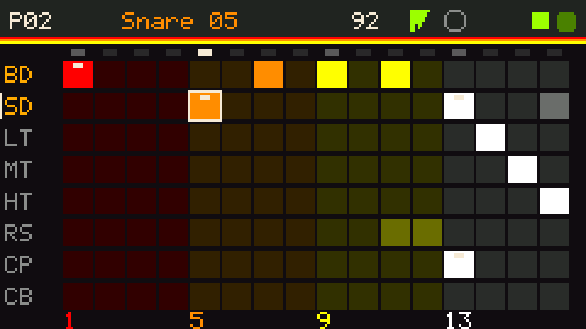

Listen to what the engine renders: [`audio/demo_drums.mp3`](audio/demo_drums.mp3) (39 s: the four demo patterns as a song, 104 BPM, light swing, drive raised for the second half; peak -4.2 dBFS, no clipped samples).

<a id="drums-3-building-and-the-first-power-on-checklist"></a>
### First power-on checklist

1. **Banner.** Open the serial monitor (115200). Check `audio shield:` names your board, and `patterns:` says *factory demo* on a first boot.
2. **Sound.** Type `hit 0` (kick), `hit 1` (snare), `hit 8` (closed hat). Then `play`: the House demo should loop.
3. **Find your pad notes.** `log notes`, then hit the 8 pads (and the second bank). Each line shows `NOTE 36 v100 -> BD`. The linear map assumes the pads send **notes 36-51**; if yours differ, `padbase <first note>` fixes it, or `pads gm` for General MIDI (useful for DAW drum tracks).
4. **CPU square** (top right of the LCD): should stay green. On the PC the worst case (all 16 voices ringing) costs about a quarter of the string machine's worst case; the real Pico figure is the first thing to record.
5. **Sync.** If you have a DAW or sequencer sending MIDI clock: Pattern page -> SYNC -> MIDI CLOCK, press Start on the other device.

<a id="drums-4-controls"></a>
### Controls

**A** tap = play / stop. **A held 0.6 s** = record on / off. **B** = next page (GRID -> INST -> PATTERN -> SONG). Joystick as below. Everything on the LCD is also reachable from MIDI and serial.

<a id="drums-grid-page"></a>
#### GRID page


16 steps x 8 tracks of the cursor's bank (tracks 1-8, or 9-16). Steps are coloured in the 808's groups of four. A step is **off** (dark), **ghost** (dim, velocity 55), **normal** (bright, 100) or **accent** (bright with a white notch, 127).

| Input | Does |
|---|---|
| LEFT / RIGHT | cursor along the steps |
| UP / DOWN | cursor to another track; **that instrument becomes the selected one** for the knobs |
| PRESS | step: off -> normal -> accent -> ghost -> off |
| pad hit | the cursor jumps to that instrument's track |

Labels turn amber while an instrument sounds. The white playhead strip only shows when the displayed pattern is the one playing. A pattern shorter than 16 steps blanks the unused cells.

<a id="drums-inst-page-the-knobs-for-the-selected-instrument"></a>
#### INST page: the knobs for the selected instrument

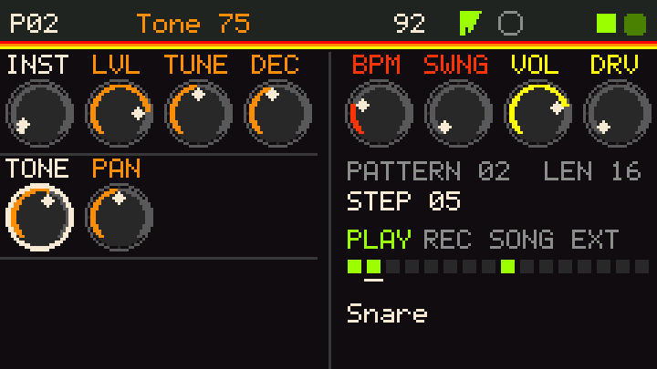

Five knobs belong to the **selected instrument** (INST, LVL, TUNE, DEC, TONE, PAN) and four to the machine (BPM, SWNG, VOL, DRV). LEFT/RIGHT choose a knob, UP/DOWN change it (hold for fast), PRESS auditions the instrument. Tempo moves in whole BPM. The block on the right shows pattern, step, transport lamps and 16 pips: which instruments are sounding, with the selected one underlined.

<a id="drums-pattern-page"></a>
#### PATTERN page

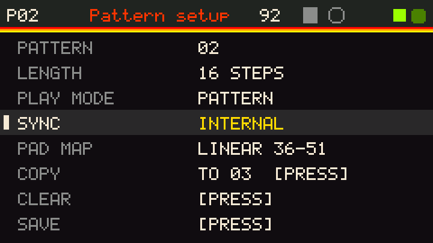

| Row | LEFT / RIGHT | PRESS |
|---|---|---|
| PATTERN | previous / next (queued to the bar end while playing) | |
| LENGTH | 1-16 steps | |
| PLAY MODE | PATTERN / SONG | toggle |
| SYNC | INTERNAL / MIDI CLOCK | toggle |
| PAD MAP | LINEAR / GENERAL MIDI | toggle |
| COPY | | copy this pattern (and its length) to the next |
| CLEAR | | press **twice within 2 s** |
| SAVE | | save to flash (**refused while playing**) |

<a id="drums-song-page"></a>
#### SONG page

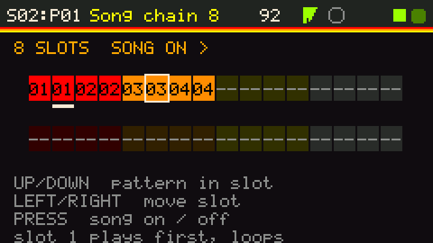

A chain of up to 32 patterns. LEFT/RIGHT move between slots, UP/DOWN set the pattern in the slot (down past 1 = empty), PRESS = song mode on/off. Slot 1 plays first and the chain loops at the first empty slot. The playing slot is underlined. While the song plays, pattern selection is ignored.

<a id="drums-5-the-instruments"></a>
### The instruments

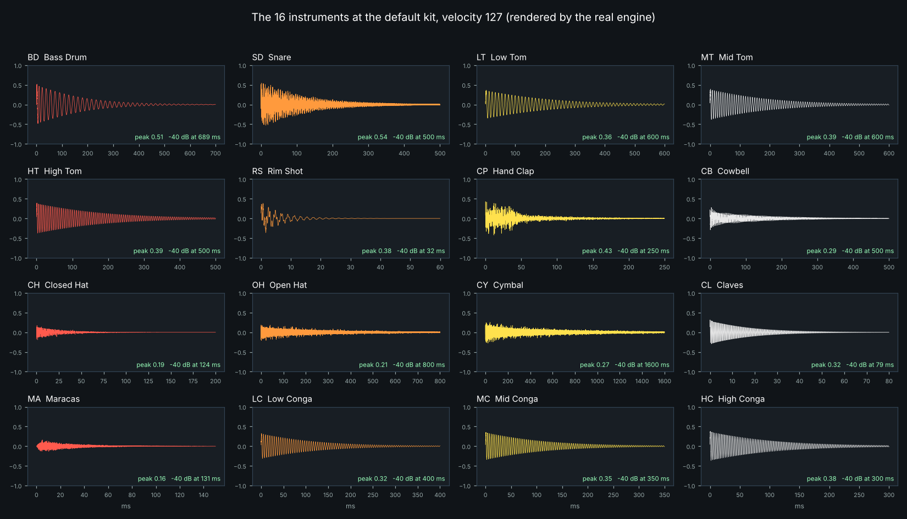

All voices are synthesised (no samples). Seven synthesis types cover the 16 instruments:

| Type | Instruments | Built from |
|---|---|---|
| sine + pitch envelope | BD, LT, MT, HT, CL, LC, MC, HC | a sine whose pitch falls exponentially, a decay envelope, a 1-3 ms noise click |
| snare | SD | two sines (185 Hz and 1.78x) plus high-passed noise |
| rim | RS | two short partials (1.7 kHz and 470 Hz) plus a click |
| clap | CP | band-passed noise: four bursts ~11 ms apart, then a tail |
| cowbell | CB | two squares (540 / 800 Hz) through a band-pass, strike + tail |
| metal | CH, OH, CY | six square oscillators at the 808's hat ratios (205 304 370 523 540 800 Hz) through a high-pass |
| noise | MA | high-passed, low-passed noise with a ~4 ms attack |

**Closed hat chokes open hat** (4 ms). Velocity scales amplitude linearly. LEVEL is a square law; PAN is constant power.

| Instrument | TUNE | DECAY | TONE |
|---|---|---|---|
| BD | end pitch 40-80 Hz | 60-720 ms | click + sweep depth |
| SD | tone pitch | both decays | noise ("snappy") vs tone |
| LT MT HT | +-6 semitones | 80-480 ms | sweep depth |
| LC MC HC | +-6 semitones | 50-250 ms | sweep depth |
| RS | pitch | decay | high vs low partial |
| CP | filter centre | tail | tail vs bursts |
| CB | pitch | tail | brightness |
| CH OH CY | metal pitch | CH 12-72 ms, OH 0.12-0.6 s, CY 0.2-1.2 s | high-pass corner |
| CL | pitch | 10-40 ms | sweep depth |
| MA | | decay | high-pass corner |

The default LEVELs were **calibrated from measurement** (`tests/drums/calibrate_kit.py`): each instrument reaches a chosen peak power at full velocity (kick biggest, hats and maracas smallest), with every default at or below 123 so there is headroom to turn up.

<a id="drums-6-the-sequencer"></a>
### The sequencer

Runs on **core 1 and counts samples**: step times are exact to 1 sample regardless of what core 0 (USB, LCD) is doing. At 120 BPM a 16th note is 5512.5 samples; measured over 33 steps the largest error is 1.0 sample (no drift).

* **16 patterns x 16 tracks x 16 steps**, per-pattern **length** 1-16. Step levels ghost / normal / accent = velocity 55 / 100 / 127.
* **Tempo** 60-187 BPM from the knob (1 BPM per step) or 30-300 with `bpm`. Changes apply from the next step.
* **Swing** 50-75 %: even steps stay on the grid, odd steps are delayed; each pair still lasts exactly two steps.

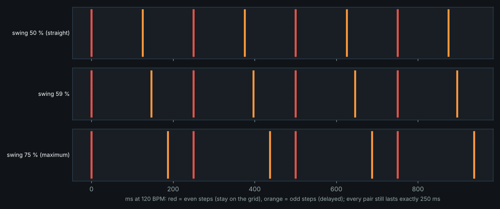

* **Pattern change while playing** is queued and takes effect on the bar line (verified to the sample). Stopped: immediate.
* **Song**: the chain of patterns; ignores pattern selection while playing.
* **Record** (A held 0.6 s, while playing): a pad hit is written to the *nearest* step, "later than half a step" goes to the next one, and a hit in the last step wraps to step 1. The velocity sets the level (>=110 accent, >=75 normal, else ghost). Recording replaces what was on that step. Hits are quantised on the audio core, so the quantisation is exact; the pattern is updated a moment later by core 0.
* **MIDI clock** (Pattern page -> SYNC): 24 ppqn, one step per 6 ticks. The first tick after Start fires step 1. Start restarts, Stop halts, **Continue resumes where it stopped**. Start / Stop / Continue also control the transport in internal sync. Clock jitter on the input becomes step jitter (core 0 polls USB); swing is not applied under external clock.
* **Program change 0-15** selects the pattern (queued to the bar end).

<a id="drums-7-midi"></a>
### MIDI

| Message | Does |
|---|---|
| notes 36-51 (linear) or the GM drum map | pad -> instrument; velocity = level; selects the instrument |
| CC 1-8 (AKAI K1-K8) | K1 TUNE, K2 DECAY, K3 TONE, K4 LEVEL (selected instrument), K5 BPM, K6 SWING, K7 VOLUME, K8 DRIVE |
| CC 7 / 10 / 20-23 | volume / pan / level / tune / decay / tone (selected instrument) |
| CC 24 25 26 27 | tempo / swing / drive / select instrument (value / 8) |
| CC 120 | all sound off (chokes every voice in ~20 ms) |
| program change | pattern |
| clock F8, start FA, continue FB, stop FC | transport (see above) |

The GM map: 35/36 BD, 37 RS, 38/40 SD, 39 CP, 41/43 LT, 45/47 MT, 48/50 HT, 42/44 CH, 46 OH, 49/51/52/55/57 CY, 56 CB, 75 CL, 69/70 MA, 64 LC, 63 MC, 62 HC.

`midi_handler.h` was changed for this project: a real-time byte (clock!) can appear *between* the data bytes of another message; the old parser treated it as a new status byte and corrupted the note, and its channel filter would have discarded real-time messages (`0xF8 & 0x0F` reads as "channel 9"). Both are fixed and tested (see Testing). The behaviour is behind `MIDI_REALTIME` (default off in the shared file) so the other projects are unaffected until they adopt it.

<a id="drums-8-serial-console"></a>
### Serial console

`help` lists everything. The useful ones: `log notes` (which instrument each pad hits), `grid` (the pattern as text), `kit`, `hit <0-15>`, `step <inst> <step> <0-3>`, `song 1 1 2 3`, `bpm 97.5`, `padbase`, `pads gm`, `save`, `load`, `demo`, `stat`.

```
pattern 1, length 16   (. off  1 ghost  2 normal  3 accent)
   |0123|4567|8901|2345
BD |3...|2...|2...|2...
...
```

<a id="drums-9-testing"></a>
### Testing

`tests/drums/run_tests.sh` builds and runs every suite against the real sources, with AddressSanitizer + UBSan (+ float-cast-overflow) on:

| Suite | Checks | Covers |
|---|---|---|
| `test_dsp.py` | 36 | pitches, sweeps, decay laws, snare balance, hat brightness and decay, choke both ways, clap bursts, cowbell partials, maracas attack, velocity / level / pan laws, headroom, determinism, voices release |
| `test_seq.py` | 37 | sample-exact timing, swing, tempo change, transport, pattern queue, song, length, levels, record quantise, MIDI clock, pads, CCs, volume, drive, panic |
| `test_engine.cpp` | 56 | parameters, ring buffer, save image + corruption, 250,000-event torture, two-thread race, 3000 paced hits = 3000 voice starts, softSat bound, full-scale extremes |
| `test_storage.cpp` | 14 | the real LittleFS wrapper: save / load, refusal while playing, **power cut during save keeps the old file**, bit-rot, truncated, erased flash |
| `test_lcd.cpp` | 87 check lines | an ST7789 emulator behind SPI: every page painted completely, cell colours, cursor, editing, pad follow, playhead, A tap / hold, B, all page controls, 1500-step random fuzz (panel == framebuffer), largest transfer **8651 bytes = 1.15 ms** |
| `test_midi.cpp` | 16 + 19 | the real `midi_handler.h`: clock inside a note, running status, USB packets; built twice (omni and `MIDI_CHANNEL 10`) |
| `test_audio.py` | | the real audio driver for both shields through a PIO emulator |

Tests that matter because they *failed first*: the step-cycle table (my bug), the save-then-delete-then-rename ordering (my bug, would have lost the only good save on a power cut), and the `softSat` overshoot.

**Performance** (`tests/drums/bench.cpp`, x86 at -O2, *relative* numbers only): idle 14 ns/sample; the demo pattern averages 24 ns (up to 3 voices); **all 16 voices alive at once 69 ns**; every track on every step at 300 BPM 79 ns. For comparison the string machine's worst case is 349 ns on the same machine. No CPU governor is needed.

<a id="drums-10-known-limitations--not-yet-verified"></a>
### Known limitations

* **Confirmed working on the tower; voicing not yet tuned by ear, CPU not measured.** The first thing to measure is the CPU square. Whether it sounds like an 808 is your call: filter constants and the hat/clap/rim voicings are first guesses, derived from the known circuit values, not tuned by ear. The voicing parameters are all in `drum_voices.h` (`derive()`) and `config.h`.
* The 808 hats use naive (not band-limited) squares: some aliasing, which suits metallic sounds, but it is there. The hat centroid measures ~10 kHz.
* `usb_host.h` cannot be compiled on a PC (it needs the PIO-USB stack). It is now only ~10 lines that call the shared, tested `_dispatchUsbPacket()`.
* **Flash saving** (LittleFS) is tested against an in-memory mock, not real flash. The save pauses the audio for a few ms, which is why it refuses to run while playing.
* One fixed 16-step grid per pattern (with a per-pattern length), not per-track lengths (polymeter); no per-track mute or solo; no pattern chaining on one button.
* External clock: jitter of the incoming clock (core 0 polling) goes straight into the step timing, and swing is not applied.
* A USB hub is not supported by this pio_usb version.

<a id="drums-editor"></a>
### The drum editor (`tools/drums`)

A browser-based editor for the drum machine, in the same spirit as the piano's bank configurator: edit **patterns, the song chain, the kit and the sounds**, keep a **library**, **hear the result through the firmware's own engine on your PC**, and move everything to and from the machine over USB.

```bash
python3 -m pip install -r tools/drums/requirements.txt     # flask (+ pyserial for the USB link)
python3 tools/drums/drum_gui.py                            # opens http://127.0.0.1:5001
```

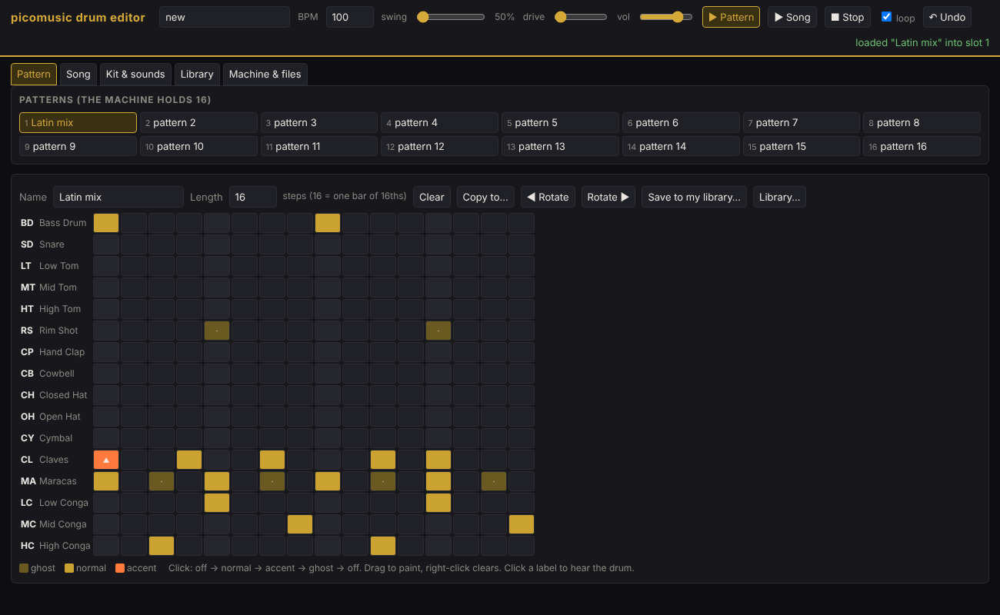

- **Pattern tab.** The 16 pattern slots, a 16-track x 16-step grid (click: off, normal, accent, ghost; drag to paint, right-click clears), pattern length 1..16, rotate, copy, clear. Click a drum name to hear it.
- **Song tab.** Build the chain of up to 32 patterns by clicking slots.
- **Kit & sounds tab.** The five settings of every drum (level, tune, decay, tone, pan) as sliders: moving one plays the drum. Per drum a *sound preset* list, per kit a *kit preset* list, and *save to my library* for both.


- **Library tab.** 43 patterns (house, techno, electro, disco, hip hop, trap, breaks, drum and bass, garage, rock, pop, funk, reggae, latin, afro, fills and test patterns), 9 kits and 124 sound presets. *Hear* plays an entry on your current kit, *Load* puts a pattern into the selected slot (with its tempo and swing if you like). **Save to my library** keeps your own patterns, kits and sounds in `tools/drums/library/user/` (never touched by the shipped library, which is regenerated by `tools/drums/build_library.py`).
- **Machine & files tab.** *Read from machine* / *Send to machine* over the Pico's USB serial port (with an optional *also save to flash*), projects as `.json` files in `tools/drums/projects/`, and the raw machine image as `.bin`.
- **Audition.** The play buttons render the pattern, the song, a drum or the whole kit with the firmware's real `DrumManager` compiled for the PC (needs `g++`; the first start compiles it, about 10 s). Patterns loop seamlessly (the ring-out of the last bar is mixed under the first). The status line shows the peak level and warns if it clips.


**How it talks to the machine.** Two serial commands were added to the drum firmware: `dump` prints the whole state (kit, 16 patterns, song, tempo, swing, volume, drive, pad map) as one hex line, `image <hex>` loads one; both use the 4247-byte image that the flash save uses (header, sizes, CRC32), so a damaged or foreign image is refused without changing anything. The firmware refuses `image` while playing, the editor sends `stop` first. You can also type both commands in the serial console by hand.

**What it does not do.**
- The machine stores no names: pattern and kit names live in the project `.json` only (and in your library). *Read from machine* gives patterns names like "pattern 3".
- The library rhythms are textbook grooves written from memory, kept simple, and **not** checked by ear against recordings; the kits and the sound presets are plain offsets of the factory kit (shorter, longer, lower, higher, darker, brighter) plus a few hand-made ones, starting points rather than tuned sounds. The audition uses the PC build of the engine, so it matches the firmware's maths, not your speakers.
- The USB link has been tested against a stand-in that answers like the firmware, and the firmware change compiles and its hex/image code is host-tested, but it has **not been tried on the real machine yet**.
- Only the five per-drum settings exist in the engine: "editing sounds" means those five numbers per drum (level, tune, decay, tone, pan). Changing the voices themselves is a firmware job (`drum_voices.h`).
- 16 steps per pattern and 16 patterns, as in the firmware.

Tests: `tests/run_tests.sh drums` (image round trip against the real firmware, library, API, engine, loop, USB protocol, frontend script).

<a id="drums-source-files"></a>
### Source files (`firmware/drums/`)

| file | what it is |
|---|---|
| `config.h` | Pico Drum Machine, Pico 2 (RP2350) |
| `drum_dsp.h` | small DSP primitives for the drum voices (core 1, force-inlined, no libm) |
| `drum_hex.h` | hex text <-> bytes, for the serial commands  dump  and  image <hex> |
| `drum_manager.h` | the drum machine: voices, sequencer, patterns, song, transport |
| `drum_params.h` | instruments, the knob table, the default kit, pad maps, demo patterns |
| `drum_storage.h` | save / load the kit + patterns + song to flash (LittleFS) |
| `drum_voices.h` | the 16 synthesised drum voices (TR-808-style, digital approximations) |
| `lcd.cpp` | 4-page drum machine panel, Waveshare Pico-LCD-1.14 (ST7789, 240x135) |
| `lcd.h` | public interface of the LCD panel + joystick/buttons |
| `main.cpp` | Drum Machine  (same architecture as the analog synth, the tonewheel organ and the string machine) |
| `midi_handler.h` | –  MIDI input: USB-MIDI + UART MIDI |


---

<a id="10-sampled-piano"></a>
## 10. Sampled piano

**Environment:** `pio run -e piano -t upload` (and `piano_nohost`) &nbsp;·&nbsp; **Sources:** `firmware/piano/` &nbsp;·&nbsp; **Tests:** `tests/run_tests.sh piano`
&nbsp;·&nbsp; **Listen:** [`audio/demo_piano.mp3`](audio/demo_piano.mp3)

A 24-note sampled keyboard engine (32 voice slots) on a plain **4 MB** Pico 2: 4-bit ADPCM samples play straight from flash. It ships with an acoustic grand (3.0 MB) and now also supports **several instruments, velocity layers and seamless loops**, a four-effect pipeline (**wah, tremolo / auto-pan, chorus, reverb**), and a laptop-side **bank configurator** (command line and web GUI) that builds the sample bank from your own samples or an SFZ library. Velocity dynamics, sustain pedal, una corda, damper, stereo spread, an 88-key lit keyboard on the LCD. Same platform, architecture and test tooling as the analog synth, tonewheel organ, string machine, drum machine and bass synth.

> **Status (November 2026):** confirmed working on the hardware. Tested mostly with an AKAI MPK mini on the USB host port. The behaviour described in this chapter was derived and measured on a PC against the real firmware sources (see the Testing part); the CPU figures have not been measured on the Pico, the voicing has not been tuned by ear, and some small errors are still to be chased.


The two knob pages: the piano (above) and the effects (below). Selecting past the 8th knob turns the page; the instrument name is top left, its credit line bottom.


Listen to what the engine renders: [`audio/demo_piano.mp3`](audio/demo_piano.mp3) (31 s: the harmonic outline of the C-major arpeggio prelude, BWV 846, under the sustain pedal with small velocity variations, then a held chord; peak -7 dBFS, no clipped samples).


<a id="piano-1-the-samples-and-the-licence"></a>
### The samples and the licence

The sound is the **Salamander Grand Piano V3** (Yamaha C5, Alexander Holm, **CC BY 3.0**), the **lossless** 48 kHz / 24-bit recordings from the sfzinstruments repository: 30 samples, every minor third from A0 to C8, **one velocity layer** (layer 10 of 16, velocities 73..80; the original has 16). An earlier version of this project used a 38 kbit/s MP3 rendition of the V2 recordings: it has almost nothing above 5 kHz (-99 dB above 6 kHz in the first 100 ms of C4, against -62 dB in the lossless file), so the attack was dull. Attribution and a list of what was changed are in [`NOTICE.md`](NOTICE.md): please read it, CC BY requires it. `tools/piano/fetch_salamander.sh` downloads the 30 files (about 45 MB; `fetch_salamander.sh 13` fetches a harder layer instead).

**Other instruments.** The firmware plays whatever bank you build; the shipped one is the grand only. I looked for free Rhodes and clavinet samples (November 2026, from the GitHub pages; verify each licence yourself before relying on this):

| Source | What | Licence as I read it |
|---|---|---|
| jlearman.jRhodes3c (sfzinstruments) | a 1977 Rhodes Mark I, up to 5 velocity layers, looped version about 16 MB | **CC BY-NC-SA 4.0**: attribution, **non-commercial**, **share-alike** (a bank built from it must carry the same terms) |
| GregSullivan.E-Pianos (sfzinstruments) | Yamaha CP80, Wurlitzer EP200, Hohner Pianet T | CC BY 3.0 |
| jlearman/stevie-clavinet | a real Hohner clavinet | **"License is unknown"** in its README: private use at your own risk, do not redistribute |
| thecowgoesmoo/TwinCl | a newly designed clavinet, simulated | MIT, but not a recording of a real clavinet |
| General MIDI clavinet (FluidR3 / WebAudioFont) | 11 tiny looped MP3 zones, 67 KB in total | permissive, but thin |

Nothing but the grand is bundled, but there are download scripts and ready configs for the other two, **for your own use**: `tools/piano/fetch_rhodes.sh` (jRhodes3c into `samples/jRhodes3c`), `tools/piano/fetch_clavinet.sh` (Stevie Clavinet into `samples/stevie-clavinet`), and `banks/rhodes.yaml`, `banks/clavinet.yaml` and `banks/all.yaml` (grand + Rhodes + clavinet in one 3.0 MB bank). Do not redistribute these samples or a bank built from them (CC BY-NC-SA for the Rhodes, unknown for the clavinet). I built `all.yaml` against the real libraries and played each instrument through the engine (see *The bank configurator*); I have not listened to the result. Every instrument carries its own credit line (shown on the LCD): see `NOTICE.md`.

<a id="piano-2-how-it-fits-in-4-mb"></a>
### How it fits in 4 MB


* **4-bit ADPCM with an adaptive predictor ("codec 2"), mono, 4:1 against 16 bit.** The quantiser is IMA ADPCM (same step table, same index adaptation); the predictor is new: four taps, backward-adaptive, **integer only** (Q13 weights, a sign-error LMS update `w += sign(error) * history >> 7` on the reconstructed signal, no side information in the stream), so the PC encoder and the Pico agree to the bit. A piano note is a few decaying sinusoids, which four taps anticipate far better than "the previous sample" (all that plain IMA predicts), so the 4 bits code a much smaller residual and the noise is much lower. The firmware decoder and the encoder tool share one header (`piano_adpcm.h`), so they cannot disagree. Decoder cost: four multiply-accumulates and four shift-adds per sample.
* **Per-register sample rate and length**, set by `rate_rules` in `banks/grand.yaml` and fitted to a byte budget by `tools/piano/bankconf` (default 3,000,000): bass 16 kHz and 15 s (low notes carry little high-frequency energy and sing for a long time), mid 24 kHz and 9.7 s, treble 32 kHz and 4.8 s (bright, but they die quickly). Each zone ends in a raised-cosine fade, so a note held longer than that fades out instead of looping. **The budget is shared by all instruments**: with the grand alone it keeps 3.0 MB; if it shares the flash, its notes get shorter (not its quality per second): 2.4 MB gives 11.9 / 7.6 / 3.8 s, 1.8 MB 8.9 / 5.7 / 2.9 s, 1.5 MB 7.4 / 4.8 / 2.4 s, 1.0 MB 4.9 / 3.2 / 1.6 s (bass / mid / treble).
* **Every key plays the nearest sample** shifted by at most one semitone (4-point Hermite interpolation), which is why a sample every minor third is enough.
* **Stretch tuning is kept.** The tool measured each recording's true fundamental: A0 is 24 cents flat, C4 is in tune, C8 is 100 cents sharp (a real piano's stretch). Correcting that to equal temperament would make it sound dead, so keys keep the recording's tuning and only shift by exact semitones.
* **The strike is stored losslessly.** Measured in 1 ms windows, the codec's SNR falls to **27-29 dB for 1-3 ms at the hammer strike** while the rest of the note runs at 45-46 dB (the same with plain IMA ADPCM, and with either source): a 4-bit quantiser cannot follow the sharpest transient of the note. That burst is amplified by velocity, and it is what a loud note's "hiss at the hit, none in the sustain" is. No setting of the start state, lead-in or fade-in changed it, so the first **9 ms of every zone are plain 16-bit PCM** (144 / 216 / 288 samples at 16 / 24 / 32 kHz, 13.8 KB for the whole grand, 0.5 % of the flash) and the ADPCM stream continues from the head's history at a step index the tool picks per zone. The worst 1 ms window after the handover is 35-38 dB instead of 29, the total SNR is unchanged.
* **Every zone is stored at full scale** (peak 0.92) and a **zone gain** (-10.2 .. 0 dB for the grand) restores the level at play-back, so quiet zones no longer sit 10 dB lower in the 16-bit range, closer to the codec's noise floor. The play-back level is unchanged (tested: the engine's output equals the decoded zone including that gain, to 53-56 dB).
* **ADPCM quality (measured on the shipped grand, whole zones, lossless source, head included):** SNR **35.6 .. 51.4 dB, mean 45.4**. With the same encoder search and the 38 kbit/s MP3 source, plain IMA gave 25.4 .. 46.8, mean 38.0; by register, plain IMA -> codec 2 + beam 16: C2 37.6 -> 45.5 dB, C4 38.4 -> 46.7, C6 34.3 -> 44.6, **C7 28.5 -> 43.2**. The noise is a fixed fraction of the signal and so falls with the note as it decays.

<a id="piano-3-building-and-the-first-power-on-checklist"></a>
### First power-on checklist

1. **Check the size first.** `pio run` prints the program size: it must be **under about 3.9 MB** (3.0 MB of samples + the firmware). The other projects' firmware is roughly 0.3-0.5 MB, so this should fit, but I have not been able to build for the Pico here, so this is the number to look at.
2. **Banner.** Serial monitor at 115200: it names your audio board, then each instrument with its credit, then `1 instrument(s), 30 zones, 3000059 bytes of ADPCM in flash, 24 voices (32 slots)`.
3. **Sound.** `on 60` (middle C), `off 60`. Then `on 60 20` (soft, dark) and `on 60 120` (loud). `pedal on`, play a few notes, `off` them, they should keep ringing; `pedal off` damps them.
4. **CPU square** (top right): should stay green. The PC worst case (24 voices at once) is 95-124 ns/sample, a third of the string machine's. Press 10-20 keys with the pedal down and record the real number with `stat`.
5. **Keys.** Play the MPK; the LCD keyboard should light the keys you press (and keep them lit while they ring).

<a id="piano-4-controls"></a>
### Controls

| Input | Does |
|---|---|
| LEFT / RIGHT | select a knob: 16 in a ring, two pages of eight (page 1 VOL TONE HARD REL DEC WIDE TUNE SOFT; page 2 WAH WPOS WLFO TREM TRAT CHOR REV RSIZ); the page turns by itself |
| UP / DOWN | change it (hold = fast) |
| PRESS | a tap auditions middle C (400 ms); **held 0.6 s it selects the next instrument** (MIDI program change and the serial command `inst n` do too) |
| **A** | sustain pedal (latching); CC64 from the keyboard does the same |
| **B** | una corda (latching); CC67 does the same |

| Knob | Range | What it does |
|---|---|---|
| VOL | 0..127, square law | master level |
| TONE | -64 .. +63 | brightness of the velocity filter: 0 cuts it 4 octaves (a dark upright), 64 neutral, 127 lets soft notes sparkle |
| HARD | exponent 0.9 .. 1.9 (default 1.4) | how steeply velocity maps to loudness |
| REL | damper x0.35 .. x2.8 | how fast a released key is damped (the time itself depends on the key) |
| DEC | 1 s .. 40 s T60, or *natural* (124 up) | extra string decay: shortens how long a held note rings |
| WIDE | 0 .. 100 % | stereo spread: bass to the left, treble to the right (constant power) |
| TUNE | -50 .. +49 cents | master tuning (pitch bend is +-2 semitones) |
| SOFT | 0 .. 100 % | una corda: -5.2 dB and darker |
| WAH | 0 .. 127 | wah dry/wet mix (0 = off) |
| WPOS | 0 .. 127 | wah pedal position, 350 Hz .. 2.8 kHz; **MIDI CC11 (expression pedal)** moves it |
| WLFO | 0 = manual, then 0.2 .. 6.4 Hz | automatic wah sweep |
| TREM | 64 = off; below = tremolo, above = auto-pan | depth 0..100 % each way: tremolo modulates the level, auto-pan swings left and right in antiphase (the Rhodes suitcase sound) |
| TRAT | 0.5 .. 9.9 Hz | tremolo / auto-pan rate |
| CHOR | 0 .. 127 | chorus mix (two swept delays, 11 ms +- 3.5 ms at 0.6 Hz) |
| REV | 0 .. 127 | reverb level (0 = off) on a **squared taper**: relative to 100 %, 50 % is -13 dB, 25 % -25 dB, 10 % -40 dB, 2 % -71 dB (the first percent are inaudible). 100 % adds about 3 dB to the total energy of a note |
| RSIZ | 0 .. 127 | reverb time, about 0.4 s .. 5.5 s; it does **not** change the reverb's loudness (it used to: up to 5 dB for a mid note and 16 dB for a bass note) |


<a id="piano-5-how-it-plays"></a>
### How it plays

* **Velocity.** The recording is one velocity layer, so dynamics are synthesised: **velocity 80 plays the sample exactly as recorded.** Gain is `(vel/80)^HARD`; below 80 a one-pole low-pass darkens the note (down to ~1.5 kHz at velocity 20, measured 7 dB less energy above 2 kHz); above 80 it is simply louder, since a quiet recording cannot be made brighter. The numbers are measured in the tests.
* **Pedals.** Sustain keeps released keys ringing until the pedal lifts; lifting damps them. A re-struck key quickly damps its previous string (15 ms) so repeated notes do not stack. CC123 damps everything even under the pedal; CC120 is a fast panic.
* **Damper time** depends on the key: T60 about 0.5 s at C1, 0.18 s at C4, 0.06 s at C7, times REL.
* **24 notes, no clicks.** Held, pedalled and releasing notes all count towards 24. When the 25th arrives, the **quietest releasing** voice (else the oldest) is not cut: it fades out over ~13 ms in one of 8 spare slots (the pool has 32) while the new note starts beside it. Cutting it instantly was an audible click, measured as a discontinuity 10.7x the signal's normal roughness; with the fade it is 3.1x, the same as anywhere else in the signal. Only if all 8 spare slots are busy fading (more than ~400 notes a second) is a voice cut.
* **Output limiter.** `softLimit` is **exactly linear up to a knee at 0.72** (bit for bit: a normal note is not touched), then compresses smoothly (unit slope at the knee, `K + (1-K) t/(1+t)`) and never reaches full scale, for any input including infinity and NaN. It replaced a tanh-like saturator that bent the signal from the first sample. Measured with the real engine, distortion against the same note rendered below the knee: velocity-127 C4 at the default volume **-33 dB -> below -65 dB**, C7 -35 -> -57 dB; a four-note chord at velocity 127, whose linear peak is 1.01, -22 -> -35 dB (only the peaks above the knee are compressed: 1.011 -> 0.863). A ten-note chord at velocity 127 under the pedal would reach 1.4 of full scale at the default volume: it is loud, turn VOL or HARD down.
* **Why loud notes hissed even with a clean limiter** (measured, so it is written down): the source has almost nothing above 5 kHz after the attack (-106 dB), but plain ADPCM put its noise there at -64 to -84 dB re full scale, a fixed distance below the note's loudness: pure hiss in a band where the piano has no signal, loudest on high-velocity notes (gain up to x1.9, and the velocity filter that darkens soft notes is bypassed). Noise-shaping the encoder (moving the error under the loud low frequencies) was tried and rejected: it cut the high-band hiss by 5-12 dB but cost 15-30 dB in the low and mid bands. The fix was the predictor (codec 2), which lowers the noise everywhere.
* **Stereo.** The samples are mixed to mono (halving the flash); the width comes from panning each key (A0 left, C8 right) at constant power.

<a id="piano-where-noise-can-come-from-measured-so-it-is-written-down"></a>
#### Where noise can come from (measured, so it is written down)

* **The firmware has no noise floor of its own.** With nothing sounding the output is *exactly* 0 LSB: 20-30 s after a note, 35-45 s after one on the longest reverb, and at VOL 0 (tested). Hiss you hear **between notes**, or hiss that stays when you move VOL with no note playing, is downstream of the Pico: the DAC, the amplifier, the supply.
* **The codec's noise is proportional to the note**, so it cannot explain "soft notes are noisier than loud ones" once both are brought to the same loudness: SNR is about 45 dB on the shipped grand and the same at every velocity (gain and the velocity filter scale signal and noise together). It does explain the burst at the hit, which the PCM head removes.
* **A noise floor that does not scale with the note is what you hear when you add gain after the Pico**, and the grand uses little of the digital range. At the default volume (VOL 100), dBFS: C4 at velocity 127 peaks -5.0 (RMS -18.2), at 110 -6.8 (-19.9), at 80 -10.7 (-23.8), at 60 -14.2 (-27.4), at 30 -23.1 (-36.0); a treble note (C6) at velocity 30 has an RMS of **-45 dBFS**. A grand's peak-to-average ratio is about 14 dB and the limiter only starts at -2.9 dBFS, so single notes cannot be made much hotter without chords reaching the limiter. At VOL 127 everything is +4.1 dB (C4 at velocity 127 then peaks at -1.6 dBFS, just inside the limiter's knee).
* **What helps**, in order of effect: use the **VOL knob (up to 127) instead of gain after the Pico** (+4.1 dB); **HARD** lower (a flatter velocity curve: soft notes get louder, 1.4 -> 0.9 is +4 dB at velocity 30); a moderate **REV** (see *Effects*: until 14 November the reverb added up to 11 dB of energy at 100 %, which is why it "reduced" the noise: it made the whole signal louder); and per instrument `gain: <dB>` in the bank config. **The cost of more level is headroom**: at the default volume a mezzo-forte *triad* already peaks at 0.6-0.7 and the limiter starts at 0.72, so raising the default (an attempt with VOL 115 gave a triad peak of 0.82) puts ordinary chords into the limiter; that is why the default is where it is.
* **A recording of the Pico** (your `piano.wav`, 14 November: B4, F4, C5, soft to loud) analysed with `tools/piano/noise_report.py`: only the right channel carried the notes (the left was at -84 dBFS, so it was not connected/recorded and says nothing about the hardware floor); the **haze in the 8-16 kHz band sits 31-39 dB below the piano's own band (40 Hz - 4 kHz), on every note** (-31 dB on the loudest, -37 .. -38 dB on the soft ones: *less* haze relative to the note when soft, not more); it **moves in lock-step with the note** for 3 s (e.g. note band -22.8 -> -42.2 dB while the haze goes -52.8 -> -80.9 dB), it has **no click at the hit** (12-20 kHz at the floor, -93 .. -102 dBFS, around the onset) and it **stops at about 12 kHz**, the Nyquist frequency of a 24 kHz zone. So it is noise inside the sample data scaling with the note: codec noise by its signature, but **about 20 dB above what the current bank produces on a PC** for the same keys (-51 .. -58 dB loud, -63 .. -69 dB soft, dry). That points at an older bank/firmware, at settings that are not the defaults, or at something on the Pico that the PC cannot show; the comparison below separates them.
* **Compare the Pico with the PC, note for note:** `python3 -m bankconf render banks/all.yaml --inst 0 --notes 65:60,72:100,65:100 --out pc.wav --set rev=0` plays the notes through the firmware's own engine on the laptop; record the same notes on the Pico with the same settings; run `python3 tools/piano/noise_report.py pico.wav` and `python3 tools/piano/noise_report.py pc.wav`. Same haze in both: the bank/codec; clean on the PC and hazy on the Pico: the Pico side (CPU load, flash, the audio path).
* **To tell hardware from firmware in ten seconds:** play nothing and move VOL. A hiss that does not change is the hardware; a hiss that follows the notes is the sample path.

<a id="piano-6-instruments-layers-and-loops"></a>
### Instruments, layers and loops

The bank (format v2, generated by `tools/piano/bankconf` into `firmware/piano/piano_bank.h` and `piano_data.cpp`) is a list of **instruments**, each a list of **zones**:

| Zone field | Meaning |
|---|---|
| `root`, `lo..hi` | the key the sample was recorded at, and the keys it serves |
| `vlo..vhi`, `vref` | the velocity layer, and the velocity it was recorded at (it plays unchanged and unfiltered there) |
| `rate`, `off`, `n`, `pred0/idx0` | sample rate, where its ADPCM data is, how many samples, the decoder's start state (history = `pred0`, weights 1,0,0,0, step index `idx0`) |
| `loopStart..loopEnd`, `lh[4]`, `lw[4]`, `lidx` | a seamless loop at the end of the data, and the **full decoder state** at its start (the predictor's history and weights and the step index: a jump has to restore all of it) |
| `head` | how many samples at the start of the zone's data are plain 16-bit PCM (the hammer strike); the ADPCM stream follows and continues from their history |
| `gain10` | the zone's own gain in tenths of a dB: the instrument's `gain`, the level-match offset, and the compensation for per-zone normalisation (0 .. about -14 dB) |

* **Zone choice happens on core 0** (`selectZone`): the velocity layer first (the nearest one if none contains the velocity), then the key range, then the nearest root, ties to the lower one. The note-on event carries the zone index and the playback increment, so the audio core needs no tables and no libm.
* **Velocity layers switch at note-on**; there is no crossfade between layers. Each layer keeps the velocity filter around its own `vref`; its loudness follows the common curve `(velocity / 80)^1.4` (`layer_levels: law`, see *The bank configurator*), or, for `natural` sets, the hardness law around its own `vref`.
* **Loops:** when playback reaches `loopEnd` it jumps to `loopStart` and restores the ADPCM decoder state saved there (the tool takes it from the real decoder). The tool finds the loop at the end of the kept sample, a whole number of periods long (0.25 .. 1 s), choosing the length at which the waveform before the end best matches the waveform before the start, and **crossfades 12 ms** across the seam in the sample's own rate. A looped zone stores its data only up to the loop end (no release part): the damper envelope ends the note. Tested through the real engine with a pure sine: after 9 s of looping the residual against an ideal sinusoid is -37 dB, the largest seam error 2.5 % of the amplitude, constant level.
* **Pitch shift:** the shipped bank shifts at most one semitone, so at most one ADPCM sample is decoded per output sample. A user bank may shift further; the tool warns about shifts over 4 semitones and about increments of 1 or more (extra CPU, more aliasing). The engine's sanity ceiling is 8.
* **Instrument selection** loads that instrument's knob defaults (all 16, effects included; set per instrument in the config). Notes that are already sounding keep playing their own samples.
* **The piano is untouched by all this:** five golden renders recorded before the change (single note, soft bass, chord with pedal and bend, 60-note steal flood, extreme settings) are bit-identical afterwards.

<a id="piano-7-effects"></a>
### Effects

```
voices -> volume -> WAH -> TREMOLO / AUTO-PAN -> CHORUS -> REVERB -> soft limiter
```

On the finished stereo mix, so the cost does not depend on the number of notes. With everything off the stage does not touch the signal (bit-exact, tested; switching all effects off again restores the dry signal at once).

| Effect | How | Measured (real engine) |
|---|---|---|
| Wah | Chamberlin state-variable band-pass per channel, Q about 5.5, coefficient updated every 16 samples, `exp2` by a 5th-order polynomial | resonance at 334 / 1006 / 2741 Hz for WPOS 0 / 64 / 127 (design 350 / 998 / 2800); peak gain 0.89 .. 0.99; out-of-band 8 kHz at 1.0 / 0.5 / ~0 for WAH 0 / 64 / 127. An automatic sweep modulates a tone it passes through at **twice** the LFO rate (the resonance crosses it twice per cycle) |
| Tremolo / auto-pan | one LFO, parabolic sine | full-depth tremolo reaches 0.002 min/max; auto-pan left and right in antiphase (correlation -0.998); rate 0.5 .. 9.9 Hz |
| Chorus | two interpolated delays, left and right in antiphase | the delayed copy arrives 9 .. 15 ms after the dry signal; a sine is the worst case for a chorus (it passes about seven comb nulls per LFO cycle) |
| Reverb | per channel 4 damped feedback combs + 2 all-passes (Freeverb-style, different lengths left and right); the input passes a one-pole **high-pass at ~150 Hz** (bass notes were exciting the comb resonances); the level knob is a squared taper and a 5-point table (computed on core 0) makes the wet level independent of the reverb time | RT60 0.44 / 0.89 / 5.56 s at RSIZ 0 / 64 / 127; left and right tails decorrelated (|r| < 0.2); after 10 s the longest tail is down by more than 90 dB. **Level, measured on played material** (a bass note, a mid note, a treble note, a soft note, a chord; wet energy over 6 s against the dry energy): at REV 100 % **-7.3 .. +0.6 dB, mean -3.1 dB at every reverb time** (the first calibration, on one sine, gave +0.7 .. +16.4 dB: notes were up to three times as loud at 100 %); a C4 at 100 % adds 3.3 dB to the total energy and x1.57 to the peak |

**Cost** (PC, x86 -O2, relative; the same machine measures the 24-voice piano at about 106 ns/sample): wah 8.2 ns, tremolo 2.3, auto-pan 2.6, chorus 5.7, reverb about 14 (the high-pass adds one multiply-add), **all four about 22 ns**, off 0.9. **RAM: 60,248 bytes** (reverb 52 KB, chorus 8 KB). The effects code runs on core 1 from SRAM like the rest of the audio loop; what that costs on the Pico is not measured.

MIDI: CC11 wah pedal, CC80 wah, CC81 auto-wah, CC82 tremolo / pan, CC83 rate, CC84 reverb time, CC91 reverb, CC93 chorus. Everything above was tuned by measurement; the reverb level, the chorus depth and the wah gain are the first things to adjust once you have heard them.

<a id="piano-8-the-bank-configurator-toolsbankconf"></a>
### The bank configurator (`tools/piano/bankconf`)

In this repository the tool lives in `tools/piano/` (with `banks/` and `samples/` next to it): run every command below from that directory (`cd tools/piano`). It finds the firmware headers in `firmware/piano/` and `firmware/shared/` by itself.

A laptop-side tool that turns a config into the bank the firmware plays.

**What you need installed** (run `python3 tools/piano/check_setup.py`: it checks each item and says what to do about a failure):

| Needed | For | macOS | Linux |
|---|---|---|---|
| Python 3.8+ with `flask`, `pyyaml`, `numpy` | the tool and the GUI | `python3 -m pip install -r tools/piano/requirements.txt` | the same |
| **ffmpeg with soxr and MP3/FLAC decoding** (and `ffprobe`) | decoding the samples, high-quality sample-rate conversion | `brew install ffmpeg` | `sudo apt install ffmpeg` |
| **a C++ compiler** that can build C++17 | the ADPCM encoder (`tools/piano/adpcm_tool.cpp`) and the audition engine | `xcode-select --install` (the Xcode Command Line Tools) | `sudo apt install build-essential` |
| `git` | `tools/piano/fetch_*.sh` | included with the Command Line Tools | `sudo apt install git` |
| Node.js, matplotlib, Pillow | only the project's own test suite and figure script | optional | optional |

If the bank tool says `'cstdio' file not found` (or any "file not found" for a standard header), the C++ standard library is not reachable from your compiler: on a Mac that means the Command Line Tools are missing or stale (common after a macOS update): run `xcode-select --install`, and if they are installed and it persists, `sudo rm -rf /Library/Developer/CommandLineTools && xcode-select --install`. The tool tries `$CXX`, `c++`, `clang++` and `g++`, and on macOS also retries with the SDK path from `xcrun`, before giving up with a message that says this.

```
tools/piano/fetch_salamander.sh                          # the 30 lossless grand samples (45 MB) into samples/salamander-flac/
python3 -m bankconf estimate banks/grand.yaml      # (run from tools/piano/) instant size estimate and warnings
python3 -m bankconf render   banks/all.yaml --inst 0 --notes 65:60,72:100 --out pc.wav   # play notes through the firmware's own engine on the PC and write a WAV
python3 tools/piano/noise_report.py recording.wav        # hiss riding on the notes: per note the haze (8-16 kHz) relative to the piano band, early and late
python3 -m bankconf levels   banks/all.yaml        # build, then print every instrument's loudness across the keyboard measured through the firmware's own engine
python3 -m bankconf build    banks/grand.yaml      # build and write ../../firmware/piano/piano_bank.h, piano_data.cpp, tools/piano/.gen/bank.bin, bank.json
python3 tools/piano/bank_gui.py banks/grand.yaml         # the web GUI at http://127.0.0.1:5000
```

**Config** (YAML): a total `budget` in bytes for **all** instruments, `normalize_peak`, `normalize: zone|instrument` (default `zone`: each zone stored at full scale, level restored by its gain; `instrument` = one gain per instrument, the old way), `pcm_head_ms` (default 9; 0 = no PCM head), `layer_levels: law|natural` (see below), `level_match: auto|<dBFS>` (see below), `adpcm_beam`, and a list of `instruments`. Each has a `name` (at most 12 characters), a `credit` (at most 38, shown on the LCD), a `gain` in dB, `defaults` (any of the 16 knob names: `vol tone hard rel decay width tune soft wah wpos wlfo trem trate chor rev rsize`), `rate_rules` (sample rate and maximum length by register) and samples from `import` (a folder and a file name pattern such as `{note}.mp3` or `organ_{midi}.wav`), `sfz` (an SFZ file: key ranges, velocity layers and loops come from it) or an explicit `samples` list (`file, root, lo, hi, vlo, vhi, vref, gain, loop: none|auto|sfz, rate, maxdur`). Key ranges left out are split halfway between neighbouring roots inside each velocity layer. The knob names are read from `firmware/piano/piano_params.h`, so the tool and the firmware cannot disagree.

**Pipeline per sample:** decode (ffmpeg, mono, 44.1 kHz) -> trim to 3 ms before the onset -> keep as much as the budget allows (one scale factor on every sample's maximum length, found by bisection) -> fade out, or find and crossfade a loop -> resample (soxr) -> 4-bit IMA ADPCM with the firmware's own codec -> zone entry. With `adpcm_beam: 0` (the classic greedy IMA encoder) it **reproduces the original grand byte for byte** (md5 8bda1733...; verified when the encoder was added). The shipped grand uses **`adpcm_beam: 16`**, a beam search over code sequences (each path carries its own predictor state) that minimises the squared error of the whole stream: about +2.5 dB over the greedy encoder, the same decoder, no cost on the Pico, under two minutes for the whole bank. Note that the bank is now **codec 2**: the codec-1 md5 quoted here was for the old plain-IMA bank (reproducible from git history only); `test_bank.py --full` rebuilds the current grand and compares it with the firmware's bank (`test_bank.py --full` rebuilds the grand and compares it with the firmware's bank).

**SFZ options** (`sfz:` takes a file name or a list of entries with `file` and): `loop: auto|none` (overrides the SFZ's own loop settings: the Rhodes SFZ says `loop_continuous` but keeps its loop points inside the FLAC files, so the tool must find its own), `max_layers: N` (keep N evenly spaced velocity layers and stretch them to cover 1..127), `every: N` (keep every N-th root of each layer, always the highest; key ranges become automatic). The folder import keeps **one file per note** when a folder holds several formats (wav before flac before aiff before mp3 before ogg) and reports what it ignored. A missing sample set is a plain message that names the script to run, not a crash.

**Real libraries** (`banks/all.yaml`, built against jRhodes3c and Stevie Clavinet): the Rhodes SFZ gives 75 samples (5 layers x 15 roots, F1..C7), the clavinet 240 (4 layers x 60 roots, release-noise samples skipped). With `max_layers: 3` for the Rhodes and `max_layers: 2, every: 3` for the clavinet the three instruments take 1.43 MB (grand, 30 zones, notes 7 / 5 / 2.4 s), 0.85 MB (Rhodes, 45 zones, all looped, 0.5-1.7 s kept) and 0.72 MB (clavinet, 42 zones, 1.4 s) of the shared 3.0 MB, in 162 s. Through the engine, a held Rhodes C4 sustains at a **steady level** (RMS 0.079 / 0.070 / 0.070 at 1 / 3 / 5 s) and stops on release; the clavinet decays within its 1.4 s. The tool warns that the Rhodes SFZ stretches each sample 8-9 semitones and that the clavinet's top sample covers up to C8 (20 semitones). **Not listened to.** The clavinet's ADPCM SNR is low (mean 27.9 dB, minimum 23.6) because it is bright and staccato at 24 kHz: raise its `rate` to 32000 if it sounds hissy.

**One loudness curve for every instrument and layer** (`layer_levels: law`, the default; `natural` = the old way). Loudness follows `(velocity / 80)^1.4` (the HARD knob changes the exponent) for *every* instrument; velocity layers supply the timbre only. This was added after a recording of the same phrase on all three instruments showed the clavinet **16 dB** and the Rhodes **11 dB** louder than the grand at a soft touch: a layer used to be played at `(velocity / its reference velocity)^1.4`, which *boosts* a soft layer by up to +8 dB near the top of its range, and the next layer then starts back near its own reference: on the real bank the loudness **dropped about 10 dB at a layer boundary** (clavinet, velocity 65 -> 80: -12.0 -> -22.2 dBFS) and the layered instruments were +8 (Rhodes) and +13 dB (clavinet) louder than the single-layer grand at velocities 25-45. The old behaviour is right only for sets whose layers carry real level differences (the 16-layer Salamander); the Stevie Clavinet README says its samples were *normalised*. After the change, at every velocity from 25 to 127: clavinet within +0.3 .. +2.6 dB of the grand, Rhodes within -0.7 .. -3.0 dB (RMS of the 150 ms after the hit), loudness rising smoothly through the layer boundaries (tested, and the test is shown to fail on the old behaviour).

**Level matching** (`level_match: auto`, or a number = a target in dBFS): the tool measures each instrument's loudness (the median over the zones of the velocity layer that contains velocity 80 of the RMS of the **first 300 ms** at the layer's scaling; a whole second compares a decaying piano and a sustaining Rhodes unfairly) and adds a gain to every zone of an instrument so that all instruments reach the median (limited to +-12 dB, with a warning). It is an *approximation*: the match is tested through the real engine on synthetic instruments (within 2 dB), and on the real grand/Rhodes/clavinet bank the medians landed within about 5 dB. Use `python3 -m bankconf levels banks/all.yaml` to see the real per-key levels and `gain: <dB>` on an instrument to correct them. What it measured on the real libraries: the grand slopes **15 dB across the keyboard** (-16 dB at key 30 to -31 dB at key 96) while the clavinet is flat to within 0.5 dB, and a looped Rhodes holds its level while the piano decays by ~20 dB in a second or two: much of what sounds like "the grand is quieter" is register and decay, not a level error.

**The GUI** shows a live budget bar (per instrument; samples are cut to x % of their maximum length; what is left of a 4 MB part), an editable sample table (root, key range, velocity layer, reference velocity, gain, loop, rate, maximum length), folder / SFZ import with a file browser, a keyboard map with one lane per velocity layer (**red = a key with no sample**), a waveform view with the kept part and the loop markers, and the warnings (gaps, shifts over 4 semitones, increments of 1 or more, ADPCM SNR under 20 dB, an unusably tight budget, a credit that is too long). **Build** runs as a background job with progress; **Export to firmware** writes the four files; **Audition** compiles the firmware's own engine against the *built* bank (g++ needed; about 15 s the first time after a build) and renders a note or a chord with the knob settings, so what you hear is what the Pico will play. Tested: the API against real builds, audition returning real audio (velocity layers, loop sustain, pedal, reverb tail, chord), and the page's script executed in Node against the API's responses. **Not tested in a real browser.**

**Workflow:** edit the config in the GUI, watch the budget bar and the keyboard map, Build, Audition, Export, then `pio run`. If the firmware no longer compiles after a parameter change, `static_assert(PIANO_N_DEFAULTS == N_PARAMS)` says the bank was generated for another parameter table: rebuild it.


<a id="piano-9-midi"></a>
### MIDI

| Message | Does |
|---|---|
| notes A0..C8 (21-108), velocity | play; velocity 0 = note off; others ignored |
| pitch bend | +-2 semitones |
| CC64 / CC67 | sustain pedal / una corda (>= 64 = on) |
| CC 1-8 (AKAI K1-K8) | K1 TONE, K2 HARD, K3 REL, K4 DECAY, K5 WIDTH, K6 TUNE, K7 VOLUME, K8 SOFT |
| CC 7 / 74 / 72 / 20-24 | volume / tone / damper / hardness, decay, width, tune, una corda (see `PARAM_INFO`) |
| CC11 / CC80 / CC81 / CC82 / CC83 / CC84 / CC91 / CC93 | wah pedal / wah / auto-wah / tremolo-pan / rate / reverb time / reverb / chorus |
| program change | selects the instrument (program modulo the number of instruments) |
| CC120 / CC123 | panic (fast) / all notes off (even under the pedal) |

The real-time bytes (clock, start, stop) are parsed out of the byte stream so they can never corrupt a note message, and then ignored.

<a id="piano-10-serial-console"></a>
### Serial console

`help` lists everything. Useful: `on 60 80`, `off 60`, `inst 1`, `pedal on`, `soft on`, `set tone 90`, `params`, `keys` (which keys sound), `stat`, `panic`, `log notes`.

<a id="piano-11-testing"></a>
### Testing

`tests/piano/run_tests.sh` builds and runs every suite against the real sources, with AddressSanitizer + UBSan (+ float-cast-overflow):

| Suite | Checks | Covers |
|---|---|---|
| `test_dsp.py` | 55 | **the bank** (30 zones, 3.0 MB, data array identical to the bin, tuning curve, SNR); **the player vs the recording** (decoded ADPCM ideally resampled: 25-33 dB match, sub-sample aligned); **pitch of all 88 keys** within 6 cents; attack; velocity law, HARD, brightness, TONE, una corda; pedal, damper times, DECAY; polyphony, stealing **without clicks** (the discontinuity at every steal is measured against the signal's own roughness), re-strike; stereo, constant power; bend; tune; extremes |
| `test_engine.cpp` | 118 | parameters (16 knobs, defaults per instrument), **zone choice for every instrument, key and velocity**, instrument and effects wiring (CC mapping, LFO and exp2 accuracy, effects RAM), ring, key mask, **panic that survives a full ring**, **steal fades** (no hard cut at 200 notes a second), **the output limiter** (bit-exact below the knee, smooth above, NaN-safe), 250,000-event torture including instrument switching, two-thread race, exactly-once delivery with hand-off, 88 notes at full scale. **The whole suite is also compiled and run against a synthetic multi-instrument bank with layers and loops** (by `test_bank.py`), under ASan + UBSan |
| `test_lcd.cpp` | 49 check lines | ST7789 emulator: keyboard geometry, every key lights, one key repaints only its strips, **two knob pages and the page turn**, instrument name and credit line, long press = next instrument (a tap still auditions), top-bar text never overruns, pedals, knobs, 1500-step fuzz over all 16 knobs (panel == framebuffer), largest transfer **8651 B = 1.15 ms** |
| `test_midi.cpp` | 16 + 19 | the real `midi_handler.h`, omni and channel 10 |
| `test_audio.py` | | the real audio driver, both shields |
| `test_fx.py` | 33 | **bit-exact bypass against the golden renders**; wah resonance and band-pass shape; auto-wah rate; tremolo depth and rate; auto-pan antiphase; chorus delay; reverb RT60, stability, decorrelation, level; effects on the piano |
| `test_bank.py` | 76 | note names, SFZ parser, config expansion and its errors, **the codec: an independent Python decoder equals the C++ one bit for bit**, **compiling on other machines (compiler fallback, helpful errors, `check_setup.py`)**, estimate vs build, the budget solver, warnings, **a looped pure sine through the real engine**, layers and gains, instrument defaults, the CLI, and (`--full`) **the shipped grand rebuilt from `banks/grand.yaml` byte for byte** |
| `test_gui.py` + `gui_dom_test.js` | 69 | the Flask API against real builds (import, browse, waveform, save / load, background build, export, **audition returning real audio** from the firmware's engine) and the frontend script executed in Node against the API's real responses |

`golden_piano.json` holds the md5 of five piano renders and `test_fx.py` checks them on every run. It has been re-recorded twice on 14 November for deliberate sound changes (the output limiter, then codec 2). **`golden_piano_v1.json` is the original**; before the codec change it was reproduced exactly by the old saturator + the classic-encoder bank on the then-current engine, which proved that nothing else in the engine had changed. The codec change is validated differently: an independent Python implementation of the decoder equals the C++ one bit for bit on random and extreme streams and on real zones, and the engine's output matches the decoded recording at 54.6 .. 57.8 dB.

Found by a listening test, then fixed and measured: **stealing a voice used to cut it instantly (a click).** Bugs the tests found *in this project*: the tuning estimator only searched +-60 cents and so mis-measured the C8 sample (it is +100 cents sharp); black keys on the LCD were drawn one white key too far right; `allNotesOff()` posted 88 events into a ring of 63, and the **panic** queued behind them was lost (both are now counters that cannot be dropped); the velocity filter darkened bass notes even at velocity 80; the soft/dark settings were too gentle to hear; the default level made a mezzo-forte triad peak at 0.84.

Found while building the tools and effects, by tests, by looking, or by listening (the limiter: reported from playing the piano loud): a missing sample file crashed the tool instead of explaining itself, then a missing SFZ file crashed the GUI server (it showed in a real server log), and a folder with every note in two formats silently doubled the sample set; an unusably tight budget was reported as met; the first reverb was 20 dB too quiet to hear (measured, then recalibrated); the credit line on the screen was hard-coded to the grand (it is now per instrument); the GUI sent a `GET` with a body, listed samples twice when an imported instrument was edited, and did not escape `>`; three of my own test expectations were wrong and two could not fail (corrected against independent calculations, not by loosening them).

**Performance** (`tests/piano/bench.cpp`, x86 -O2, *relative* only): idle 16 ns/sample; one note 17-19 ns; **24 sounding voices (plus fading ones) 95-106 ns** (this PC varies by about 10 % between runs) (124 ns with the filter bypassed). The string machine's worst case on the same machine is 349 ns. Flash bandwidth: each voice reads about 0.25 byte per output sample, so 24 voices need ~6 bytes per sample from XIP flash. That is an estimate, to be checked on hardware.

<a id="piano-12-known-limitations--not-yet-verified"></a>
### Known limitations

* **Confirmed working on the tower; voicing not yet tuned by ear, CPU not measured.** Total firmware size, CPU on the Pico (including the effects: 21.7 ns/sample for all four on the PC, 60 KB of RAM) and the XIP cache behaviour with 24 streams are untested; so is whether 4-bit ADPCM at these rates is good enough for you. If it is not, the budget trades length for quality: raise `budget` in the config (and give the grand more of it).
* **The shipped grand has one velocity layer.** Dynamics are gain plus a low-pass, not different recordings. The engine and the tool support layers, but a second layer costs as much flash as the first: with 4 MB, layers mean shorter notes (see *How it fits in 4 MB*). Layers switch at note-on, with no crossfade between them.
* **No release samples** (hammer/damper noise), **no sympathetic string resonance**, no half-pedal, no key-off noise. A looped sound has no release part either: the damper envelope ends it.
* Notes of a non-looped instrument held past the recorded length (15 s bass .. 4.8 s treble) fade out; they do not loop. Loops exist where the config asks for them.
* Stereo comes from panning, not from the original two-microphone image.
* The samples are 10 MB of source: `piano_data.cpp` makes a clone/zip big; it is generated by `tools/piano/bankconf`, so do not edit it.
* **The effects were tuned by measurement, not by ear**, and the bank GUI was never opened in a real browser (your own use has since exercised it: load, estimate, build, audition). The SFZ importer now reads the real Rhodes and clavinet SFZ files and `banks/all.yaml` builds, but I have not listened to those banks. **The Rhodes layers** come out *quieter* at velocity 110 than at 80 in the engine (-28.1 against -24.3 dBFS median RMS): not investigated, probably how the source's layers were recorded. Audition needs `g++` on the laptop.
* Instrument names are at most 12 characters (8 shown on the top bar), credit lines at most 38.
* Sample licence: see `NOTICE.md`. `usb_host.h` cannot be compiled on a PC.

<a id="piano-source-files"></a>
### Source files (`firmware/piano/`)

| file | what it is |
|---|---|
| `config.h` | Pico Sampled Piano (Salamander Grand, 4-bit ADPCM in flash), Pico 2 (RP2350) |
| `lcd.cpp` | piano panel, Waveshare Pico-LCD-1.14 (ST7789, 240x135) |
| `lcd.h` | public interface of the LCD panel + joystick/buttons. Implementation: lcd.cpp |
| `main.cpp` | Sampled Piano  (same architecture as the analog synth, organ, string machine, drum machine and bass synth) |
| `midi_handler.h` | –  MIDI input: USB-MIDI + UART MIDI |
| `piano_adpcm.h` | "codec 2": 4-bit ADPCM with a 4-tap adaptive predictor. Shared by the firmware decoder and the host-side |
| `piano_bank.h` |  |
| `piano_data.cpp` | the sample bank (GENERATED by `tools/piano/bankconf`, 3 MB of ADPCM) |
| `piano_fx.h` | the piano's name for the effects pipeline, which lives in firmware/shared/stereo_fx.h (the DX7 uses the same one): |
| `piano_manager.h` | sampled piano: 24 voices playing 4-bit ADPCM zones straight from flash |
| `piano_params.h` | the eight knobs, their value mappings, keyboard geometry |


---

<a id="11-dx7-fm-synthesizer"></a>
## 11. DX7 FM synthesizer

<a id="dx7-overview"></a>
### Overview

A six-operator FM synthesizer in the style of the Yamaha DX7: six sine operators, the 32 DX7 algorithms, per-operator envelopes, feedback, LFO, velocity, key and rate scaling. It loads standard **DX7 32-voice SysEx banks** over any MIDI input. Twelve factory voices are built in. The piano's effects (wah, tremolo/auto-pan, chorus, reverb) are available through the shared `stereo_fx.h`.

**Status: confirmed working on the tower (November 2026); the author reports it sounds great and is very good for creative sounds. CPU load not measured.** Build size: 113 KB flash, 211 KB RAM. Polyphony `N_POLY` 12 (pool 16). Demo: [audio/demo_dx7.mp3](audio/demo_dx7.mp3).

```bash
pio run -e dx7 -t upload
```

<a id="dx7-engine"></a>
### Sound engine

- Operators are sine tables (4096 entries) with an amplitude table (4352 entries) in **log units: 256 = one octave**. Operator amplitude is `2^((A-3840)/256)`, with `A` = envelope level plus level offset.
- A modulator's output shifts the phase of the next operator by 2 x its amplitude in cycles; feedback on the algorithm's feedback operator uses the mean of the last two outputs.
- Envelope stages use DX7-style levels and rates (rate in units/s from the rate value, rising segments get an attack boost). Velocity, key-level and rate scaling follow the msfa tables. Frequency ratio: coarse x (1 + fine/100), coarse 0 = 0.5.
- LFO waves 0-5, pitch and amplitude modulation depth (PMS table).
- **Not played:** pitch EG, oscillator key sync, LFO key sync (the patch data is stored and round-trips, the engine ignores it).
- Core 0 builds the note data; the core 1 control tick runs the envelopes, LFO and voice stealing, as in the other instruments ([Architecture](#architecture)).

<a id="dx7-voices"></a>
### Factory voices

Program change 0..11: E.PIANO 1, FM BASS, BRASS 1, MARIMBA, TUB.BELLS, CLAV, ORGAN, FLUTE, SAW LEAD, STRINGS, HARPSICH, VIBES. They are approximations built for this engine, not the Yamaha originals.

<a id="dx7-controls"></a>
### Controls

The panel shows the voice name, the six operators and eight knob cells. **AKAI K1..K8:** mod depth, brightness, attack, release, feedback, tune, volume, velocity sensitivity. Joystick LEFT/RIGHT select a parameter, UP/DOWN change it. Further parameters (the piano-style effects) are reachable by joystick, `set` and CC.

<a id="dx7-midi"></a>
### MIDI, CC and SysEx

Notes, pitch bend (±2 semitones), sustain (CC64), program change, CC7 volume, CC1..CC8 as above, panic/all notes off. **SysEx:** a DX7 32-voice bulk dump (`F0 43 0n 09 20 00`, 4096 data bytes, checksum, `F7`) is accepted from the UART, USB device and USB host, and replaces the 32 voices; a bad checksum, truncation or oversize message is rejected. Banks are **not saved**: after a power cycle the factory voices are back. A dump takes about 1.4 s over a DIN cable.

<a id="dx7-serial"></a>
### Serial console

`help`, `stat`, `params`, `patch`, `voice <n>`, `on <key> [vel]`, `off <key>`, `pedal`, `bend`, `cc`, `set <name> <value>`, `log notes|cc|all|off`, `panic`, `pio`.

<a id="dx7-first-power-on"></a>
### First power-on checklist

1. Follow the [common checklist](#building).
2. `voice 0`, `on 60`: an electric-piano tone. `voice 4` should be bell-like.
3. Play six-note chords with `stat` open: the CPU square must stay green. **CPU load has not been measured**; if it turns red, lower `N_POLY` in `firmware/dx7/config.h`.
4. Send a DX7 bank from a computer to the USB device port and check the voice names change.

<a id="dx7-testing"></a>
### Testing

`tests/run_tests.sh dx7` (ASan/UBSan, mocked pico-sdk): the carrier count of all 32 algorithms, VMEM pack/unpack round trip, pitch accuracy, FM sidebands against Bessel functions, envelope/velocity steps, LFO, polyphony/stealing/pedal, SysEx (UART and USB, bad checksum, truncation, real-time bytes inside a dump, oversize), a two-thread race, the audio driver on both audio boards, and a 32 s demo render.

<a id="dx7-limits"></a>
### Known limitations

- Envelope and LFO shapes are approximations of the DX7's, the detune scale is a guess; it will not match a real DX7 or a Dexed patch exactly.
- CPU headroom unmeasured.
- Pitch EG, key sync and LFO sync are ignored. No bank storage.

<a id="dx7-credits"></a>
### Credits

The 32-algorithm table layout follows the msfa (Music Synthesizer for Android) project, Apache-2.0. The engine itself is original code.

<a id="dx7-source-files"></a>
### Source files (`firmware/dx7/`)

| file | what it is |
|---|---|
| `config.h` | Pico DX7: six-operator FM synthesizer, Pico 2 (RP2350) |
| `dx7_manager.h` | six-operator FM synthesizer: 12 voices (N_POLY), each six sine operators wired by one of 32 algorithms |
| `dx7_params.h` | the eight performance knobs (plus the eight effects knobs), their value mappings |
| `dx7_patch.h` | the voice ("patch") of a six-operator FM synthesizer, the 32 algorithms, and the 128-byte packed voice |
| `dx7_presets.h` | twelve factory voices, written for this firmware from the usual FM recipes (nothing is copied from any |
| `lcd.cpp` | DX7 panel, Waveshare Pico-LCD-1.14 (ST7789, 240x135) |
| `lcd.h` | public interface of the LCD panel + joystick/buttons. Implementation: lcd.cpp |
| `main.cpp` | DX7: six-operator FM synthesizer  (same architecture as the other instruments) |
| `midi_handler.h` | –  MIDI input: USB-MIDI + UART MIDI |


---

<a id="12-testing"></a>
## 12. Testing

```bash
tests/run_tests.sh              # every instrument
tests/run_tests.sh piano        # one: tonewheel synth strings bass drums piano dx7
tests/run_tests.sh strings quick
```

The real firmware sources are staged into `tests/.build/<instrument>/` and compiled for the PC with g++, AddressSanitizer and UBSan, against mocked Arduino/pico-sdk headers. Suites cover DSP behaviour, the engine (including two-thread races), display code, MIDI parsers, the audio driver (replayed through a PIO emulator and an I2S receiver model) and, for the piano, the bank tool and GUI. `tests/.build/` is generated and can be deleted. The drum editor has its own suite inside `tests/run_tests.sh drums`. `tests/render_demos.sh` re-renders the tonewheel and synth demo WAVs (and the DX7 one comes from `tests/run_tests.sh dx7`).

**Not verified by tests:** real-time CPU load on the Pico, the analogue output chain, the USB host with various devices, sound quality. Those need the hardware.

<a id="13-tools-and-hardware-files"></a>
## 13. Tools and hardware files

- `tools/piano/` bank configurator and GUI (run from that directory), `tools/drums/` the drum editor (patterns, kit, library, USB link; see [the drum editor](#drums-editor)), `tools/{bass,strings,synth}/` sample/table generators.
- `hardware/tower-pcb/` KiCad project and PDFs of the USB shield; `hardware/tonewheel-case/` case SVG/STL/OpenSCAD.
- `lib/pio_usb/` vendored Pico-PIO-USB.

<a id="repository-layout"></a>
## 14. Repository layout, licences and credits

```
platformio.ini      environments for all instruments + [audio] switch
firmware/shared/    audio driver, PIO programs, USB host glue, wavetable, stereo effects
firmware/<inst>/    tonewheel synth strings bass drums piano dx7
tests/<inst>/       host test suites; tests/run_tests.sh
tools/              per-instrument tools
hardware/           tower-pcb, tonewheel-case
lib/pio_usb/        vendored USB host library
docs/ audio/        pictures, MP3 demos
context.md          technical handoff notes
NOTICE.md           third-party licences
```

Third-party: Pico-PIO-USB, TinyUSB, Arduino MIDI Library, Salamander Grand Piano (CC BY 3.0), jRhodes (CC BY-NC-SA), msfa (Apache-2.0). Details in [NOTICE.md](NOTICE.md). *TODO (author): this project has no licence of its own yet.*

<a id="15-known-issues-and-what-is-next"></a>
## 15. Known issues and what is next

- All instruments work on the hardware, but some small errors are still to be chased (planned for a later session).
- Only the tonewheel has its own keyboard; the rest were tested mainly with an AKAI MPK mini.
- DX7: approximate envelopes/LFO compared with a real DX7, unmeasured CPU, no bank persistence.
- Piano tool `make_figures.py` is only approximately adapted to this layout.
- Opto-coupler wiring and pin pass-through of the USB shield were read from the schematic and should be confirmed.
- No Pico 1 builds.
